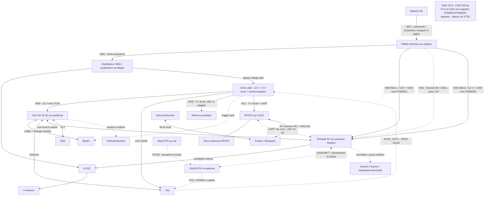

# Architecture électrique et réseaux

| Champ | Valeur |
|---|---|
| Référence | `DOC-ELEC` |
| Nature | document vivant |
| Dernière mise à jour | 24 septembre 2026 |
| Statut | architecture candidate ; schémas, faisceaux et qualifications **À valider** |

## 1. Objet

Ce document décrit l'énergie, l'électronique, les réseaux, les interfaces de
données et la synchronisation du système. Il porte la nomenclature électrique
et les essais d'interface. Les implantations sont décrites dans
[DOC-MEC](ARCHITECTURE_MECANIQUE.md), le logiciel dans
[DOC-SW](ARCHITECTURE_LOGICIELLE.md) et le fonctionnement global dans
[DOC-HLD](HLD.md).

## 2. Principes d'architecture

- PX4, ses capteurs de vol et ses failsafes restent indépendants du calculateur
  compagnon autant que possible.
- La charge utile possède un départ protégé distinct ; un défaut du Jetson ou
  d'un capteur ne doit pas faire chuter l'alimentation du contrôleur de vol.
- Les interfaces exposent tension, courant, puissance, débit, protocole,
  horloge, connecteur, blindage et comportement en défaut.
- Les masses électriques, protections et retours de courant sont conçus avec le
  faisceau, pas ajoutés après l'implantation mécanique.
- Les communications critiques ont une politique de perte explicite et testée.
- Une position RTK et une synchronisation temporelle sont deux fonctions
  distinctes.

## 3. Chaîne d'énergie candidate du cartographe

```text
Batterie 6S amovible → connexion/coupure/protection à définir → PM08-CAN
  ├─ OUT 6S → distribution → 4 ESC/moteurs
  │             └─ départ protégé → CA01 : 12 V calcul/LiDAR et 5 V auxiliaires/radio
  ├─ BEC1 5,3 V/3 A → POWER1 de la porteuse Pixhawk Jetson
  ├─ BEC2 5,3 V/3 A → POWER2 de la même porteuse
  └─ DroneCAN → CAN1 de la porteuse, sans injection de +5 V
Porteuse Holybro : Pixhawk 6X (FCU) + Jetson Orin NX 16 Go (compagnon).
Jetson alimenté séparément via XT30 depuis le 12 V calcul candidat.
```

Le PM08-CAN et la batterie restent des points communs : les deux entrées
POWER1/POWER2 protègent contre la perte d'un BEC ou d'une voie d'entrée
seulement après essais de bascule et d'absence de réalimentation. Les deux
BEC ne sont pas mis en parallèle. Le port CAN1 transporte les données batterie
séparément des entrées POWER ; ni le faisceau fourni ni son brochage ne sont
présumés compatibles sans contrôle contact par contact.

Cette chaîne est une architecture fonctionnelle **Planifiée**, pas un schéma
prêt à fabriquer. Calibres, fusibles, sections, connecteurs, références de
convertisseurs, masses et coupure restent **À valider**. Les 85 A sont une
réserve historique de dimensionnement issue d'un scénario plein régime,
pas un besoin continu démontré (§5.1). La cible de câblage V0.5 remplace V0.4 ;
le schéma interne CA01 V0.3 et la CAO ne sont pas migrés.

## 4. Domaines électriques

| Domaine | Source/convertisseur | Charges | Isolation et surveillance attendues |
|---|---|---|---|
| propulsion | batterie 6S et distribution | ESC/moteurs | courant fort, coupure, température et retour de courant |
| vol critique | deux BEC PM08-CAN vers POWER1/POWER2 séparés | Pixhawk et capteurs de vol | bascule sans reset, mesure batterie et absence de retour entre BEC |
| calcul | DC/DC 12 V candidat vers XT30 de la porteuse | Orin NX, SSD, ventilation et USB | fusible, transitoires, sous-tension, température et arrêt propre |
| perception | DC/DC ou rails qualifiés | Airy, Basler, synchronisation | bruit, courant de démarrage, masse et blindage |
| navigation/liaisons | rails qualifiés, dont 5 V local CA01 pour RP4TD | GNSS, récepteur RC, télémétrie | maintien du contrôle et comportement à la perte |
| station sol | alimentation indépendante | base RTK, radio, tablette/PC | autonomie, recharge et protection environnementale |

La batterie et le PM08-CAN en tête restent des éléments communs à toutes les
branches. La sélectivité des protections aval doit être démontrée par injection
de défauts ; aucune redondance de ces éléments communs n'est revendiquée.


### 4.1 Implantation avionique et interfaces à finaliser

La CAO du 16 septembre 2026 empile l'avionique sur les deux plateaux carbone
OEM. P06 porte les conversions et les modules auxiliaires ; P20 porte le
Pixhawk, avec cales, visserie et retenues. Les détails de fixation sont dans
DOC-MEC §4.4. Le modèle assure une implantation nominale et ne constitue pas
un faisceau prêt à câbler.

Le passage au-dessus du DC/DC est limité à 2,8 mm sous le plateau carbone,
2,2 mm sangle comprise. La définition des sorties latérales et des câbles est
donc un préalable au gel des références. Les cales et l'intercalaire ne suffisent
pas à démontrer l'isolation des vis traversantes ou des équipements vis-à-vis
du carbone conducteur.

| Interface | Action à réaliser | Condition de clôture |
|---|---|---|
| batterie → distribution | confirmer révision X650, pack, contacts et sections ; dimensionner protection et précharge sur profil de courant | schéma et bilan thermique revus, défauts et échauffement mesurés |
| PM08-CAN → porteuse Pixhawk Jetson | POWER1/POWER2 énergie séparée, CAN1 données batterie ; contrôler le faisceau réel | alimentation, bascule et mesure conformes sur banc, sans dépendance au Jetson |
| DC/DC → charge utile | sélectionner rails/références, connecteurs latéraux, protection et refroidissement | enveloppes fabricant substituées, marge électrique et thermique démontrée |
| Airy → Basler | confirmer niveaux, polarité, largeur et courant SYNC_OUT1/trigger avant adaptation | schéma validé et mesure temporelle ; aucun raccordement direct supposé |
| RC / télémétrie | choisir récepteur, radio, antennes et connecteurs ; vérifier accès et séparation des faisceaux | modèles réels intégrés, portée/CEM et comportements à la perte testés |
| GNSS / RTCM / PPS | choisir architecture A/B et allocation simultanée des ports | brochages et cheminements définis puis synchronisation testée |
| carbone / mécanique | définir rondelles, isolants, fixation des masses et prévention du frottement | continuité/isolement et inspection après vibration et traction |

### 4.2 Cahier des charges de la carte avionique commune CA01

Décision du 24 septembre 2026 : la cible V0.5 associe la
[Pixhawk Jetson Baseboard Holybro](https://holybro.com/products/pixhawk-jetson-baseboard?variant=44636223602877),
un [Pixhawk 6X module seul](https://holybro.com/products/pixhawk-6x?variant=44390763692221)
et un [Jetson Orin NX 16 Go](https://www.arrow.com/en/products/900-13767-0000-001/nvidia.html).
Le [PM08-CAN](https://holybro.com/products/dronecan-pm08-power-module-14s-200a?variant=44052276609213)
reste externe et fixé au châssis. BEC1 alimente POWER1 ; BEC2 alimente POWER2.
CA01 retrouve un convertisseur 5 V local protégé pour radio, auxiliaires et
synchronisation. Les convertisseurs 12 V et la régulation 3,3 V restent
**Planifiés**. Son schéma KiCad V0.3 est une ébauche historique non raccordable
à cette cible ; la CAO conserve l'ancienne implantation.

Le projet d'étude est
[CA01_Avionique.kicad_pro](../../hardware/electronique/cartographe/carte_avionique/CA01_Avionique.kicad_pro).
Le premier schéma n'est ni un dossier de fabrication ni une carte testée.
L'intégration mécanique de la porteuse et de CA01 reste **À valider** dans
DOC-MEC.

#### 4.2.1 Périmètre et frontières électriques

- La propulsion conserve sa distribution et son faisceau : aucun courant
  moteur ni chemin principal batterie ne traverse CA01.
- Le PM08-CAN est en série entre batterie et distribution. Ses BEC 5,3 V/3 A
  desservent exclusivement les deux entrées d'alimentation du Pixhawk sur la
  porteuse Holybro ; ils ne fournissent ni CA01 ni le Jetson.
- Un départ 6S protégé en aval du PM08-CAN fournit les conversions 12 V et
  le 5 V local CA01. Le RP4TD est alimenté depuis ce 5 V, avec protection
  et budget propres ; son UART rejoint directement le Pixhawk. Sa commande
  ne dépend ni du PC ni du Jetson. Une panne du 5 V CA01 peut néanmoins
  faire perdre la radio : le comportement PX4 correspondant est à tester.
- Ethernet Airy et USB3 Basler restent liés au Jetson ; l'interface de
  déclenchement Basler n'est pas une entrée d'alimentation de la caméra.

Les protections, retours de masse et risques de réalimentation par UART, USB,
CAN ou I²C doivent être contrôlés sur le faisceau et sur la porteuse. Les deux
BEC partagent batterie et PM08-CAN : aucune redondance de ces éléments communs
n'est revendiquée. PX4 garde seul l'autorité sur les moteurs.

#### 4.2.2 PM08-CAN, porteuse et affectation des faisceaux

Le PM08-CAN, fixé au châssis près de la distribution, remplace le PM02D dans
la cible. Le fabricant annonce 200 A continus, 400 A pendant 1 s à 25 °C
et deux BEC indépendants de 5,3 V/3 A chacun ; ces valeurs ne qualifient ni
connecteurs, ni faisceau, ni tenue thermique installée. Son enveloppe
45 × 41 × 26 mm hors câbles et sa masse de 185 g câbles inclus doivent
encore être répercutées dans la CAO et le bilan de masse.

| Voie fonctionnelle | Destination | Contrainte |
|---|---|---|
| BEC1 PM08-CAN, +5,3 V et GND | porteuse POWER1, contacts +5 V 1/2 et GND 5/6 | 3 A maximum annoncés ; contacts et orientation à contrôler |
| BEC2 PM08-CAN, +5,3 V et GND | porteuse POWER2, contacts +5 V 1/2 et GND 5/6 | voie distincte, sans pont avec POWER1 |
| CAN-H, CAN-L et GND PM08-CAN | porteuse CAN1, contacts 2, 3 et 4 | CAN1 contact 1 (+5 V OUT) non raccordé au PM |
| 6S protégé, hors BEC | CA01 ; 12 V calcul vers XT30 de la porteuse | polarité, courant, protection et connecteur à dimensionner |

Sur la porteuse, POWER1 et POWER2 sont des connecteurs à six contacts :
1/2 = +5 V, 3/4 = I²C SCL/SDA, 5/6 = GND. CAN1 est un connecteur distinct
à quatre contacts : 1 = +5 V OUT, 2 = CAN-H, 3 = CAN-L, 4 = GND.
**Ne jamais raccorder directement les six fils d'un port combiné PM08-CAN
à POWER1 ou POWER2 : CAN-H/L ne doivent pas atteindre SCL/SDA.**
Les numéros des contacts côté PM et le contenu du faisceau livré restent
**À valider** sur la révision reçue. Si le faisceau ne sépare pas énergie
et CAN avec ces correspondances, produire un adaptateur documenté,
détrompé et vérifié avant branchement. Les deux BEC ne sont jamais
mis en parallèle ; vérifier également l'absence de retour vers CAN1 +5 V.

CAN1 est réservé au PM08-CAN ; allocation GNSS et terminaisons du bus
restent à fermer. La paire CAN est torsadée ; les résistances de 120 Ω
doivent se trouver aux deux extrémités seulement, après contrôle de celles
présentes sur les modules. La mesure batterie vient de DroneCAN, pas
de POWER1/POWER2 I²C. Configuration PX4, étalonnage tension/courant et
comportement à la perte CAN sont **À valider**.

La Jetson Baseboard a une entrée d'alimentation XT30 distincte pour le
module Jetson. Le 12 V calcul est un candidat dans la plage annoncée
7–21 V du produit ; la révision exacte, les appels de courant, le SSD,
la caméra USB et le refroidissement doivent être mesurés avant gel.
Aucun des BEC 3 A du PM n'alimente cette entrée.

Sources : [fiche PM08-CAN](https://holybro.com/products/dronecan-pm08-power-module-14s-200a?variant=44052276609213),
[brochage Pixhawk Jetson Baseboard](https://docs.holybro.com/autopilot/pixhawk-baseboards/pixhawk-jetson-baseboard/ports-pinout),
[fiche de la porteuse](https://holybro.com/products/pixhawk-jetson-baseboard?variant=44636223602877),
[configuration DroneCAN/PX4](https://docs.holybro.com/power-module-and-pdb/power-module/dronecan-power-module-setup).

#### 4.2.3 Rails et conversion proposés

L'entrée est une LiPo 6S, 22,2 V nominal et 25,2 V pleine charge. Les 19,8 V
utilisés dans le bilan sont un point de calcul, pas un seuil de coupure fixé.
La plage minimale, les transitoires admissibles et la protection amont sont
**À valider** avant de choisir définitivement les composants. La tension maximale
d'une puce n'est pas la tenue de l'ensemble condensateurs, MOSFET et connecteurs.

| Rail candidat | Charge et capacité de travail | Définition V0 et réserves |
|---|---|---|
| `5V3_POWER1` / `5V3_POWER2` | deux BEC PM08-CAN indépendants, 3 A annoncés chacun, vers POWER1/POWER2 de la porteuse | aucun parallèle ; consommation Pixhawk et bascule à mesurer ; ancien label KiCad `5V2_FLIGHT` historique |
| `12V_COMPUTE` | convertisseur candidat 12 V/6 A vers XT30 porteuse Jetson ; Orin NX, SSD, ventilation et USB inclus | LM5146-Q1 représenté par bloc fonctionnel ; puissance réelle, protections et courant du connecteur à dimensionner |
| `12V_LIDAR` | 12 V avec capacité d'au moins 2 A pour Airy | LM76003 candidat ; schéma buck amorcé, passifs marqués `À_CALCULER` |
| `5V_AUX` cible | DC/DC 5 V local CA01 depuis 6S protégé ; RP4TD, auxiliaires et synchronisation | U301 du schéma V0.3 est une base historique à recalculer ; protection, budget et implantation à définir |
| `3V3_SYNC` / alimentation trigger | 5 V CA01 via protection et régulation locale | régulateur, adaptation trigger et absence de retour vers POWER1/POWER2 à valider |

La porteuse Holybro Pixhawk Jetson possède une entrée XT30 dédiée au Jetson.
La fiche produit annonce 7–21 V pour cette entrée ; la révision livrée et la
limite réelle du connecteur doivent être contrôlées. Le 12 V est un point de
conception candidat, sans validation du convertisseur 6 A ni de la consommation
Orin NX + USB Basler + SSD + refroidissement. Les limites de l'ancien kit
Orin Nano ne sont pas transférables à cette porteuse.
[Spécification Holybro](https://holybro.com/products/pixhawk-jetson-baseboard?variant=44636223602877).

L'Airy accepte 9–32 V, consomme 8 W typiques et son dépannage fabricant demande
une source capable d'au moins 2 A à 12 V : la puissance typique seule ne
suffit pas pour dimensionner le démarrage.
[Manuel RoboSense Airy, spécifications et dépannage](https://robosense-robotics.github.io/product-manual/en/Airy/).

Deux familles TI servent de bases de conception, sans qualification du circuit
CA01 :

- [LM5146-Q1](https://www.ti.com/product/LM5146-Q1), contrôleur buck avec
  MOSFET externes : l'[EVM 12 V/8 A](https://www.ti.com/tool/LM5146-Q1-EVM12V)
  documente une entrée 15–85 V et un fonctionnement 400 kHz, avec EN/UVLO,
  soft-start et PGOOD. Cette référence aide à établir le 12 V calcul ; la V0
  n'en reproduit pas encore l'étage de puissance, la compensation ou le routage.
- [LM76003](https://www.ti.com/product/LM76003), buck intégré 3,5–60 V/3,5 A,
  avec compensation interne : conservé comme candidat pour le rail Airy ; U301
  reste présent dans le schéma V0.3 comme base du 5 V CA01, à redimensionner
  et protéger pour la nouvelle cible V0.5.
  L'[EVM](https://www.ti.com/tool/LM76003EVM-500K) documente 3,3/5 V ; son
  passage à 12 V nécessite de recalculer inductance, capacités, feedback,
  courant limite et comportement thermique. Le symbole réel dans l'ébauche
  ne vaut pas circuit calculé ; toutes les valeurs `À_CALCULER` restent ouvertes.

Tolérances, ondulation, chute transitoire, ordre de démarrage, seuils UVLO,
protection inversion/surtension et limitation d'appel doivent être chiffrés
avant revue de fabrication. Prévoir EN/PGOOD et points de mesure accessibles
sans leur attribuer une action logicielle de vol non spécifiée.

#### 4.2.4 Radio et adaptation de synchronisation

Le RP4TD est alimenté par le 5 V local CA01, sa fiche annonçant 4,5–12 V.
Sa consommation et les niveaux électriques de TX/RX restent à confirmer.
L'ébauche représente les interfaces série candidates ; une éventuelle
adaptation de niveau, la protection ESD et la prévention des courants lorsque
l'un des équipements est hors tension restent à définir. Le connecteur et le
port Pixhawk retenus doivent préserver la liaison locale avec le Jetson.
Les résistances série R401/R402 sont DNP (non montées) par défaut ; les monter seulement après validation des niveaux et de la réalimentation hors tension. La fonction RF/MAVLink et ses limitations restent celles du §7.4.

Pour la Basler a2A4096-30ucBAS, la voie proposée utilise l'entrée optocouplée :
**broche 2, Line1**, alimentée par `5V_SYNC`, et **broche 3, Opto GND**, commutée
par le collecteur d'un **MMBT3904 candidat**. L'émetteur rejoint la masse locale
synchronisation ; une résistance de base 1 kΩ et un rappel base-émetteur 47 kΩ
sont des valeurs de départ **À valider**, non une interface déjà dimensionnée.
L'assertion logique et le front de déclenchement doivent être confirmés sur
oscilloscope et dans la configuration caméra. La cible est alimentée depuis le 5 V local CA01 : adaptation, courant et
protection à vérifier avant de figer le rail 5V_SYNC. Cette connexion n'alimente pas la caméra.

Le niveau, l'impédance, la polarité et la largeur de `SYNC_OUT1` Airy ne sont
pas démontrés par les éléments consultés. Son adaptation demeure un bloc non
défini et la liaison vers le driver Basler est **DNP / non montée** dans la V0.
Le cavalier JP501 est ouvert. U502 (SN74LVC1G17 candidat) reçoit un rappel R503 de 100 kΩ vers la masse et un découplage C501 de 100 nF, valeurs à valider après définition de U501 et U503. Aucun raccordement direct Airy → base du transistor n'est autorisé sur la seule
base de cette ébauche. Les caractéristiques de l'entrée PPS de l'Airy ne
permettent pas de déduire celles de sa sortie SYNC_OUT1. Le PPS/GPRMC GNSS,
les éventuels niveaux RS232 et l'allocation des ports restent à arrêter au §8.

Sources d'interface :
[Basler a2A4096-30ucBAS](https://docs.baslerweb.com/a2a4096-30ucbas),
[entrées optocouplées Basler](https://docs.baslerweb.com/a2a4096-30ucbas#opto-coupled-io-input-line),
[RP4TD](https://radiomasterrc.com/products/rp4td-expresslrs-2-4ghz-diversity-receiver).

#### 4.2.5 Exigences et recette

Les exigences suivantes portent les fonctions attendues. Leurs réalisations
sont **Planifiées** et leurs résultats **À valider** ; les seuils non définis
ci-dessous doivent être fermés avant l'essai, pas choisis après mesure.
Les protocoles et résultats sont centralisés dans
[DOC-VAL](../VALIDATION_QUALIFICATION.md), sous `T-CA01-01..12`.

| Exigence | Composant et critère d'acceptation | Test | Résultat |
|---|---|---|---|
| `CARTE-001` séparation de propulsion | connecteurs/nets CA01 : aucun chemin de courant moteur ; mesure globale PM08-CAN/DroneCAN hors CA01 explicitée | `T-CA01-01` revue schéma, netlist et faisceau | **À valider** |
| `CARTE-002` maintien du vol | défaut d'une branche charge utile isolé sans reset Pixhawk ; si le 5 V radio CA01 est perdu, détecter la perte RC et vérifier le repli PX4 ; sélectivité mesurée | `T-CA01-02` défauts et transitoires sur banc limité | **À valider** |
| `CARTE-003` entrée 6S protégée | inversion, surtension, appel capacitif et sous-tension : enveloppe et seuils chiffrés puis respectés | `T-CA01-03` rampe, démarrage et perturbations d'entrée | **À valider** |
| `CARTE-004` alimentation calcul | 12 V/6 A cible du buck, respect de la limite d'entrée porteuse, charge réelle stable et température admissible | `T-CA01-04` charge statique/dynamique, démarrage Jetson/USB/SSD | **À valider** |
| `CARTE-005` alimentation LiDAR | source 12 V capable d'au moins 2 A, démarrage sans boucle de reset et fonctionnement Airy stable | `T-CA01-05` démarrages et acquisition à chaud | **À valider** |
| `CARTE-006` rails auxiliaires | 5 V CA01 local protégé depuis 6S ; budgets 5 V/3,3 V fermés, plages des charges respectées, aucun retour vers POWER1/2 | `T-CA01-06` charges, défaut et séquences marche/arrêt | **À valider** |
| `CARTE-007` alimentation et mesure vol | PM08 externe, POWER1/POWER2 séparés, CAN1 distinct ; deux budgets 5,3 V ≤3 A, bascule sans reset, capteurs de vol essentiels surveillés, absence de retour et calibration vérifiés | `T-CA01-07` et `T-PM-V05-01/02/05/06`, DOC-VAL §12.7 | **À valider** |
| `CARTE-008` radio autonome du calcul | niveaux UART conformes, commande RC et QGC opérationnels avec Jetson arrêté ; alimentation radio stable | `T-CA01-08` interfaces et renvoi `T-RF-01..05` | **À valider** |
| `CARTE-009` trigger compatible | SYNC_OUT1 caractérisé avant montage ; courant optocoupleur, polarité, largeur et association image/impulsion validés | `T-CA01-09` oscilloscope et captures caméra | **À valider** |
| `CARTE-010` intégration mécanique | contour, hauteur, fixations, masse, isolation carbone et connecteurs accessibles validés dans SA03 réel | `T-CA01-10` CAO, montage et inspection | **À valider** |
| `CARTE-011` thermique et perturbations | composants sous limites avec marge définie ; GNSS/radio/capteurs sans perturbation invalidante, pertes et bruit mesurés | `T-CA01-11` charge simultanée, CEM et essais moteurs progressifs | **À valider** |
| `CARTE-012` dossier reproductible | schéma, BOM, empreintes et netlist cohérents, aucune valeur ouverte pour fabrication, ERC/DRC expliqués et revue indépendante | `T-CA01-12` contrôle des artefacts et revue | **À valider** |

La qualification doit suivre simulation/analyse, alimentation limitée, banc
sans hélices et progression DOC-VAL. Aucun essai de vol, carte assemblée ou
résultat thermique n'est revendiqué par l'existence du schéma.

#### 4.2.6 Outillage et limites du premier schéma

Le [pont KiCad](https://github.com/mixelpixx/KiCAD-MCP-Server) est installé
localement sous `.runtime/kicad-mcp`, sur le commit
`ac716d1a8bfad325b4aa93a398222645b3f78fd7`. Le test historique Windows amd64
avec KiCad 10.0.6 a vérifié l'inventaire de 233 outils, une création/relecture
de projet factice et l'export d'une netlist ; preuve :
`hardware/electronique/cartographe/verification/kicad_mcp_probe_20260915.json`.
Ce résultat concerne l'outillage et ne qualifie pas CA01.

L'ébauche interne V0.3 est **Implémentée** sous KiCad, mais ne représente pas
encore la cible V0.5 : remplacement PM02D, séparation POWER1/POWER2/CAN1,
source 5 V locale protégée et interfaces de la nouvelle porteuse restent à réaliser.
La preuve historique décrit KiCad
10.0.6 : une racine et cinq feuilles, 45 symboles et 44 nets.
Le transit PM/Pixhawk a été retiré via le pont MCP.
Les quatre blocs U101 (protection), U102 (buck calcul), U501 (adaptation Airy)
et U503 (3,3 V) sont fonctionnels, exclus de la BOM et du PCB. Les deux
LM76003 sont représentés avec leur brochage réel et leurs réseaux bootstrap,
VCC, feedback et puissance ; les valeurs `A_CALCULER` empêchent toute fabrication.
Le fichier PCB est uniquement le canevas vide créé avec le projet.

Contrôles : six fichiers schématiques relus par KiCad, 14 invariants de netlist
conformes et revue indépendante des interfaces vol/radio/synchronisation.
L'ERC demeure **non conforme : 3 erreurs, 0 avertissement**, sur les nets
`VIN_PAYLOAD_PROT`, `GND` et `3V3_SYNC` sans source de puissance déclarée.
Ces erreurs restent ouvertes ; aucun indicateur artificiel de puissance ne les
masque. Les blocs incomplets, les protections et les dimensions non définies
restent également bloquants même si un ERC venait à devenir vierge.
Preuves et périmètre : [DOC-VAL §12.5](../VALIDATION_QUALIFICATION.md#125-pm02d-en-tête-et-câblage-v03-22-septembre-2026),
[manifeste CA01](../../hardware/electronique/cartographe/carte_avionique/manifest.json).

Avant fabrication, fermer au minimum les protections amont/aval, tous les
passifs de conversion, le budget radio et GNSS, la mesure globale batterie,
les niveaux UART et SYNC_OUT1, les références/empreintes de connecteurs,
l'implantation mécanique, les bilans thermiques et la revue indépendante.
Le schéma V0 peut conserver des blocs fonctionnels et des valeurs ouvertes
pour poursuivre la conception ; ceux-ci doivent rester explicitement visibles.

#### 4.2.7 Critère de fin du schéma CA01

Un **schéma terminé pour passage au placement/routage** permet de réaliser le
PCB sans devoir encore inventer un circuit, une tension, un courant admissible
ou un brochage. Cette étape est distincte d'un PCB fabricable et d'une carte
qualifiée sur banc.

| Lot ouvert | Manque actuel | Condition pour clore le schéma |
|---|---|---|
| Enveloppes et budgets | VIN minimal/transitoires, appels de courant, budget 5V/3V3/vol et charges exactes non fermés | plages d'entrée/sortie, tolérances, ondulation, charge permanente/pointe, température et marges documentées pour chaque rail |
| U102, calcul 12V | LM5146-Q1 seulement représenté par un bloc | contrôleur, MOSFET, inductance, condensateurs, bootstrap, feedback/compensation, fréquence, EN/UVLO et protections calculés ; références choisies et raccordées |
| U201/U301, LiDAR et 5V | LM76003 réels mais passifs `A_CALCULER` | L/C/R et fréquence définis, saturation/ripple/stabilité et pertes vérifiés, tension/courant/puissance des composants justifiés |
| U101 et protections | protection d'entrée non conçue ; F101/F102/F501 sans calibre | inversion, surtension/transitoires, appel/UVLO, courts-circuits, sélectivité et protection des câbles définis ; 5 V local et radio protégés sur CA01 |
| U503 et rails synchronisation | régulation 3V3 fonctionnelle seulement | régulateur et découplages sélectionnés ; budget, séquencement et alimentation 5V du trigger définis |
| U501 et driver caméra | caractéristiques SYNC_OUT1 inconnues ; JP501 ouvert | niveaux, courant, polarité, fréquence/largeur connus par garantie fabricant ou caractérisation ; adaptation/protections et driver dimensionnés, état au repos déterminé |
| Radio | UART non confirmé ; R401/R402 DNP | niveaux logiques, TX/RX, comportement hors tension, protections et budget radio établis ; montage ou DNP de chaque option justifié |
| Interfaces physiques | connecteurs CA01 génériques et plusieurs ports OEM ouverts | références, détrompage, orientation, numéros de broches, retours, masses/blindages, calibres et empreintes cohérents avec le câblage global |
| Revue et livrables | trois erreurs ERC, blocs incomplets et BOM non commandable | aucun bloc de circuit non défini, aucune valeur à calculer, BOM/empreintes/datasheets cohérentes ; ERC sans erreur et sans avertissement inexpliqué ; revue indépendante des calculs et du schéma |

Les trois erreurs ERC actuelles sont un symptôme partiel de l'incomplétude.
Après définition des sources réelles et de leurs retours, leurs types
électriques et éventuels indicateurs de puissance pourront être renseignés
avec justification ; obtenir un ERC vierge seul ne clôt pas le schéma.

Le contour, les fixations, le placement, les boucles de commutation, les
sections de cuivre, la dissipation, le dégagement RF et le DRC relèvent ensuite
du **PCB**. Les mesures de charge, défauts, thermique, CEM, synchronisation
et RF relèvent de la **qualification**. Les contraintes de routage et
l'enveloppe mécanique nécessaires doivent toutefois être connues avant de
déclarer le schéma prêt à router.

Les fonctions entièrement externes (mesure globale, choix du GNSS) n'imposent
pas nécessairement d'attendre pour fermer un circuit CA01 indépendant ; elles
deviennent bloquantes si elles changent ses rails, ses connecteurs, ses ports
ou ses budgets. Elles restent obligatoires pour clore le câblage du drone.

### 4.3 Câblage global du cartographe

Exigence `CAB-CARTO-001` : tenir les E/S et les liaisons Wxx cohérentes avec le schéma, puis contrôler chaque faisceau point à point avant branchement.

Première définition du 21 septembre 2026 : schéma d'interconnexion et registre
des entrées/sorties, **Planifié / À valider**, pas un faisceau prêt à fabriquer.
Révision cible V0.5 du 24 septembre : PM08-CAN sur châssis, BEC1 vers POWER1,
BEC2 vers POWER2 et DroneCAN distinct sur CAN1 ; CA01 retrouve son 5 V local.
Budgets, bascule, compatibilité et thermique **À valider** ; CA01 interne V0.3
et la CAO ne sont pas migrées.
Le périmètre couvre le cartographe et ses liens au sol ; la pompe, les vannes
et les actionneurs du drone de traitement feront l'objet de leur propre variante.

Sources techniques éditables : [schéma global Mermaid](../../hardware/electronique/cartographe/cablage_global.mmd)
et [registre modules/liaisons](../../hardware/electronique/cartographe/cablage_global.json).
Les 30 liaisons actives sont `W01..W06`, `W08..W29`, `W31`
(DroneCAN) et `W32` (BEC2). W07, ancienne dérivation du BEC1 vers la
radio, est retirée ; W08 alimente CA01 et W11 relie sa radio. W30 reste retiré
et sa fonction de mesure est portée par W31.
W06 ne transporte que l'énergie. Les identifiants retirés ne sont pas réutilisés.
W32 correspond désormais au second départ FCU. W11, W18 et W26 dépendent
de la migration du 5 V local CA01. Les broches conservées et interfaces à
migrer sont distinguées dans le registre ; aucune preuve V0.4 ne qualifie V0.5.
Les flèches d'énergie représentent alimentation **et retour** ; la masse est
commune, les blindages et l'isolation du carbone restent à concevoir.
Les traits pointillés désignent des interfaces ouvertes ou non raccordées.
La porteuse regroupe physiquement le FCU et le Jetson, mais conserve leurs
entrées électriques séparées. CA01 ne reçoit aucun BEC du PM.



#### 4.3.1 Entrées et sorties des modules

Les ports internes SSD/refroidissement ne sont pas des sorties CA01 supplémentaires.
Les antennes RF/GNSS, les équipements au sol et les accessoires de sécurité
sont recensés pour éviter les omissions de faisceau ou d'alimentation.
Aucun accessoire optionnel non identifié n'est considéré comme déjà installé.

| Module | Entrées | Sorties / interfaces | À figer |
|---|---|---|---|
| `BAT` Batterie 6S candidate | charge externe hors vol | puissance batterie | pack/révision, décharge et connecteur définitifs |
| `DIST` Distribution X650 et protections de départ | PM08-CAN OUT +/− | départs ESC et CA01 | distribution, fusibles, sections ; connexion/coupure batterie en amont du PM fixé au châssis |
| `ESC1..4` Quatre ESC | 6S ; consigne Pixhawk | trois phases vers chaque moteur | références, protocole et brochages |
| `M1..4` Quatre moteurs | trois phases ESC | couple mécanique | références, ordre et sens |
| `PM` Holybro PM08-CAN sur châssis | batterie 6S via IN | OUT vers distribution ; BEC1 et BEC2 5,3 V/3 A vers FCU ; DroneCAN | variante, brochage, câbles et terminaisons ; tenue thermique et mesure à vérifier |
| `FCU` Pixhawk 6X sur porteuse Holybro | POWER1 BEC1 ; POWER2 BEC2 ; CAN1 mesures PM ; RC/navigation/compagnon | ESC ; états ; télémétrie | bascule, connecteurs, CAN1 et bus GNSS à finaliser |
| `CA01` Carte alimentation/radio/synchronisation | 6S charge utile protégé ; SYNC Airy | 12 V calcul/LiDAR ; 5 V local radio/aux ; 3,3 V sync ; trigger ; UART | convertisseur 5 V et protections à migrer ; schéma interne V0.3 non raccordable |
| `RF` RP4TD rapporté sur CA01 | 5 V local CA01 ; UART ; RF | UART ; RF | défaut 5 V local, UART, consommation et antennes à tester |
| `RFANT1..2` Deux antennes RP4TD | coaxiaux RF | liaison radio | références, emplacement et dégagement carbone |
| `CPU` Orin NX 16 Go et porteuse Holybro | 12 V candidat via XT30 ; données capteurs/Pixhawk | USB caméra ; Ethernet ; consignes haut niveau | révision porteuse, polarité XT30 et budget USB/SSD/refroidissement |
| `SSD` SSD NVMe | alimentation et PCIe porteuse | données stockées | modèle, endurance et courant |
| `FAN` Refroidissement Jetson | alimentation et éventuelle commande | retour vitesse éventuel | solution/refroidissement, connecteur et budget |
| `LID` RoboSense Airy | 12V ; Ethernet ; temps GNSS candidat | Ethernet ; SYNC_OUT1 | variante/faisceau et niveaux de synchronisation |
| `CAM` Basler a2A4096-30ucBAS | USB3 alimenté ; trigger optocouplé | images USB3 | câble USB/M8 et configuration trigger |
| `GNSS` GNSS RTK embarqué à choisir | alimentation ; antenne ; RTCM | navigation PX4 ; temps/données candidat | Holybro DroneCAN ou ArduSimple : un seul choix à figer |
| `GNSSANT` Antenne GNSS | interface RF du rover | signaux GNSS | référence, câble et alimentation antenne éventuelle |
| `SAFE` Accessoires Pixhawk à identifier | alimentation/commande FCU | bouton sécurité / buzzer / signalisation éventuels | inventaire livré et références ; aucune fonction supposée présente |
| `POCKET` Pocket ELRS / Backpack au sol | manches ; supervision QGC ; énergie propre | liaison RF commune | configuration et batteries |
| `GCS` Station QGroundControl | supervision RF ; RTCM éventuel | missions et commandes autorisées | poste/réseau et acheminement RTCM |
| `BASE` Base RTK et antenne au sol | GNSS ; énergie propre | RTCM | référence, alimentation et transport jusqu’au rover |
| `AUX_RESERVE` Réserve auxiliaire sans charge affectée | 5 V local CA01, sortie J301 à adapter | aucune fonction affectée | charge, protection et budget avant usage ; schéma V0.3 non validé |

#### 4.3.2 Registre des liaisons

Les numéros `Jxxx` sont ceux du schéma CA01 ; ils ne fixent ni l'empreinte,
ni l'ordre visuel d'un connecteur constructeur vu côté accouplement.
Chaque liaison reste **Planifiée / À valider**. Les deux sens des liaisons
de données sont décrits dans leur fonction même si la colonne source/cible
n'indique qu'un sens de lecture.

| Liaison | Modules | Fonction | Signaux / contacts connus | Réserve avant câblage |
|---|---|---|---|---|
| `W01` | `BAT` → `PM` | Batterie amovible → connexion/coupure/protection → PM08-CAN IN fixe | +/− ; 6S ; 25,2 V pleine charge candidate | variante et faisceau à dimensionner ; aucun départ contournant PM ; déconnexion batterie coupe aussi PM |
| `W02` | `DIST` → `ESC1..4` | Quatre départs propulsion | +/− vers chaque ESC | courant moteur via PM08-CAN IN/OUT, jamais via CA01 ; sections et protections à dimensionner |
| `W03` | `ESC1..4` → `M1..4` | Trois phases par moteur | U/V/W logiques, ordre à vérifier | référence ESC/moteur et sens à figer |
| `W04` | `FCU` → `ESC1..4` | Sorties moteur PX4 exclusivement | signal/retour ; PWM/DShot/autre à choisir | numéro sortie, ordre moteur et télémétrie ESC non figés |
| `W05` | `PM` → `DIST` | PM08-CAN OUT → distribution de toutes les charges aval | 6S +/− ; sortie puissance PM, variante de terminaisons à choisir | courant total, pointes/durée, température et terminaisons à qualifier |
| `W06` | `PM` → `FCU` | BEC1 → POWER1 de la porteuse | côté porteuse : +5 V contacts 1/2, GND 5/6 ; 3/4 SCL/SDA non raccordés au PM | contacts côté PM, orientation et faisceau à contrôler ; 3 A annoncés |
| `W08` | `DIST` → `CA01` | Départ charge utile → J103 | CA01 J103:1 = VBAT_PAYLOAD ; :2 = GND | calibre, connecteur et protection amont à figer |
| `W09` | `CA01` → `CPU` | 12 V calcul candidat → XT30 Jetson de la porteuse | J104:1 = 12V_COMPUTE ; :2 = GND, correspondance XT30 à documenter | polarité, protection, tension et appels Orin NX/USB/SSD à mesurer |
| `W10` | `CA01` → `LID` | J201 → alimentation Airy | J201:1 = 12V_LIDAR ; :2 = GND | connecteur réel Airy et faisceau à confirmer |
| `W11` | `CA01` → `RF` | J401 → pads RP4TD | J401:1 = 5V_RADIO ; :2 = GND ; :3 = RP_TX ; :4 = RP_RX | numérotation logique CA01, pas numéros OEM ; R401/R402 DNP |
| `W12` | `CA01` → `FCU` | J402 → UART Pixhawk réservé RF | J402:1 = GND ; :2 = FC_RX_RF ; :3 = FC_TX_RF | choisir port ; TX/RX croisés ; pas injection 5 V TELEM supposée |
| `W13` | `RF` → `RFANT1..2` | Deux liaisons coaxiales | ports antenne du module, deux antennes | références et cheminements ; pas deux systèmes radio indépendants |
| `W14` | `FCU` → `CPU` | Liaison compagnon locale | UART ou Ethernet ; uXRCE-DDS/MAVLink selon choix | réserver port distinct RF ; retour/masse/niveaux et ports exacts à arrêter |
| `W15` | `LID` → `CPU` | Ethernet direct Airy ↔ Jetson | interface/câble Ethernet du faisceau Airy | port Jetson, IP, blindage ; partage Ethernet FCU éventuel à résoudre |
| `W16` | `CPU` → `CAM` | USB3 direct Jetson ↔ caméra | alimentation par USB et USB3 Vision | câble verrouillable, budget port et débits ; pas alimentation via M8 |
| `W17` | `LID` → `CA01` | SYNC_OUT1 → J501 | Airy pin10 / D2 candidat → J501:1 ; retour D4 → :2 | faisceau/version à confirmer ; niveaux inconnus ; JP501 ouvert |
| `W18` | `CA01` → `CAM` | J502 → E/S Basler M8 six contacts | 1 NC ; 2 Line1 / 5V_SYNC ; 3 retour opto commuté ; 4/5/6 NC en V0 | broche 3 non reliée directement à GND ; trigger issu du 5 V local CA01 à qualifier |
| `W19` | `CPU` → `SSD` | Port M.2 NVMe de la porteuse | PCIe / alimentation interne porteuse | référence SSD et courant ; pas de rail externe ajouté par supposition |
| `W20` | `CPU` → `FAN` | Commande/alimentation refroidissement candidat | connecteur porteuse ou autre solution à définir | aucune tension ou numérotation de ventilateur présumée |
| `W21` | `FCU` → `GNSS` | GNSS vol : interface à choisir | CAN/UART selon candidat ; alimentation du domaine vol à définir | CAN1 réservé PM ; CAN2 candidat GNSS ou partage conçu ; alimentation GNSS et défaut de chaque BEC à étudier |
| `W22` | `GNSS` → `GNSSANT` | Rover ↔ antenne GNSS | connecteur, coaxial et alimentation active éventuelle | référence et implantation à choisir |
| `W23` | `GNSS` → `LID` | PPS + GPRMC vers Airy, si retenu | pins exactes et adaptation PPS/série à confirmer | non raccordé en V0 ; ne pas déduire niveaux de SYNC_OUT1 |
| `W24` | `GNSS` → `CPU` | Navigation/temps vers compagnon | routage via FCU ou autre interface à choisir | pas de Y passif UART ; allocation simultanée des ports obligatoire |
| `W25` | `FCU` → `SAFE` | Accessoires de vol à inventorier | bouton/buzzer/LED : ports et niveaux inconnus | réalisation après identification du matériel livré |
| `W26` | `CA01` → `AUX_RESERVE` | Distribution du 5 V local → réserve J301 à adapter | cible J301:1 = 5V_AUX ; :2 = GND, nets à confirmer après migration | budget/protection à fermer ; ne pas déduire le schéma V0.3 qualifié |
| `W27` | `POCKET` → `RF` | ELRS commun commande + MAVLink | liaison sans fil ; Pocket alimentée séparément | profil/firmware/débit/portée à qualifier |
| `W28` | `GCS` → `POCKET` | Wi-Fi local QGC ↔ Backpack | MAVLink/UDP candidat | radio manuelle fonctionne sans PC ; versions à figer |
| `W29` | `BASE` → `GNSS` | Chemin sol → rover à sélectionner | radio dédiée ou via QGC/RF commun sous budget | trait représenté fonctionnellement, aucun câble/transport retenu |
| `W31` | `PM` → `FCU` | PM08-CAN → CAN1 de la porteuse, séparé de POWER1/POWER2 | côté porteuse : CAN1 2 H, 3 L, 4 GND ; contact 1 +5 V OUT non raccordé au PM | contacts PM et faisceau à vérifier ; torsade, terminaisons, configuration PX4 |
| `W32` | `PM` → `FCU` | BEC2 → POWER2 de la porteuse | côté porteuse : +5 V contacts 1/2, GND 5/6 ; 3/4 SCL/SDA non raccordés au PM | contacts côté PM, orientation et faisceau à contrôler ; 3 A annoncés ; aucun pont vers POWER1 |

Pour transformer ce registre en dossier de faisceau : renseigner pour chaque
Wxx les références des deux connecteurs et contacts, vues de brochage, nombre
de conducteurs, section, longueur, blindage, couleur/repérage, sertissage,
détrompage, protection, fixation et test de continuité/isolement.
Le choix PWM/DShot, les ports Pixhawk/Jetson et le chemin RTCM sont des
décisions ouvertes ; aucun Y passif UART ni partage implicite de port n'est autorisé.
Les sorties BEC éventuelles des ESC ne doivent pas être mises en parallèle
avec les BEC du PM08-CAN sans architecture explicitement conçue.

Le courant propulsion et charge utile traverse le chemin IN→OUT du PM08-CAN.
BEC1 et BEC2 desservent uniquement les deux entrées du FCU. Le 5 V local CA01
alimente la radio et les auxiliaires depuis le départ 6S protégé. Le défaut de
ce rail radio doit être traité comme perte RC, même si le FCU reste alimenté.


## 5. Budget électrique préliminaire

Le tableau ci-dessous conserve les repères historiques de consommation. Les
capacités candidates des rails CA01 du §4.2 sont des objectifs de dimensionnement,
pas leur consommation simultanée mesurée ; le bilan de puissance et les
protections doivent être recalculés après fermeture des budgets de chaque rail.

| Charge | Repère de travail | Réserve |
|---|---:|---|
| RoboSense Airy | environ 8 W typiques | variante, pointes et température **À valider** |
| Basler a2A4096-30ucBAS | environ 3,2 W typiques | mode, USB et déclenchement **À valider** |
| module Jetson | mode 25 W comme repère | porteuse, SSD et refroidissement non inclus |
| sous-total illustratif | 36,2 W | ne dimensionne pas le convertisseur |

Une batterie 6S 10 Ah représente 222 Wh nominaux. Énergie utilisable, réserve de
retour, pertes et autonomie ne sont pas qualifiées. Le bilan complet doit ajouter
propulsion, avionique, radios, GNSS, convertisseurs, câbles et pointes de
démarrage, puis être mesuré à chaud en mission représentative.

### 5.1 Enveloppe de présélection du faisceau

Le calcul historique plus conservateur retient 75 W utiles pour Jetson,
porteuse/SSD/ventilateur, Basler, Airy, Pixhawk, GNSS, RC/télémétrie et
synchronisation. Avec un rendement global d'étude de 80 %, cela représente
93,75 W côté batterie, soit 3,72 A à 25,2 V, 4,22 A à 22,2 V et 4,73 A à
19,8 V. Les 19,8 V ne constituent pas un seuil PX4 validé.

La courbe fabricant disponible pour MN4014 KV330 à 22,2 V et hélice T-Motor
15×5 indique 3,6/5,9/7,8/10,1/11,9 A par moteur pour 50/65/75/85/100 % de
commande. Le kit candidat utilise des Gemfan 1555 : ces données sont une base
de présélection, pas une courbe qualifiée du drone.

**Audit du 22 septembre 2026 : l'arithmétique est correcte, mais présenter
« 85 A continus » comme besoin du drone était prématuré.** Cette valeur reste
une réserve historique de présélection, **À valider**, et ne constitue ni une
mesure ni une prévision de consommation continue en mission.

| Étape historique | Hypothèse / formule | Résultat |
|---|---|---:|
| Propulsion plein régime, 22,2 V | 4 × 11,9 A, hélice de référence | 47,60 A |
| Avionique côté batterie | 75 W / 0,80 | 93,75 W, soit 4,22 A à 22,2 V |
| Total au point de référence | 47,6 + 93,75 / 22,2 | 51,82 A |
| Batterie basse, puissance constante | (1 056,72 + 93,75) / 19,8 | 58,10 A |
| Batterie pleine, propulsion extrapolée | 47,6 × (25,2 / 22,2)² + 93,75 / 25,2 | 65,05 A |
| Marge puis arrondi | 65,05435 × 1,25 = 81,31794 | 85 A historiques |

Ces deux scénarios de tension emploient des hypothèses différentes : puissance
constante à basse tension, plein régime et courant proportionnel au carré de
la tension à batterie pleine. La seconde loi est une approximation, pas une
borne. Ni l'hélice réelle, ni le profil de commande, ni la durée au plein
régime ne sont qualifiés. Les 25 % sont une marge d'étude sans justification
thermique expérimentale. Les appels de courant et transitoires ne sont pas bornés.

Les 75 W couvrent toute l'avionique, y compris des équipements déjà présents
dans le kit ; ce n'est pas le seul surcroît ajouté au kit. Leur effet direct
est d'environ 3,72–4,73 A aux points de calcul. L'effet indirect de la masse
ajoutée sur la propulsion n'est pas calculé ici. Actualiser le bilan de masse
DOC-MEC §6.1 puis établir poussée et courant avec les Gemfan 1555. Aucun
pourcentage de commande n'est assimilé au stationnaire ; les calibres des
ESC ne représentent pas la consommation des moteurs.

Le [kit X650 complet](https://holybro.com/products/x650-development-kit)
comprend un PM02D avec le Pixhawk 6X ; la variante Pixhawk 6C utilise un PM02 V3.
Il comporte quatre MN4014 KV330, quatre ESC Tekko32 F4 45 A et des Gemfan 1555.
Sa fourniture avec un PM02D ne qualifie pas notre configuration chargée.
[Tableau moteur Holybro](https://docs.holybro.com/drone-development-kit/x650-development-kit/motor-specifications).

La sélection courante est le **PM08-CAN sur châssis** (§4.2.2), remplaçant la
décision antérieure PM02D/faisceau adapté. L'audit des 85 A reste historique :
ni cette réserve ni les 200 A annoncés pour le PM08 ne qualifient le besoin
réel, les connecteurs ou le faisceau. Actualiser masse et consommation, puis
vérifier courant, durée des pointes, budgets des deux BEC et échauffement.
CA01 reste hors chemin moteur.

La CAO fournit masses, inerties et implantation. Gazebo/PX4 peut ensuite
estimer les sollicitations en mission si propulsion, charge électrique et
batterie sont modélisées et confrontées aux mesures. Une décharge paramétrée
ne valide pas le courant réel : le [modèle batterie Gazebo](https://gazebosim.org/api/sim/8/battery.html)
reçoit une puissance consommée configurée ou calculée par les systèmes.
Ni ce modèle ni un vol simulé ne qualifient shunt, cuivre, soudures, câbles,
connecteurs, appels capacitifs ou thermique du module de puissance. Le banc reste requis
avant les vols progressifs ; voir DOC-VAL §12.6.

[Preuve de recalcul](../../hardware/electronique/cartographe/verification/audit_courant_20260922.json).
Le bilan historique est conservé ; son champ `design_continuous_a` décrit
l'hypothèse ancienne et ne fige pas une exigence.

### 5.2 Limites de la chaîne actuelle

- Le PM08-CAN est annoncé à 200 A continus ; ces capacités ne valent pas
  qualification des terminaisons, du faisceau ni de la distribution X650.
- Le pack candidat est livré avec EC5 et AWG10 ; ajouter une prise AWG4 ne
  qualifie pas le câble existant.
- Le maximum de mesure du capteur de courant n'est pas sa capacité de transport.
- Une limitation d'appel capacitif ou précharge adaptée aux ESC/DC-DC est à
  définir ; aucun échange sous charge n'est prévu.
- Vérifier au banc le monitoring PM08 avec OUT, BEC1 et BEC2 séparément,
  puis simultanément ; tester perte CAN et absence de réalimentation entre rails.

## 6. Nomenclature électrique candidate

| ID | Équipement | Quantité | Fonction | État |
|---|---|---:|---|---|
| `ELEC-BAT-01` | LiPo 6S 10 Ah Tattu candidate | 1 en vol + 1 identique en stock | source d'énergie | candidate de dimensionnement **À valider** |
| `ELEC-CON-01` | Anderson SBS X-75A, fiche et réceptacle | 1 paire | échange batterie | présélection d'étude |
| `ELEC-CAB-01` | contacts 1339G4 et câble AWG4 | selon faisceau | courant batterie | terminaison et longueur **À valider** |
| `ELEC-PWR-01` | distribution X650 | 1 | propulsion et dérivations | révision exacte **À valider** |
| `ELEC-PWR-02` | Holybro PM08-CAN 14S 200A | 1 par drone, fixe au châssis | mesure DroneCAN ; BEC1→POWER1, BEC2→POWER2 | support/faisceau **Planifiés**, courants/thermique **À valider** |
| `ELEC-PWR-03` | conversions CA01 12 V calcul/LiDAR et 5 V auxiliaires | selon rails §4.2 | Jetson XT30, Airy, radio et synchronisation | références/protections à calculer ; KiCad V0.3 non migré |
| `ELEC-CA01` | carte avionique commune CA01 | 1 | porteuse radio, conversion et synchronisation ; PM externe | **Planifié** ; schéma V0, implantation CAO non réalisée |
| `ELEC-FCU-01` | Holybro Pixhawk 6X module seul | 1 | contrôle de vol PX4 sur porteuse | sélection cible **Planifiée** ; matériel **À valider** |
| `ELEC-CMP-01` | NVIDIA Jetson Orin NX 16 Go 900-13767-0000-001 | 1 | compagnon ROS 2 | sélection cible **Planifiée** ; thermique/performance **À valider** |
| `ELEC-BRD-01` | Holybro Pixhawk Jetson Baseboard | 1 | porteuse commune FCU/compagnon | révision, connecteurs, fixation et alimentation **À valider** |
| `ELEC-STO-01` | SSD NVMe 1 To candidat | 1 | acquisition locale | endurance/thermique **À valider** |
| `ELEC-LID-01` | RoboSense Airy | 1 | LiDAR et source de synchronisation candidate | maintenu pour première itération |
| `ELEC-CAM-01` | Basler a2A4096-30ucBAS USB | 1 | image RGB | présélection confirmée ; optique **À valider** |
| `ELEC-SYN-01` | adaptation SYNC_OUT1/trigger sur CA01 | 1 | datation exposition caméra | driver candidat ; adaptation Airy non définie et liaison DNP |
| `ELEC-GNS-01` | GNSS RTK embarqué | 1 | position, temps et corrections | architecture A/B **À valider** |
| `ELEC-CTL-01` | RadioMaster RP4TD candidat, partagé avec ELEC-TLM-01 | 1 par drone équipé | commande manuelle + MAVLink sur RF commun | présélection §7.4 ; **À valider** |
| `ELEC-TLM-01` | Pocket ELRS EU-LBT au sol + même RP4TD embarqué | 1 ensemble par drone utilisé, sans double comptage du RX | QGC/MAVLink + commande manuelle | présélection §7.4 ; débit, portée et conformité **À valider** |
| `ELEC-RTK-01` | base RTK locale, antenne et radio/USB | 1 jeu | corrections RTCM sans abonnement | candidate **À valider** |
| `ELEC-CHG-01` | chargeur LiPo et accessoires sûrs | 1 jeu | recharge et stockage | référence/procédure **À valider** |

Les quantités de rechange et de banc ne sont pas figées. Les équipements
mécaniques associés sont listés dans `DOC-MEC`.

L'Orin NX 16 Go est la cible d'intégration sur la porteuse Holybro. Le budget
CPU/GPU, la mémoire, la température et la puissance restent à confirmer sur
le matériel réel ; l'ancien Orin Nano reste une référence historique de CAO. Le
GNSS embarqué reste à choisir entre une solution Holybro H-RTK DroneCAN et une
solution ArduSimple adaptée. La cible du 16 septembre est une liaison RF
commune RC + MAVLink, remplaçant la présélection de deux radios distinctes.
La commande manuelle demeure indépendante du PC et du Jetson, mais n'est pas
indépendante de la liaison RF de supervision. L'allocation RTCM reste séparée
dans l'étude : son ajout au RF commun exige un bilan de débit et de défaillance.
Les choix matériels restent **À valider** ; voir §7.4 et DOC-HLD §4.6–4.7.

Pour un drone et deux cassettes, la présélection SBS prévoit deux fiches mobiles
`SBSX75A-PLUG-KIT-BLK`, un réceptacle panneau `SBSX75A-PMREC-KIT-BLK`, six
contacts `1339G4`, les joints adaptés au diamètre réel des câbles et des
capuchons pour toutes les interfaces débranchées. Le constructeur annonce
90 A CSA ou 145 A UL pour la combinaison panneau/câble AWG4 à 25 °C ; ces
valeurs reposent sur des critères thermiques différents et ne qualifient pas
notre faisceau. Effort d'accouplement, chute de tension, température, étanchéité
et cycles restent **À valider**.

## 7. Architecture réseau et données

```text
 Station Qt / QGroundControl
    +-- réseau local / service HTTP de banc --> Docker, télémétrie et PX4 SITL
    +-- Wi-Fi local vers Pocket/Backpack ---> RF commun RC + MAVLink ---> Pixhawk
    +-- corrections RTCM --------------------> GNSS rover via voie qualifiée
    +-- transfert de paquets ----------------> compagnon Jetson (**À valider**)

 Radiocommande Pocket ----------------------> même RF (commande sans PC)

 Jetson / ROS 2
    +-- uXRCE-DDS ou MAVLink ----------------> Pixhawk
    +-- Ethernet ----------------------------> Airy
    +-- USB3 --------------------------------> Basler
    +-- CAN/UART/USB ------------------------> GNSS selon candidat
    +-- NVMe --------------------------------> stockage local
```

### 7.1 Matrice d'interfaces

La porteuse Holybro offre des chemins locaux entre Pixhawk et Jetson ; le
port, la liaison physique et le protocole effectivement utilisés restent à
choisir avec la réservation du port RF. CAN1 est affecté au PM08-CAN.

| Producteur | Consommateur | Physique/protocole candidat | Donnée | Point ouvert |
|---|---|---|---|---|
| Pixhawk 6X | Orin NX sur même porteuse | UART ou Ethernet interne, uXRCE-DDS/MAVLink candidat | état PX4 et consignes ROS 2 | port, débit, QoS et comportement au redémarrage **À valider** |
| Airy | Jetson | Ethernet | points LiDAR, temps et diagnostics | configuration IP, débit et pertes **À valider** |
| Basler | Jetson | USB3 Vision | images et métadonnées | câble, débit soutenu et reset **À valider** |
| Airy | adaptation trigger | SYNC_OUT1 électrique | impulsion de synchronisation | niveau, largeur et isolement **À valider** |
| adaptation trigger | Basler/Jetson | entrée trigger + timestamp | exposition associée à l'impulsion | latence et correspondance image **À valider** |
| GNSS rover | Pixhawk/Jetson/Airy | CAN, UART, PPS et GPRMC selon choix | position, corrections et temps | allocation simultanée des ports **À valider** |
| base RTK | rover | RTCM via télémétrie, radio locale ou QGC | corrections | disponibilité sans réseau et portée **À valider** |
| RP4TD RC + télémétrie | Pixhawk | UART MAVLink candidat, §7.4 | voies opérateur et télémétrie bidirectionnelle | coexistence, sélection d'autorité et pertes **À valider** |
| station | Jetson | Ethernet/Wi-Fi/support amovible | acquisitions, cartes et missions | protocole, signature et reprise **À valider** |

### 7.2 Réseaux logiciels

Sur le poste de développement, les services de banc exposent uniquement les
interfaces nécessaires. Le pont de télémétrie LIO utilise actuellement
`127.0.0.1:8092` et le service PX4 SITL `127.0.0.1:8091`. Ces ports sont des
interfaces locales de développement, pas l'architecture radio du drone.

Les domaines ROS 2 Humble, ROS 2 Jazzy et PX4/Gazebo restent isolés dans des
conteneurs adaptés. Les liaisons DDS finales, découverte, sécurité, QoS et
topologie embarquée sont **À valider**.

### 7.3 Caméra et optique du cartographe

La Basler ace 2 R `a2A4096-30ucBAS` est la candidate confirmée pour le premier
banc : IMX545 4096 × 3000, obturateur global, USB 3, monture C, trigger
matériel, environ 85 g hors objectif et 3,2 W typiques annoncés. Le SDK pylon
existe pour Linux `x86_64` et `arm64`, sans démontrer encore la compatibilité de
notre combinaison JetPack, Docker et matériel.

Alternatives conservées seulement comme voies de repli : Basler
`a2A4096-9gcPRO` GigE/PTP, e-con `e-CAM56_CUONX` MIPI plus sobre, et Teledyne
FLIR `BFS-U3-123S6C-C` USB plus légère. Un changement exige une limite mesurée
de la Basler retenue et la mise à jour du présent document.

Pour l'IMX545, la focale de travail initiale 8–12 mm reste **À valider**. Les
ordres de grandeur idéaux sont :

| Hauteur locale | Focale | GSD théorique | Largeur théorique |
|---:|---:|---:|---:|
| 10 m | 8 mm | 3,43 mm/pixel | 14,03 m |
| 20 m | 8 mm | 6,85 mm/pixel | 28,06 m |
| 20 m | 12 mm | 4,57 mm/pixel | 18,71 m |

À 3 m/s et 6,85 mm/pixel, un flou de translation limité à 0,5 pixel demanderait
environ 1,14 ms d'exposition ; rotations, vibrations, lumière et distorsion ne
sont pas incluses. À 5 images/s en Bayer8, le flux brut vaut environ
61,44 Mo/s et 73,73 Go sur 20 minutes, hors LiDAR et métadonnées. Ces calculs
dimensionnent le banc mais ne fixent ni hauteur, ni vitesse, ni objectif.

Le RoboSense Airy est maintenu pour la première itération. Cette sélection doit
être réouverte si les essais montrent une portée, densité, synchronisation,
tenue thermique, débit ou intégration `arm64` insuffisante. Le plafond d'étude
de 30 m AGL n'est pas une hauteur nominale ; la portée oblique peut être
supérieure et reste à mesurer. Les contrôles de portée, densité et stabilité
`T-HW-LID-01..03` restent **À valider**.

### 7.4 Liaison RF commune RC et MAVLink

**Présélection — À valider**, sources consultées le 16 septembre 2026 :
**RadioMaster Pocket ELRS 2,4 GHz EU-LBT + RP4TD LBT**. La liaison doit
servir les deux modes décrits dans DOC-HLD, avec suivi QGroundControl.
Ce choix vise la compacité du prototype et n'est ni un achat, ni une
qualification RF à Cornas. Une paire dessert le drone utilisé ; l'exploitation
simultanée des deux drones n'est pas dimensionnée ici.

```text
Manches / interrupteurs Pocket --------> module ELRS interne
PC QGroundControl <--> Wi-Fi local <--> TX Backpack
                                             |
                                  même liaison RF 2,4 GHz
                                             |
                                       RP4TD embarqué
                                             |
                                      UART MAVLink
                                             |
                                          Pixhawk
                          compagnon ROS 2 <--+--> vol critique PX4
```

[ExpressLRS MAVLink](https://www.expresslrs.org/software/mavlink/) combine
commande RC et MAVLink bidirectionnel sur un UART. Minimum documentaire :
TX/RX 3.5.0 et Backpack 1.5.0 ; versions compatibles exactes à figer au banc.
La Pocket utilise son Backpack pour QGC en Wi-Fi/UDP ; son USB ne fournit
pas ce pont depuis le module interne. La série à 460800 bauds ne représente
pas le débit RF : à 333 Hz Full, la documentation estime environ 1470 octets/s
descendants et 735 montants avec RC, hors dégradations. Le profil radio
européen effectivement disponible reste à vérifier. Ces capacités imposent un
budget de messages ; ni vidéo, ni images brutes, ni LiDAR ne passent ici.
Le support Backpack de la Pocket est confirmé dans
[la liste matérielle](https://www.expresslrs.org/hardware/backpack/esp-backpack/).

| Option | Compatibilité documentaire et arbitrage |
|---|---|
| Pocket ELRS EU-LBT + RP4TD | première candidate ; pont local Wi-Fi vers PC, deux antennes côté drone |
| RadioMaster Ranger Micro EU-LBT + RP4TD | variante module externe avec Backpack, à monter sur une radiocommande à baie JR compatible ; connexion PC USB possible, réglage DTR Low à vérifier dans QGC Windows ; ne se monte pas directement sur la baie Nano de la Pocket |
| MATEKSYS mR24-30 + mR24-30-TX, mLRS | alternative RC + MAVLink avec intégration et firmware différents ; conformité du profil RF et câblage à établir avant sélection |
| SIYI HM30 | alternative RC + données + vidéo ; plus encombrante pour ce besoin sans vidéo, unité air 74 g, 70 × 55 × 16 mm |

Le [RP4TD](https://radiomasterrc.com/products/rp4td-expresslrs-2-4ghz-diversity-receiver)
associe ESP32 et deux SX1281 ; la fiche indique 4,5–12 V, 23,7 × 16,3 × 4 mm
et 1,4 g **sans antennes**. Il ne se branche pas directement sur la batterie
6S. Un rail régulé de la branche de vol, candidat 5 V, est à dimensionner.
La consommation moyenne et les pointes ne sont pas données par cette fiche :
mesure obligatoire avant de fermer le budget DC/DC. La CAO conserve ses
enveloppes candidates tant que module, antennes, câble et retenue ne sont
pas intégrés. Deux circuits RF ne constituent pas deux chaînes indépendantes.

La [Pocket](https://radiomasterrc.com/products/pocket-radio-controller-m2)
doit être la version **ELRS EU-LBT**, avec batteries de radiocommande adaptées.
Le domaine, les antennes et la configuration conformes à l'usage français
doivent être conservés et vérifiés sur la référence livrée. Le seul choix
d'un menu EU-LBT ne démontre pas la conformité de l'intégration.
La surface de 5 ha ne garantit ni distance ni couverture : relever les
positions opérateur, relief et masques, puis mesurer la liaison installée.

L'alternative [AirPort](https://www.expresslrs.org/software/airport/) remplace
la commande RC par un lien série : elle ne répond pas au besoin d'un seul RF
avec les deux fonctions. La télémétrie CRSF habituelle d'une radiocommande
n'est pas non plus équivalente à un transport MAVLink complet pour QGC.

Le RP4TD en mode MAVLink se raccorde à un UART disponible du Pixhawk
(TX/RX croisés, masse commune, niveaux et alimentation à vérifier).
La sélection du port doit préserver la liaison locale PX4–Jetson.
Cette voie ne suppose pas le pilote CRSF évoqué pour la présélection précédente.
Le code [PX4 v1.15.4](https://raw.githubusercontent.com/PX4/PX4-Autopilot/v1.15.4/src/modules/mavlink/mavlink_receiver.cpp)
traite `RC_CHANNELS_OVERRIDE` comme une entrée RC ; ce constat ne qualifie
pas le firmware cible. Vérifier voies, calibration, arbitrage avec les
commandes QGC, fraîcheur, heartbeats et identifiants MAVLink ; ne pas appliquer
un réglage « joystick uniquement » sur la seule base du mot MAVLink.
Les versions finales doivent inclure les correctifs applicables :
[ELRS 4.0.1](https://github.com/ExpressLRS/ExpressLRS/releases/tag/4.0.1)
corrige notamment une anomalie de voies MAVLink en famille SX1280.
Un minimum de version fonctionnel n'est pas une version qualifiée.

Restent à démontrer : commande physique PC arrêté, télémétrie et transferts
avec accusé de réception, absence de commandes périmées sous saturation,
pertes séparées et communes, reconnexion, couverture, thermique/CEM et
consommation. Le transport éventuel de RTCM doit être budgété en plus.
Les paramètres headless SITL restent exclus de la configuration matérielle.

Sources des alternatives :
[Ranger Micro](https://www.radiomasterrc.com/products/ranger-micro-2-4ghz-elrs-module),
[mLRS](https://github.com/olliw42/mLRS),
[MATEKSYS mR24-30](https://www.mateksys.com/?portfolio=mr24-30),
[SIYI HM30](https://www.siyi.biz/en/product/image-digital-link/hm30/spec/).

## 8. Synchronisation et repères temporels

La chaîne candidate utilise une source GNSS pour temps absolu, PPS/GPRMC vers le
LiDAR si le matériel le permet, puis `SYNC_OUT1` de l'Airy pour déclencher ou
repérer les expositions Basler. Cette chaîne doit associer chaque image et chaque
point LiDAR à une horloge identifiée.

À démontrer :

- niveaux électriques et protection de chaque entrée/sortie ;
- offset et dérive entre GNSS, LiDAR, caméra, IMU et Jetson ;
- comportement à la perte de PPS, GPRMC, trigger ou paquet ;
- correspondance entre numéro d'image, impulsion et timestamp ;
- reprise après redémarrage d'un équipement ;
- correction du mouvement pendant le balayage LiDAR.

Un trigger commun ne rend pas un scan LiDAR instantané et ne remplace pas la
calibration temporelle.

## 9. Sûreté, défauts et comportements attendus

| Défaut | Détection | Réponse attendue |
|---|---|---|
| court-circuit charge utile ou 5 V CA01 | protection et chute de rail | isoler la branche, maintenir le FCU ; si la radio est perdue, appliquer le failsafe RC validé |
| perte d'un BEC PM08-CAN | tensions POWER1/POWER2 et journal PX4 | maintenir le FCU sur l'autre entrée si essais validés ; aucune réalimentation de la sortie défaillante |
| perte DroneCAN batterie | fraîcheur de mesure PX4 | signaler l'absence de mesure et appliquer la politique d'énergie validée |
| sous-tension batterie | PM08-CAN/PX4 et supervision | failsafe PX4 selon configuration qualifiée |
| perte Jetson ou du rail XT30 | heartbeat/interface PX4 | arrêt des consignes ; comportement PX4 sûr sans reset FCU |
| perte télémétrie station | fraîcheur des messages et timeout PX4/QGC | poursuite AUTO sous gardes ; suivi indisponible ; commande physique maintenue si RF valide |
| perte RC | fraîcheur voies et état récepteur/PX4 | AUTO : poursuite sous gardes ; MANU : repli préconfiguré ; paramètres **À valider** |
| perte RF commune | perte voies et échanges MAVLink | même politique selon mode, avec perte simultanée du suivi et de la reprise ; évaluer aussi RTCM s'il partage le lien |
| reconnexion | identité, fraîcheur et état des commandes | pas de changement d'autorité ni de réarmement par simple reconnexion ; reprise volontaire validée |
| perte corrections RTK | statut GNSS | dégrader ou interrompre selon mission, sans prétendre au RTK fixe |
| perte synchronisation | diagnostics de temps | marquer acquisition invalide ou dégradée, ne pas inventer le temps |
| stockage plein/lent | télémétrie SSD et compteurs | interrompre l'acquisition utile avant corruption silencieuse |
| surchauffe Jetson/DC-DC | capteurs thermiques | dégradation contrôlée puis interruption avant limite |

## 10. Vérification et traçabilité

Les protocoles transversaux, résultats et statuts de qualification sont
centralisés dans [DOC-VAL](../VALIDATION_QUALIFICATION.md).

| Exigence | Composant/interface | Test | Résultat |
|---|---|---|---|
| `ELEC-PWR-001` défaut charge utile sans perte FCU | protections, PM08-CAN, DC/DC | court-circuit/transitoires sur banc instrumenté | **À valider** |
| `ELEC-PWR-002` courant et température admissibles | batterie, SBS, PM08, BEC, XT30, CA01, faisceau | charge graduelle jusqu'au profil mission | calcul préliminaire ; **À valider** |
| `ELEC-PWR-003` continuité de l'alimentation FCU | BEC1/POWER1 et BEC2/POWER2 | `T-PM-V05-01/02` : pinout, perte de chaque BEC, absence de retour et reset | **Planifié / À valider** |
| `ELEC-DAT-001` acquisition sans pertes silencieuses | Airy, Basler, Jetson, SSD | débit soutenu à chaud et compteurs | **À valider** |
| `ELEC-TIM-001` datation multi-capteurs maîtrisée | GNSS, Airy, trigger, Basler | mesure offset/dérive/pertes/redémarrage | **À valider** |
| `ELEC-LNK-001` perte de chaque liaison sûre | RC, télémétrie, DDS, RTCM | T-RF-02..05, pertes selon AUTO/MANU, simulation puis banc | RF commun **Planifié** ; seul le failsafe Offboard historique a une preuve SITL |
| `ELEC-LNK-002` RC et MAVLink simultanés | Pocket/Backpack, RP4TD et PX4 | T-RF-01/04/05 : commande, QGC, charge, alimentation/CEM et terrain | **Planifié**, non exécuté |
| `ELEC-EMC-001` absence de perturbation critique | moteurs, DC/DC, GNSS, capteurs | essais moteurs, bruit rails, GNSS et données | **À valider** |
| `ELEC-ARM-001` prise batterie sûre et durable | SBS X-75A et câble | traction, cycles, échauffement et insertion erronée | CAO préliminaire ; **À valider** |

Ordre des essais : simulation des pertes, alimentation de laboratoire limitée,
banc sec sans hélices, banc propulsion sécurisé, puis intégration et vols
progressifs selon protocole validé.

## 11. Points à fermer avant fabrication du faisceau

1. révision exacte du kit X650, de la distribution, du PM08-CAN, de la porteuse, du 6X module seul et de l'Orin NX ;
2. courant continu, pointes, marge et profil thermique mesurés ;
3. références des DC/DC et protections avec tenue aux transitoires 6S ;
4. sections, connecteurs, longueurs, cheminement et masse du faisceau ; continuité POWER1/POWER2/CAN1 et polarité XT30 ;
5. GNSS embarqué, architecture PPS/GPRMC et voie RTCM ;
6. liaison Pixhawk–Jetson, radio opérateur et comportement à chaque perte ;
7. schéma électrique CA01 migré, liste des nets, brochages PM/faisceau et plan de test revus.

Tous ces choix restent **À valider**. Aucun faisceau de vol ne doit être fabriqué
à partir du seul diagramme fonctionnel de ce document.

## 12. Références et historique consolidés

- Les interfaces PX4–ROS 2, candidats capteurs, plateforme, batterie et
  connecteur sont définis aux sections 3, 5, 6 et 7.
- Sources primaires : [Airy](https://robosense-robotics.github.io/product-manual/en/Airy/),
  [Basler a2A4096-30ucBAS](https://www.baslerweb.com/en/shop/a2a4096-30ucbas/),
  [Pixhawk 6X](https://docs.px4.io/main/en/flight_controller/pixhawk6x),
  [PM08-CAN](https://holybro.com/collections/power-modules-pdbs/products/dronecan-pm08-power-module-14s-200a),
  [Jetson Orin NX](https://www.arrow.com/en/products/900-13767-0000-001/nvidia.html),
  [porteuse Pixhawk Jetson Holybro](https://docs.holybro.com/autopilot/pixhawk-baseboards/pixhawk-jetson-baseboard/ports-pinout),
  [simpleRTK2B](https://www.ardusimple.com/user-guide-simplertk2b-budget/) et
  [SBS X-75A](https://www.andersonpower.com/product-lines/sbsx-connector-series/).
- Preuve de calcul :
  `hardware/mecanique/cartographe/verification/bilan_electrique.json`.

## Journal de modifications

| Date | Modification |
|---|---|
| 24 septembre 2026 | cible V0.5 : porteuse Holybro Pixhawk Jetson + 6X + Orin NX 16 Go ; BEC1/2 vers POWER1/2, CAN1 séparé, 5 V CA01 local ; registre, diagramme et contrôle documentaire actualisés, faisceau, KiCad et CAO à valider |
| 22 septembre 2026 | câblage cible V0.4 PM08-CAN sur châssis, BEC1 vol/BEC2 auxiliaires, CAN distinct POWER1 ; migration interne CA01 explicitement planifiée |
| 22 septembre 2026 | décision PM02D complet en tête, faisceau adapté, BEC conservé ; W01/W05 réorientés, MEAS/W30 retirés ; simulation et banc distingués |
| 22 septembre 2026 | audit 85 A : arithmétique reproduite, besoin continu non démontré ; effet direct avionique et effet de masse distingués ; choix PM et topologie à réévaluer |
| 21 septembre 2026 | PM02D externe, POWER1 direct et entrée radio dédiée ; câblage W01..W30 et critères de fin schéma/PCB/qualification |
| 20 septembre 2026 | ébauche KiCad CA01 créée et contrôlée : six feuilles, 46 symboles ; revue interfaces, UART DNP, rappel de synchronisation ; 3 erreurs ERC ouvertes, aucun matériel qualifié |
| 17 septembre 2026 | cahier des charges CA01 : porteuse commune radio/PM, rails et synchronisation ; séparation 85 A/vol/charge utile, candidats DC/DC, exigences CARTE et recette T-CA01 ; schéma V0 non fabricable |
| 16 septembre 2026 | présélection RF commune Pocket/RP4TD en MAVLink, alternatives, interfaces et pertes alignées sur le HLD ; essais à réaliser |
| 16 septembre 2026 | pile avionique sur ancrages OEM, réserves de connectique et isolation ; option PCB et test du pont KiCad |
| 13 septembre 2026 | consolidation des décisions actives d'équipement, liaisons, LiDAR et caméra ; retrait du registre ADR |
| 10 septembre 2026 | consolidation énergie, faisceau 85 A, caméra/optique, réseaux, synchronisation, BOM et tests |
