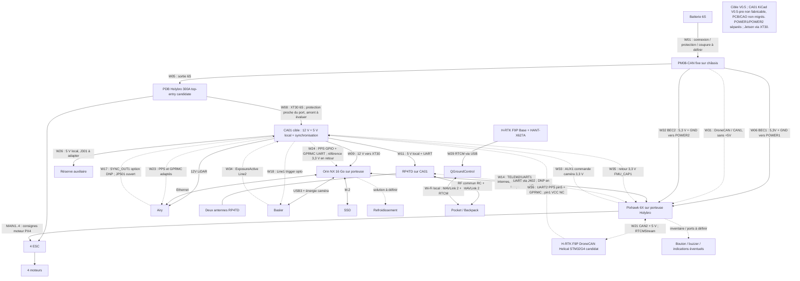

# Architecture électrique et réseaux

| Champ | Valeur |
|---|---|
| Référence | `DOC-ELEC` |
| Nature | document vivant |
| Dernière mise à jour | 1 octobre 2026 |
| Statut | architecture candidate ; schémas, faisceaux et qualifications **À valider** |

## 1. Objet

Ce document décrit l'énergie, l'électronique, les réseaux, les interfaces de
données et la synchronisation du système. Il porte la nomenclature électrique
et les essais d'interface. Les implantations sont décrites dans
[DOC-MEC](ARCHITECTURE_MECANIQUE.md), le logiciel dans
[DOC-SW](ARCHITECTURE_LOGICIELLE.md) et le fonctionnement global dans
[DOC-HLD](HLD.md).

## 2. Principes d'architecture

- PX4, ses capteurs de vol et ses failsafes restent indépendants du calculateur
  compagnon autant que possible.
- La charge utile possède un départ protégé distinct ; un défaut du Jetson ou
  d'un capteur ne doit pas faire chuter l'alimentation du contrôleur de vol.
- Les interfaces exposent tension, courant, puissance, débit, protocole,
  horloge, connecteur, blindage et comportement en défaut.
- Les masses électriques, protections et retours de courant sont conçus avec le
  faisceau, pas ajoutés après l'implantation mécanique.
- Les communications critiques ont une politique de perte explicite et testée.
- Une position RTK et une synchronisation temporelle sont deux fonctions
  distinctes.

## 3. Chaîne d'énergie candidate du cartographe

```text
Batterie 6S amovible → connexion/coupure/protection à définir → PM08-CAN
  ├─ OUT 6S → PDB Holybro 300A top-entry candidate → 4 ESC/moteurs
  │             └─ XT30 candidat → protection proche du départ → CA01 : 12 V calcul/LiDAR et 5 V auxiliaires/radio
  ├─ BEC1 5,3 V/3 A → POWER1 de la porteuse Pixhawk Jetson
  ├─ BEC2 5,3 V/3 A → POWER2 de la même porteuse
  └─ DroneCAN → CAN1 de la porteuse, sans injection de +5 V
Porteuse Holybro : Pixhawk 6X (FCU) + Jetson Orin NX 16 Go (compagnon).
Jetson alimenté séparément via XT30 depuis le 12 V calcul candidat.
```

Le PM08-CAN et la batterie restent des points communs : les deux entrées
POWER1/POWER2 protègent contre la perte d'un BEC ou d'une voie d'entrée
seulement après essais de bascule et d'absence de réalimentation. Les deux
BEC ne sont pas mis en parallèle. Le port CAN1 transporte les données batterie
séparément des entrées POWER ; ni le faisceau fourni ni son brochage ne sont
présumés compatibles sans contrôle contact par contact.

Cette chaîne est une architecture fonctionnelle **Planifiée**, pas un schéma
prêt à fabriquer. Calibres, fusibles, sections, connecteurs, références de
convertisseurs, masses et coupure restent **À valider**. Les 85 A sont une
réserve historique de dimensionnement issue d'un scénario plein régime,
pas un besoin continu démontré (§5.1). La cible de câblage V0.5 remplace V0.4 ;
le schéma CA01 V0.5-pre est migré partiellement, mais son PCB et la CAO ne le sont pas.

## 4. Domaines électriques

| Domaine | Source/convertisseur | Charges | Isolation et surveillance attendues |
|---|---|---|---|
| propulsion | batterie 6S et distribution | ESC/moteurs | courant fort, coupure, température et retour de courant |
| vol critique | deux BEC PM08-CAN vers POWER1/POWER2 séparés | Pixhawk et capteurs de vol | bascule sans reset, mesure batterie et absence de retour entre BEC |
| calcul | DC/DC 12 V candidat vers XT30 de la porteuse | Orin NX, SSD, ventilation et USB | fusible, transitoires, sous-tension, température et arrêt propre |
| perception | DC/DC ou rails qualifiés | Airy, Basler, synchronisation | bruit, courant de démarrage, masse et blindage |
| navigation/liaisons | rails qualifiés, dont 5 V local CA01 pour RP4TD | GNSS, récepteur RC, télémétrie | maintien du contrôle et comportement à la perte |
| station sol | alimentation indépendante | base RTK, radio, tablette/PC | autonomie, recharge et protection environnementale |

La batterie et le PM08-CAN en tête restent des éléments communs à toutes les
branches. La sélectivité des protections aval doit être démontrée par injection
de défauts ; aucune redondance de ces éléments communs n'est revendiquée.


### 4.1 Implantation avionique et interfaces à finaliser

La CAO du 16 septembre 2026 empile l'avionique sur les deux plateaux carbone
OEM. P06 porte les conversions et les modules auxiliaires ; P20 porte le
Pixhawk, avec cales, visserie et retenues. Les détails de fixation sont dans
DOC-MEC §4.4. Le modèle assure une implantation nominale et ne constitue pas
un faisceau prêt à câbler.

Le passage au-dessus du DC/DC est limité à 2,8 mm sous le plateau carbone,
2,2 mm sangle comprise. La définition des sorties latérales et des câbles est
donc un préalable au gel des références. Les cales et l'intercalaire ne suffisent
pas à démontrer l'isolation des vis traversantes ou des équipements vis-à-vis
du carbone conducteur.

| Interface | Action à réaliser | Condition de clôture |
|---|---|---|
| batterie → distribution | confirmer révision X650, pack, contacts et sections ; dimensionner protection et précharge sur profil de courant | schéma et bilan thermique revus, défauts et échauffement mesurés |
| PM08-CAN → porteuse Pixhawk Jetson | POWER1/POWER2 énergie séparée, CAN1 données batterie ; contrôler le faisceau réel | alimentation, bascule et mesure conformes sur banc, sans dépendance au Jetson |
| DC/DC → charge utile | sélectionner rails/références, connecteurs latéraux, protection et refroidissement | enveloppes fabricant substituées, marge électrique et thermique démontrée |
| Pixhawk/CA01 → Basler → Pixhawk | AUX1 commande Line1 ; retour ExposureActive Line2 vers FMU_CAP1 ; SYNC_OUT1 réservé | niveaux, fronts, délai et association image mesurés au banc |
| RC / télémétrie | choisir récepteur, radio, antennes et connecteurs ; vérifier accès et séparation des faisceaux | modèles réels intégrés, portée/CEM et comportements à la perte testés |
| GNSS / RTCM / PPS | candidat H-RTK DroneCAN Helical STM32G4 avec PPS UART2, Base inchangée | révision G4, niveaux, GPRMC, CAN2/RTCM et chaîne temporelle vérifiés |
| carbone / mécanique | définir rondelles, isolants, fixation des masses et prévention du frottement | continuité/isolement et inspection après vibration et traction |

### 4.2 Cahier des charges de la carte avionique commune CA01

Décision du 24 septembre 2026 : la cible V0.5 associe la
[Pixhawk Jetson Baseboard Holybro](https://holybro.com/products/pixhawk-jetson-baseboard?variant=44636223602877),
un [Pixhawk 6X module seul](https://holybro.com/products/pixhawk-6x?variant=44390763692221)
et un [Jetson Orin NX 16 Go](https://www.arrow.com/en/products/900-13767-0000-001/nvidia.html).
Le [PM08-CAN](https://holybro.com/products/dronecan-pm08-power-module-14s-200a?variant=44052276609213)
reste externe et fixé au châssis. BEC1 alimente POWER1 ; BEC2 alimente POWER2.
CA01 retrouve un convertisseur 5 V local protégé pour radio, auxiliaires et
synchronisation. Les convertisseurs 12 V et la régulation 3,3 V restent
**Planifiés**. Le schéma KiCad est en migration préliminaire vers cette cible V0.5 ;
il reste non raccordable et non fabricable. La CAO conserve l'ancienne implantation.

Le projet d'étude est
[CA01_Avionique.kicad_pro](../../hardware/electronique/cartographe/carte_avionique/CA01_Avionique.kicad_pro).
Le premier schéma n'est ni un dossier de fabrication ni une carte testée.
L'intégration mécanique de la porteuse et de CA01 reste **À valider** dans
DOC-MEC. La [PDB Holybro 300A top-entry SKU 18138](https://holybro.com/products/power-distribution-board-pdb-300a-top-entry)
est présélectionnée comme distribution passive en aval du PM08-CAN : six XT90,
deux XT30 et des bornes de puissance sont annoncés. Un XT30 est candidat pour
le départ 6S W08 vers CA01, avec protection de branche à placer au plus près
du port. Le tronçon PDB/XT30 en amont de cette protection reste exposé
au courant de défaut batterie : sa longueur, son isolement et sa tenue
doivent être justifiés avant fabrication. Aucun contact de signal, fusible, régulateur ou calibre propre à ce XT30 n'est
documenté ; la capacité annoncée de 300 A pour la PDB ne relève pas la limite
de 200 A continus annoncée pour le PM08-CAN placé en série.

#### 4.2.1 Périmètre et frontières électriques

- La propulsion conserve sa distribution et son faisceau : aucun courant
  moteur ni chemin principal batterie ne traverse CA01.
- Le PM08-CAN est en série entre batterie et PDB candidate. Ses BEC 5,3 V/3 A
  desservent exclusivement les deux entrées d'alimentation du Pixhawk sur la
  porteuse Holybro ; ils ne fournissent ni CA01 ni le Jetson.
- Un départ 6S protégé en aval du PM08-CAN fournit les conversions 12 V et
  le 5 V local CA01. Le RP4TD est alimenté depuis ce 5 V, avec protection
  et budget propres ; son UART rejoint directement le Pixhawk. Sa commande
  ne dépend ni du PC ni du Jetson. Une panne du 5 V CA01 peut néanmoins
  faire perdre la radio : le comportement PX4 correspondant est à tester.
- Ethernet Airy et USB3 Basler restent liés au Jetson ; l'interface de
  déclenchement Basler n'est pas une entrée d'alimentation de la caméra.

La liste fonctionnelle des interfaces externes de CA01 peut être fixée dès
maintenant. Les repères Jxxx ci-dessous désignent les connecteurs logiques
du schéma en cours de migration ; leur référence physique, leur orientation et
leur empreinte restent à fixer pour la cible V0.5.

| Sens vu de CA01 | Interface cible | Repère logique et liaisons | État de définition |
|---|---|---|---|
| Entrée puissance | XT30 candidat PDB → J103 via protection 6S | J103:1 = VBAT_PAYLOAD, :2 = GND ; W08 | polarité, tronçon amont, protection et calibre **À valider** |
| Entrée GNSS candidate | Helical G4 UART2 TX/PPS/GND | W36 ; J503 logique, GNSS pins 3/5/6 ; pin1 +5 V non raccordé | version STM32G4 requise, S32K1 pin5 NC ; niveaux et GPRMC **À valider** |
| Sorties de temps candidates | PPS/GPRMC adaptés vers Airy et Orin | W23/W24 ; J504 Airy, J505/J506 Orin logiques ; broches fabricant selon §4.3 | conversion série Airy, fan-out, protection, pinmux et masse **À valider** |
| Entrée commande caméra | AUX1 Pixhawk et GND | W33 ; J507 logique ; FMU PWM OUT pin2 3,3 V, pin10 GND | fonction PX4, groupe timer et protection **À valider** |
| Entrée optionnelle | SYNC_OUT1 Airy et retour | J501:1 = AIRY_SYNC_RAW, :2 = GND ; W17 | impulsion angulaire non caractérisée ; JP501 ouvert |
| Entrée/sortie radio | 5 V/GND RP4TD et UART | J401:1 = 5V_RADIO, :2 = GND, :3 = RP_TX, :4 = RP_RX ; W11 | niveaux et brochage OEM **À valider** |
| Entrée/sortie contrôleur | UART radio Pixhawk | J402:1 = GND, :2 = FC_RX_RF, :3 = FC_TX_RF ; W12 | port et TX/RX **À valider** ; pas d'alimentation Pixhawk |
| Sortie puissance | 12 V calcul vers XT30 Jetson | J104:1 = 12V_COMPUTE, :2 = GND ; W09 | conversion et courant **À valider** |
| Sortie puissance | 12 V Airy | J201:1 = 12V_LIDAR, :2 = GND ; W10 | conversion et faisceau **À valider** |
| Sortie réservée | 5 V auxiliaire local | J301:1 = 5V_AUX, :2 = GND ; W26 | protection et budget avant emploi |
| Sortie/entrée caméra | Line1 trigger et Line2 ExposureActive | J502 logique : pin2 Line1, pin3 retour opto, pin4 Line2, pin6 GND GPIO ; W18/W34 | pin1 et pin5 NC ; masses pin3/pin6 distinctes, Q501/U509 réels candidats depuis30/09 ; séquencements et banc ouverts |
| Sortie capture | retour ExposureActive vers Pixhawk | W35 ; J508 logique ; AD&IO pin2 FMU_CAP1, pin8 GND | seuil 3,3 V, rappel, polarité et pilote **À valider** ; CAP1 non partagé avec PPS |

Le 3V3_SYNC est un rail interne de CA01, pas une sortie affectée au
faisceau. J101/5V2_FLIGHT appartenait au schéma historique V0.3 et a été
retiré de l'ébauche migrée. POWER1, POWER2 et CAN1 du PM08-CAN, CAN2 GNSS,
TELEM2 interne, Ethernet Airy et USB3 Basler contournent CA01. Ses
signaux de temps et de caméra sont des adaptations de charge utile ;
leur perte ne commande aucun moteur. Les connecteurs nouveaux restent
à définir et le schéma V0.5-pre n'est pas fabricable.

Les protections, retours de masse et risques de réalimentation par UART, USB,
CAN ou I²C doivent être contrôlés sur le faisceau et sur la porteuse. Les deux
BEC partagent batterie et PM08-CAN : aucune redondance de ces éléments communs
n'est revendiquée. PX4 garde seul l'autorité sur les moteurs.

#### 4.2.2 PM08-CAN, porteuse et affectation des faisceaux

Le PM08-CAN, fixé au châssis près de la distribution, remplace le PM02D dans
la cible. Le fabricant annonce 200 A continus, 400 A pendant 1 s à 25 °C
et deux BEC indépendants de 5,3 V/3 A chacun ; ces valeurs ne qualifient ni
connecteurs, ni faisceau, ni tenue thermique installée. Son enveloppe
45 × 41 × 26 mm hors câbles et sa masse de 185 g câbles inclus doivent
encore être répercutées dans la CAO et le bilan de masse.

| Voie fonctionnelle | Destination | Contrainte |
|---|---|---|
| BEC1 PM08-CAN, +5,3 V et GND | porteuse POWER1, contacts +5 V 1/2 et GND 5/6 | 3 A maximum annoncés ; contacts et orientation à contrôler |
| BEC2 PM08-CAN, +5,3 V et GND | porteuse POWER2, contacts +5 V 1/2 et GND 5/6 | voie distincte, sans pont avec POWER1 |
| CAN-H, CAN-L et GND PM08-CAN | porteuse CAN1, contacts 2, 3 et 4 | CAN1 contact 1 (+5 V OUT) non raccordé au PM |
| 6S hors BEC | PDB candidate XT30 → protection proche du port → CA01 ; tronçon amont à évaluer ; 12 V calcul vers XT30 de la porteuse | distinguer les deux XT30, polarité, courant, protection et connecteurs à dimensionner |

Sur la porteuse, POWER1 et POWER2 sont des connecteurs à six contacts :
1/2 = +5 V, 3/4 = I²C SCL/SDA, 5/6 = GND. CAN1 est un connecteur distinct
à quatre contacts : 1 = +5 V OUT, 2 = CAN-H, 3 = CAN-L, 4 = GND.
**Ne jamais raccorder directement les six fils d'un port combiné PM08-CAN
à POWER1 ou POWER2 : CAN-H/L ne doivent pas atteindre SCL/SDA.**
Les numéros des contacts côté PM et le contenu du faisceau livré restent
**À valider** sur la révision reçue. Si le faisceau ne sépare pas énergie
et CAN avec ces correspondances, produire un adaptateur documenté,
détrompé et vérifié avant branchement. Les deux BEC ne sont jamais
mis en parallèle ; vérifier également l'absence de retour vers CAN1 +5 V.

CAN1 est réservé au PM08-CAN ; allocation GNSS et terminaisons du bus
restent à fermer. La paire CAN est torsadée ; les résistances de 120 Ω
doivent se trouver aux deux extrémités seulement, après contrôle de celles
présentes sur les modules. La mesure batterie vient de DroneCAN, pas
de POWER1/POWER2 I²C. Configuration PX4, étalonnage tension/courant et
comportement à la perte CAN sont **À valider**.

La Jetson Baseboard a une entrée d'alimentation XT30 distincte pour le
module Jetson. Le 12 V calcul est un candidat dans la plage annoncée
7–21 V du produit ; la révision exacte, les appels de courant, le SSD,
la caméra USB et le refroidissement doivent être mesurés avant gel.
Aucun des BEC 3 A du PM n'alimente cette entrée.

Sources : [fiche PM08-CAN](https://holybro.com/products/dronecan-pm08-power-module-14s-200a?variant=44052276609213),
[brochage Pixhawk Jetson Baseboard](https://docs.holybro.com/autopilot/pixhawk-baseboards/pixhawk-jetson-baseboard/ports-pinout),
[fiche de la porteuse](https://holybro.com/products/pixhawk-jetson-baseboard?variant=44636223602877),
[configuration DroneCAN/PX4](https://docs.holybro.com/power-module-and-pdb/power-module/dronecan-power-module-setup).

#### 4.2.3 Rails et conversion proposés

L'entrée est une LiPo 6S, 22,2 V nominal et 25,2 V pleine charge. Les 19,8 V
utilisés dans le bilan sont un point de calcul, pas un seuil de coupure fixé.
La plage minimale, les transitoires admissibles et la protection amont sont
**À valider** avant de choisir définitivement les composants. La tension maximale
d'une puce n'est pas la tenue de l'ensemble condensateurs, MOSFET et connecteurs.

| Rail candidat | Charge et capacité de travail | Définition V0 et réserves |
|---|---|---|
| `5V3_POWER1` / `5V3_POWER2` | deux BEC PM08-CAN indépendants, 3 A annoncés chacun, vers POWER1/POWER2 de la porteuse | aucun parallèle ; consommation Pixhawk et bascule à mesurer ; ancien label KiCad `5V2_FLIGHT` historique |
| `12V_COMPUTE` | convertisseur candidat 12 V/6 A vers XT30 porteuse Jetson ; Orin NX, SSD, ventilation et USB inclus | LM5146-Q1 réel et passifs candidats depuis le 30/09 ; boucle, Ceff, charges et protections à valider (§4.2.6) |
| `12V_LIDAR` | cible calculée 12 V/3 A, au moins 2 A requis au démarrage Airy | LM76003 réel, L/C/FB candidats calculés ; stabilité, thermique et démarrage à valider |
| `5V_AUX` cible | DC/DC 5 V/3 A total local CA01 ; RP4TD, synchronisation et réserve J301 sans charge affectée | U301 LM76003 et passifs candidats calculés ; budget réel, protection et implantation à fermer |
| `3V3_SYNC` / alimentation trigger | 5 V CA01 via F501 et TPS7A20 ; budget 3,3 V provisoire 50 mA | régulateur et adaptation trigger/capture réels candidats ; niveaux, thermique et séquencements à valider |

La porteuse Holybro Pixhawk Jetson possède une entrée XT30 dédiée au Jetson.
La fiche produit annonce 7–21 V pour cette entrée ; la révision livrée et la
limite réelle du connecteur doivent être contrôlées. Le 12 V est un point de
conception candidat, sans validation du convertisseur 6 A ni de la consommation
Orin NX + USB Basler + SSD + refroidissement. Les limites de l'ancien kit
Orin Nano ne sont pas transférables à cette porteuse.
[Spécification Holybro](https://holybro.com/products/pixhawk-jetson-baseboard?variant=44636223602877).

L'Airy accepte 9–32 V, consomme 8 W typiques et son dépannage fabricant demande
une source capable d'au moins 2 A à 12 V : la puissance typique seule ne
suffit pas pour dimensionner le démarrage.
[Manuel RoboSense Airy, spécifications et dépannage](https://robosense-robotics.github.io/product-manual/en/Airy/).

Deux familles TI servent de bases de conception, sans qualification du circuit
CA01 :

- [LM5146-Q1](https://www.ti.com/product/LM5146-Q1), contrôleur buck avec
  MOSFET externes : l'[EVM 12 V/8 A](https://www.ti.com/tool/LM5146-Q1-EVM12V)
  documente une entrée 15–85 V et un fonctionnement 400 kHz, avec EN/UVLO,
  soft-start et PGOOD. Cette référence aide à établir le 12 V calcul ; la V0
  reprend depuis le 30/09 un étage de puissance et une compensation candidats ;
  stabilité, capacités effectives, MOSFET et routage restent à valider.
- [LM76003](https://www.ti.com/product/LM76003), buck intégré 3,5–60 V/3,5 A,
  avec compensation interne : conservé comme candidat pour le rail Airy ; U301
  est repris dans le schéma V0.5-pre pour le 5 V CA01 ; les passifs de puissance,
  protections et budgets restent à fermer.
  L'[EVM](https://www.ti.com/tool/LM76003EVM-500K) documente 3,3/5 V ; son
  passage à 12 V nécessite de recalculer inductance, capacités, feedback,
  courant limite et comportement thermique. Le symbole réel dans l'ébauche
  et les calculs candidats du §4.2.6 ne valent pas qualification matérielle.

Tolérances, ondulation, chute transitoire, ordre de démarrage, seuils UVLO,
protection inversion/surtension et limitation d'appel doivent être chiffrés
avant revue de fabrication. Prévoir EN/PGOOD et points de mesure accessibles
sans leur attribuer une action logicielle de vol non spécifiée.

#### 4.2.4 Radio et adaptation de synchronisation

La feuille `04_radio.kicad_sch` (page 3 du PDF) est reprise graphiquement
le 30 septembre 2026 : port Pixhawk et arrivée 5 V à gauche, module radio
à droite, voies UART reliées par des fils directs et sens aller/retour
explicites. Les symboles J401/J402 sont agrandis pour afficher les fonctions
des broches ; les condensateurs sont regroupés près de J401. Valeurs,
numéros de broches, connexions et DNP sont conservés (DOC-VAL §12.7.3).
La guideline schématique place autant que possible les entrées à gauche
et les sorties à droite ; les symboles d'IC doivent être agrandis lorsque
leur densité nuit à la lecture.

Le RP4TD est alimenté par le 5 V local CA01, sa fiche annonçant 4,5–12 V.
Sa consommation et les niveaux électriques de TX/RX restent à confirmer.
L'ébauche représente les interfaces série candidates ; une éventuelle
adaptation de niveau, la protection ESD et la prévention des courants lorsque
l'un des équipements est hors tension restent à définir. Le connecteur et le
port Pixhawk retenus doivent préserver la liaison locale avec le Jetson.
Les résistances série R401/R402 sont DNP (non montées) par défaut ; les monter seulement après validation des niveaux et de la réalimentation hors tension. La fonction RF/MAVLink et ses limitations restent celles du §7.4.

La voie de déclenchement Basler V1 part de la sortie Pixhawk
**FMU PWM OUT AUX1**. CA01 la protège et l'adapte au courant de
l'entrée optocouplée **Line1 M8 pin2**, avec **pin3 retour opto**.
Le PMV30UN2 Q501 remplace le bloc U508 depuis le 30/09, avec grille
330 Ω et rappel 100 kΩ (§4.2.6). Le MMBT3904 de l’ancienne V0.3 est historique.
Courant opto, fronts et séquencements restent à mesurer ; aucun 5 V ne doit
revenir vers la sortie 3,3 V du Pixhawk.

La Basler fournit un retour `ExposureActive` sur **Line2 M8 pin4**
configurée en sortie, avec **pin6 GND GPIO** distinct du pin3.
CA01 comporte un circuit candidat de polarisation, protection DC et adaptation
3,3 V par SN74LVC1G17 U509 (§4.2.6) vers
**AD&IO FMU_CAP1 pin2/GND pin8**. Line2 est à collecteur ouvert ;
rappel, inversion, délai, front et correspondance Frame ID sont
**À valider**. Les pins4/6 de J502, NC dans l'ancienne V0.3,
sont représentées dans la netlist V0.5-pre. La
commande seule ou la réception USB ne datent pas l'exposition réelle.

`SYNC_OUT1` Airy reste optionnel sur J501, **JP501 ouvert/DNP** :
la sortie est angulaire et ses caractéristiques électriques ne
sont pas suffisamment établies pour commander la caméra V1.
CA01 doit aussi recevoir le PPS et le GPRMC du GNSS G4, tamponner
les sorties Airy/Orin et adapter le niveau série Airy après mesure.
Ces circuits GNSS sont désormais **Implémentés** en composants physiques
candidats dans la feuille `05_synchronisation.kicad_sch` (§4.2.6).
R530–R533 restent DNP ; niveaux OEM, interfaces et matériel sont **À valider**.
Cette réalisation schématique ne rend pas la carte fabricable.

Sources d'interface :
[Basler a2A4096-30ucBAS](https://docs.baslerweb.com/a2a4096-30ucbas),
[entrées optocouplées Basler](https://docs.baslerweb.com/a2a4096-30ucbas#opto-coupled-io-input-line),
[RP4TD](https://radiomasterrc.com/products/rp4td-expresslrs-2-4ghz-diversity-receiver).

#### 4.2.5 Exigences et recette

Les exigences suivantes portent les fonctions attendues. Leurs réalisations
sont **Planifiées** et leurs résultats **À valider** ; les seuils non définis
ci-dessous doivent être fermés avant l'essai, pas choisis après mesure.
Les protocoles et résultats sont centralisés dans
[DOC-VAL](../VALIDATION_QUALIFICATION.md), sous `T-CA01-01..12`.

| Exigence | Composant et critère d'acceptation | Test | Résultat |
|---|---|---|---|
| `CARTE-001` séparation de propulsion | connecteurs/nets CA01 : aucun chemin de courant moteur ; mesure globale PM08-CAN/DroneCAN hors CA01 explicitée | `T-CA01-01` revue schéma, netlist et faisceau | **À valider** |
| `CARTE-002` maintien du vol | défaut d'une branche charge utile isolé sans reset Pixhawk ; si le 5 V radio CA01 est perdu, détecter la perte RC et vérifier le repli PX4 ; sélectivité mesurée | `T-CA01-02` défauts et transitoires sur banc limité | **À valider** |
| `CARTE-003` entrée 6S protégée | inversion, surtension, appel capacitif et sous-tension : enveloppe et seuils chiffrés puis respectés | `T-CA01-03` rampe, démarrage et perturbations d'entrée | **À valider** |
| `CARTE-004` alimentation calcul | 12 V/6 A cible du buck, respect de la limite d'entrée porteuse, charge réelle stable et température admissible | `T-CA01-04` charge statique/dynamique, démarrage Jetson/USB/SSD | **À valider** |
| `CARTE-005` alimentation LiDAR | source 12 V capable d'au moins 2 A, démarrage sans boucle de reset et fonctionnement Airy stable | `T-CA01-05` démarrages et acquisition à chaud | **À valider** |
| `CARTE-006` rails auxiliaires | 5 V CA01 local protégé depuis 6S ; budgets 5 V/3,3 V fermés, plages des charges respectées, aucun retour vers POWER1/2 | `T-CA01-06` charges, défaut et séquences marche/arrêt | **À valider** |
| `CARTE-007` alimentation et mesure vol | PM08 externe, POWER1/POWER2 séparés, CAN1 distinct ; deux budgets 5,3 V ≤3 A, bascule sans reset, capteurs de vol essentiels surveillés, absence de retour et calibration vérifiés | `T-CA01-07` et `T-PM-V05-01/02/05/06`, DOC-VAL §12.7 | **À valider** |
| `CARTE-008` radio autonome du calcul | niveaux UART conformes, commande RC et QGC opérationnels avec Jetson arrêté ; alimentation radio stable | `T-CA01-08` interfaces et renvoi `T-RF-01..06` | **À valider** |
| `CARTE-009` temps et caméra | AUX1→CA01→Line1, ExposureActive Line2→CA01→FMU_CAP1 et PPS/GPRMC vers Airy/Orin ; niveaux, courant, fronts et Frame ID mesurés | `T-CA01-09` et `T-AIRY-SYNC-01` | **Planifié / À valider** |
| `CARTE-010` intégration mécanique | contour, hauteur, fixations, masse, isolation carbone et connecteurs accessibles validés dans SA03 réel | `T-CA01-10` CAO, montage et inspection | **À valider** |
| `CARTE-011` thermique et perturbations | composants sous limites avec marge définie ; GNSS/radio/capteurs sans perturbation invalidante, pertes et bruit mesurés | `T-CA01-11` charge simultanée, CEM et essais moteurs progressifs | **À valider** |
| `CARTE-012` dossier reproductible | schéma, BOM, empreintes et netlist cohérents, aucune valeur ouverte pour fabrication, ERC/DRC expliqués et revue indépendante | `T-CA01-12` contrôle des artefacts et revue | **À valider** |

La qualification doit suivre simulation/analyse, alimentation limitée, banc
sans hélices et progression DOC-VAL. Aucun essai de vol, carte assemblée ou
résultat thermique n'est revendiqué par l'existence du schéma.

#### 4.2.6 Outillage et limites du premier schéma

Le [schéma PDF complet CA01](../../hardware/electronique/cartographe/carte_avionique/CA01_Avionique.pdf)
est exporté directement depuis le projet KiCad et placé à côté de ses sources
pour faciliter son accès. Il comprend six pages ; sa copie dans `verification`
reste identique et la provenance d'export est consignée dans DOC-VAL §12.7.4.

**Convention graphique — 1 octobre 2026.** La page 2 (`01_energie_pm`)
sépare la protection d'entrée du convertisseur calcul. Le symbole U102 est
agrandi ; ses réseaux FB/COMP, bootstrap et commande de grille restent
filaires, avec les passifs à proximité et la sortie à droite. Sur les cinq
sous-feuilles, les rails utilisent `Alimentation_Barre`, avec tige verticale
et barre horizontale en haut, et les masses le symbole KiCad GND. Les noms
globaux et les retours distincts, dont `BASLER_OPTO_RETURN`, sont conservés.
Trois indicateurs de puissance identifient les sources physiques après
L101 (12V_COMPUTE), L301 (5V_AUX) et F102 (5V_RADIO), sans masquer les
contrôles ERC. Cette reprise graphique ne change ni les valeurs ni les
connexions électriques ; recette et preuves : DOC-VAL §12.7.4.

Le [pont KiCad](https://github.com/mixelpixx/KiCAD-MCP-Server) est installé
localement sous `.runtime/kicad-mcp`, sur le commit
`ac716d1a8bfad325b4aa93a398222645b3f78fd7`. Le test historique Windows amd64
avec KiCad 10.0.6 a vérifié l'inventaire de 233 outils, une création/relecture
de projet factice et l'export d'une netlist ; preuve :
`hardware/electronique/cartographe/verification/kicad_mcp_probe_20260915.json`.
Ce résultat concerne l'outillage et ne qualifie pas CA01.

La migration **V0.5-pre** est **Implémentée** sous KiCad 10.0.6
(Windows amd64), avec une racine et cinq feuilles fonctionnelles compactes.
Le dimensionnement du 29–30 septembre 2026 ajoute les circuits réels
ci-dessous, avec références complètes visibles dans le schéma. Les connexions
locales restent réalisées par fils suivant la
[skill HW Design schématique](../../.agents/skills/hw-design-schematique/SKILL.md).
Le PCB est vide ; la carte demeure **À valider**, non fabricable et non raccordable.

Les hypothèses de calcul sont VIN = **18–25,2 V**, capacités de sorties
12V_COMPUTE **6 A**, 12V_LIDAR **3 A**, 5V_AUX **3 A au total**. Elles restent
candidates : le plancher 18 V n'est pas un seuil de sécurité batterie PX4,
et la somme 123 W représente des capacités de rails, pas la consommation
mission. À rendement supposé 90 %, cela représente 7,59 A à 18 V pour
le départ W08. Les appels, profils réels, transitoires et températures sont ouverts.

| Fonction | Références et valeurs candidates | Résultat / limite |
|---|---|---|
| Protection entrée U101 | LM74800QDRRRQ1, Q101/Q102 CSD19531Q5A en drain commun ; CAP 220 nF/50 V avec Ceff ≥100 nF ; bulk 33 µF/100 V EEE-FK2A330P | RTN13 flottant ; contrôleur sans limitation de surcourant ; SOA sous charge et TVS **à concevoir/valider** |
| UV/OV entrée | UV 100 kΩ/8,06 kΩ ; OV 100 kΩ/4,42 kΩ, 0,1 % | UV typ. 16,50/15,18 V ; OV typ. 29,08/26,70 V, récupération minimale calculée 25,70 V incluant tolérances/fuite ; permet le réarmement à 25,2 V dans ces hypothèses |
| Appel entrée | HGATE 100 Ω et 10 nF ; capacité aval totale supposée ≤300 µF | rampe typ. 4,58 ms à 25,2 V, appel capacitif seul 1,65 A typ./2,50 A au coin Ig/C ; ne couvre pas démarrage des bucks sous charge |
| Calcul U102 | LM5146QRGYRQ1, Q103/Q104 CSD19531Q5A ; XAL1010-682MED 6,8 µH ; 400 kHz/24,9 kΩ ; FB 21 kΩ/1,50 kΩ | 12 V/6 A cible ; bootstrap 100 nF via 2,2 Ω, VCC 2,2 µF ; shunt 10 mΩ WSLT2512R0100DEA 0,5 %/1 W, ILIM 750 Ω ; boucle/courant limite/thermique à fermer |
| Capacités calcul | entrée 5×4,7 µF/100 V, sortie 5×22 µF/25 V, X7R1210 | Ceff sortie ≥60 µF hypothèse ; exemple 4 A/20 µs/0,5 V demande 160 µF : réponse transitoire non démontrée |
| Compensation calcul | base TI EVM : 8,06 kΩ + 4,7 nF série COMP→FB, 100 pF parallèle ; 51,1 Ω + 1 nF VOUT→FB | point de départ ; MOSFET/Ceff/charges diffèrent, Bode et transitoires obligatoires |
| LiDAR U201 | LM76003RNPR ; L201 15 µH XAL1010-153MED ; C203 100 µF/25 V 25SVPF100M (ESRmax24 mΩ), C208 470 pF C0G | Icrête max. calculée 3,60 A < limite HS minimale 4,35 A ; Cmin TI eq.23 =28,83 µF, disponible au −20 %=80 µF ; marge conditionnelle |
| Auxiliaire U301 | LM76003RNPR ; L301 6,8 µH XAL1010-682MED ; C303 120 µF/10 V 10SVPC120MV (ESRmax22 mΩ), C308 360 pF C0G | Icrête max. calculée 3,84 A <4,35 A ; Cmin TI =82,14 µF, disponible au −20 %=96 µF ; marge conditionnelle |
| Passifs LM76003 | Cin 2×10 µF/50 V X7R +47 nF ; BOOT470 nF/25 V ; VCC2,2 µF/25 V ; BIAS1 Ω/1 µF50 V | exiger Cin total effectif ≥10 µF ; courbes DC bias/température/vieillissement à vérifier ; RT/SS ouverts, MODE GND autorise PFM |
| Feedback LM76003 | 90,9 kΩ/8,32 kΩ et 39,7 kΩ/10 kΩ, 0,1 %, 25 ppm/K candidats | PWM : 11,69–12,21 V et 4,876–5,085 V, ΔT≤100 K/VFB/Ibias inclus ; décalage PFM +2 % **typique**, pas borne garantie |
| Régulation U503 | TPS7A2033PDBVR ; CIN/COUT4,7 µF10 V X7R, Ceff≥0,47 µF | budget50 mA, VOUT3,2505–3,3495 V ; P≈0,100 W à5,25 V ; hausse≈18,7 °C estimée sur PCB TI de référence |
| Trigger Basler Q501 | PMV30UN2, grille330 Ω, rappel100 kΩ | Line1 pin2 alimentée5V_SYNC, pin3 retour opto commuté, distinct de GND GPIOpin6 ; >5 mA requis, <15 mA interne annoncé ; fronts à mesurer |
| Capture Basler U509 | SN74LVC1G17DBVR ; rappel1 kΩ via BAT54H ; entrée4,7 kΩ/0,25 W + BZT52H-C4V7 ; sortie1 kΩ | protection DC24 V candidate, R≈80 mW en positif ; pas qualification ESD ; absence de réalimentation Pixhawk éteint non démontrée |
| Fusibles | F10110 A sans référence fixée ; F102 SF-0603F100-2 1 A ; F501 SF-0603F040-2 400 mA | calibres candidats ; Icc/pouvoir de coupure DC, derating, appels et sélectivité à fermer ; protection W08 près PDB obligatoire |

La capacité d'inductance sous courant/température et Isat typique constructeur
ne sont pas des garanties sur toute l'enveloppe. Les calculs LM76003 couvrent
f=440–560 kHz et L±20 %, pas une simulation de boucle. Les pertes de
commutation, la dissipation sur le PCB réel et la CEM restent ouvertes.
Le magasin Holybro indique 7–21 V pour la baseboard, la documentation
7–24 V : relever la révision livrée avant de figer son enveloppe ; 12 V reste candidat.

**Allocation 5 V.** W26/J301 est une **réserve sans charge affectée** dans
le câblage du drone. Les 3 A sont partagés entre radio, synchronisation et
cette réserve. Réservation provisoire : radio0,50 A (courant non publié),
sync0,08 A, reste2,42 A théorique ; les charges et pointes doivent être mesurées
avant usage. Le GNSS reste alimenté sur CAN2 ; J503pin1 +5 V demeure NC.
F501 ne garantit pas une coupure sélective si le LDO limite un défaut sous
son calibre ; une perte du5 V radio impose le repli RC PX4 prévu.

**Temps physique candidat — 30 septembre 2026.** Les anciens blocs GNSS
sont remplacés par des composants et brochages physiques **Implémentés** ;
le matériel demeure **À valider**. U512/U513 SN74LVC1G17DBVR conditionnent
respectivement PPS/TX : protection TPD1E05U06 vers GND avant résistance
série 330 Ω, rappel 22 kΩ vers GND, sans pull-up alimentant le GNSS.
U504/U505/U507/U511 SN74LVC1T45DBVR distribuent les signaux de A vers B
(DIR au rail VCCA) : PPS Airy, PPS Orin, GPRMC Orin et DIN1 RS232 Airy.
VCCA est `3V3_SYNC` ; VCCB suit `5V_AIRY_IO` pour Airy ou la référence
OEM `3V3_ORIN_IO_REF` pour Orin. Leur isolation est spécifiée avec le rail
à GND ; référence flottante, transitoires et domaines internes des appareils
restent à tester.

| Voie / composant | Réalisation candidate | Limite à valider |
|---|---|---|
| Source GNSS | J503/W36 pin3 TX, pin5 PPS, pin6 GND ; pin1 +5 V NC | 3,3 V nominal, VOH≥2,9 V et VOL≤0,4 V supposés d'après u-blox ; sortie Holybro exacte non garantie |
| Entrées U512/U513 | 330 Ω série / 22 kΩ GND, Schmitt G17, TVS TPD1E05U06 en amont | G17 revY : VT+max1,92 V à3 V et2,74 V à4,5 V ; borne2,74 V à3,3 V candidate par monotonie, sans garantie ni interpolation ; ESD système à tester |
| Rail Airy U510 | TPS70950DBVR depuis12V_LIDAR vers5V_AIRY_IO ; EN flottant autorisé par TI ; C514/C51510 µF/25 V X7R1206 | 4,89–5,11 V, budget25 mA ; ambiante60 °C/VIN12,6 V donne environ101 °C de jonction avec modèle JEDEC, pas preuve PCB |
| PPS Airy U504 | translation vers5V_AIRY_IO, R53047 Ω puisJ504 | charge candidate≤12 mA avant câble ; courant réel, niveau≥3 V et front à mesurer |
| GPRMC Airy U511/U506 | translation DIN1 puisTRS3232EIDR alimenté5V_AIRY_IO ; R53147 Ω puisJ504 | UART repos haut devient RS232 négatif ; compatible Airy selon interface RS232 principale, révision réelle à vérifier |
| Pompe U506 | quatre1 µF/25 V ; Ceff minimale100 nF/470 nF/470 nF/470 nF ; C520bypass2,2 µF/25 V X7R, Ceff≥1 µF, plus100 nF | DC bias/température/vieillissement à fermer ; valeurs effectives et implantation conditionnent fonctionnement/ESD |
| Orin U505/U507 | PPS/GPRMC logiques ; R532/R533100 Ω ; J509 reçoitCamera0 ou1 pin22VDD3,3 V etpin1GND, rappel10 kΩ de référence versGND | confirmer que cette référence suit réellement les domainesGPIO/UART ; +5 V des portsGPIO/Debug exclu ; pinmux et cible éteinte à tester |

R530–R533 demeurent **DNP pour le banc** ; J501/JP501 et R401/R402
restent DNP. Le rail Airy dépend du départ LiDAR, mais les séquences
UVLO, réserves capacitives et courants vers les appareils éteints restent
à mesurer. La protection TVS d'entrée puissance, Ceff, PCB, connecteurs
et validation d'interface restent ouverts ; `manufacturing_ready=false`.
Le §12.7.2 de DOC-VAL définit la recette de vérification de ce lot.
La [revue indépendante](../../hardware/electronique/cartographe/carte_avionique/verification/synchronisation_revue_20260930.json)
conserve un résultat préliminaire : topologie conforme, niveaux OEM et banc ouverts.

Les calculs et valeurs sont dans [dimensionnement.json](../../hardware/electronique/cartographe/carte_avionique/dimensionnement.json),
la [BOM candidate](../../hardware/electronique/cartographe/carte_avionique/bom_candidate.json)
et l'[inventaire des sources archivées](../../hardware/electronique/cartographe/sources_fabricants/manifest_sources.json)
(29 PDF selon le [contrôle des sources](../../hardware/electronique/cartographe/carte_avionique/verification/sources_controle_20260930.json), plus documentation web). Les datasheets TI, Coilcraft,
Panasonic, Nexperia, Bourns et Vishay sont conservées. Le catalogue TDK historique
est un miroir DigiKey identifié ; ordre actuel et courbes des variantes à fermer.

Le [contrôle statique](../../hardware/electronique/cartographe/carte_avionique/verification/controle_statique.json)
porte sur 151 composants/111 réseaux et **221 invariants** ;
ERC **0 erreur, 0 avertissement selon configuration du projet**, et
[44 contrôles analytiques](../../hardware/electronique/cartographe/carte_avionique/verification/calculs_reproduits.json)
conformes. Trois contrôles de conservation du lottemps sont portés par
[conservation_sync_20260930.json](../../hardware/electronique/cartographe/carte_avionique/verification/conservation_sync_20260930.json)
et la recette `verify_sync_preservation.py` : comparer les connexions
avant/après le lottemps selon les critères consignés dans cette preuve.
Les indicateurs de puissance déclarent les sources physiques :
entrée6S/GND, nœuds après FET/filtreVIN, BIAS via VOUT/R, 5V_SYNC viaF501, référenceCSI Orin surJ509 et
12V_LIDAR aprèsL201 pourU510 (#FLG503).
Ils renseignent le modèle ERC et ne qualifient pas les protections.
Les contrôles ERC ignorés du projet sont consignés dans la preuve ;
les empreintes exigent une revue fabricant distincte, notamment TI Q5A des FET.
La preuve de reprise compacte 53composants/51réseaux/22invariants/4erreurs
est historique, conservée avant dimensionnement. Aucun PCB ni banc qualifié.

#### 4.2.7 Critère de fin du schéma CA01

Un **schéma terminé pour passage au placement/routage** permet de réaliser le
PCB sans devoir encore inventer un circuit, une tension, un courant admissible
ou un brochage. Cette étape est distincte d'un PCB fabricable et d'une carte
qualifiée sur banc.

| Lot ouvert | Manque actuel | Condition pour clore le schéma |
|---|---|---|
| Charges et enveloppes | capacités candidates, appels/VIN transitoires/ambiante non mesurés ; J301 réserve | budgets continus/pointe et tolérances approuvés, profil réel Orin/USB/Airy/radio, température et marges |
| Conversions | circuits réels candidats, Ceff et boucle compute ouverts | MPN des passifs, courbes DC bias, limites de courant aux coins, stabilité/réponse/thermique justifiées |
| Protection | LM74800/FET réels, TVS absente, calibres de fusibles candidats | SOA chargée, transitoires/énergie, Icc et coupureDC, sélectivité/câble W08 prèsPDB, seuils aux tolérances |
| Temps et caméra | trigger/capture et GNSS en composants physiques candidats, sortiesR530–R533DNP | niveaux GNSS/Airy établis, référenceOrin validée, protections et délais ; cibles éteintes sans réalimentation |
| Radio et réserve | consommation inconnue, UARTDNP ; J301 sans charge | profils, protection, TX/RX et hors tension confirmés ; budget3A total partagé |
| Interfaces et empreintes | connecteurs logiques et empreintes candidates | références exactes, TIQ5A/shunt, détrompage/retours/blindages/calibres et correspondance faisceau |
| Revue | ERC conforme mais étude/PCB incomplets | plus de bloc non réalisé ni valeur ouverte, BOM commandable et sources à jour ; revue indépendante des marges et topologies |

Un ERC sans erreur ne clôt pas les exigences électriques ou les limites
de fabrication. Les interfaces GNSS et les protections encore ouvertes
interdisent le passage au PCB final et le raccordement au drone.

Le contour, les fixations, le placement, les boucles de commutation, les
sections de cuivre, la dissipation, le dégagement RF et le DRC relèvent ensuite
du **PCB**. Les mesures de charge, défauts, thermique, CEM, synchronisation
et RF relèvent de la **qualification**. Les contraintes de routage et
l'enveloppe mécanique nécessaires doivent toutefois être connues avant de
déclarer le schéma prêt à router.

Les fonctions entièrement externes (mesure globale, GNSS DroneCAN) n'imposent
pas nécessairement d'attendre pour fermer un circuit CA01 indépendant ; elles
deviennent bloquantes si elles changent ses rails, ses connecteurs, ses ports
ou ses budgets. Elles restent obligatoires pour clore le câblage du drone.

### 4.3 Câblage global du cartographe

Exigence `CAB-CARTO-001` : tenir les E/S et les liaisons Wxx cohérentes avec le schéma, puis contrôler chaque faisceau point à point avant branchement.

Première définition du 21 septembre 2026 : schéma d'interconnexion et registre
des entrées/sorties, **Planifié / À valider**, pas un faisceau prêt à fabriquer.
Révision cible V0.5 du 24 septembre : PM08-CAN sur châssis, BEC1 vers POWER1,
BEC2 vers POWER2 et DroneCAN distinct sur CAN1 ; CA01 retrouve son 5 V local.
Budgets, bascule, compatibilité et thermique **À valider** ; CA01 est migrée
en schéma préliminaire V0.5-pre, tandis que la CAO reste à mettre à jour.
Le périmètre couvre le cartographe et ses liens au sol ; la pompe, les vannes
et les actionneurs du drone de traitement feront l'objet de leur propre variante.

Sources techniques éditables : [schéma global Mermaid](../../hardware/electronique/cartographe/cablage_global.mmd)
et [registre modules/liaisons](../../hardware/electronique/cartographe/cablage_global.json).
Les 34 liaisons actives documentaires sont `W01..W06`, `W08..W29`,
`W31..W36`. W36 distribue PPS/GPRMC du GNSS vers CA01. W31 porte DroneCAN PM et W32 le BEC2 ; W33 commande
la caméra, W34 rapporte l'exposition et W35 rejoint FMU_CAP1. W07, ancienne dérivation du BEC1 vers la
radio, est retirée ; W08 alimente CA01 et W11 relie sa radio. W30 reste retiré
et sa fonction de mesure est portée par W31.
W06 ne transporte que l'énergie. Les identifiants retirés ne sont pas réutilisés.
W32 correspond au second départ FCU. W11, W18, W23, W24 et W26
dépendent de la migration du 5 V local et des adaptations CA01. Les broches conservées et interfaces à
migrer sont distinguées dans le registre ; aucune preuve V0.4 ne qualifie V0.5.
Les flèches d'énergie représentent alimentation **et retour** ; la masse est
commune, les blindages et l'isolation du carbone restent à concevoir.
Les traits pointillés désignent des interfaces ouvertes ou non raccordées.
La porteuse regroupe physiquement le FCU et le Jetson, mais conserve leurs
entrées électriques séparées. CA01 ne reçoit aucun BEC du PM.



#### 4.3.1 Entrées et sorties des modules

Les ports internes SSD/refroidissement ne sont pas des sorties CA01 supplémentaires.
Les antennes RF/GNSS, les équipements au sol et les accessoires de sécurité
sont recensés pour éviter les omissions de faisceau ou d'alimentation.
Aucun accessoire optionnel non identifié n'est considéré comme déjà installé.

| Module | Entrées | Sorties / interfaces | À figer |
|---|---|---|---|
| `BAT` Batterie 6S candidate | charge externe hors vol | puissance batterie | pack/révision, décharge et connecteur définitifs |
| `DIST` PDB Holybro 300A top-entry candidate | PM08-CAN OUT +/− | six XT90 et deux XT30 annoncés ; départs ESC et CA01 | bornes/liaison PM, polarité, protection W08, courant par sortie, montage et tenue thermique à valider |
| `ESC1..4` Quatre ESC | 6S ; consigne Pixhawk | trois phases vers chaque moteur | références, protocole et brochages |
| `M1..4` Quatre moteurs | trois phases ESC | couple mécanique | références, ordre et sens |
| `PM` Holybro PM08-CAN sur châssis | batterie 6S via IN | OUT vers distribution ; BEC1 et BEC2 5,3 V/3 A vers FCU ; DroneCAN | variante, brochage, câbles et terminaisons ; tenue thermique et mesure à vérifier |
| `FCU` Pixhawk 6X sur porteuse Holybro | POWER1/2 ; CAN1 PM ; CAN2 GNSS ; ExposureActive sur FMU_CAP1 candidat | MAIN propulsion, AUX1 caméra, TELEM2 temps/événements | capture/commande et pont d'horloges **À valider** |
| `CA01` Carte alimentation/radio/synchronisation | 6S protégé ; GNSS PPS/GPRMC ; AUX1 ; ExposureActive ; SYNC_OUT1 option DNP | 12 V/5 V ; PPS/GPRMC Airy/Orin ; trigger Basler ; retour CAP1 ; UART RF | circuits énergie/caméra candidats ; quatre adaptations GNSS ouvertes/DNP, protections/PCB/banc à fermer, non raccordable |
| `RF` RP4TD rapporté sur CA01 | 5 V local CA01 ; UART ; RF | UART ; RF | défaut 5 V local, UART, consommation et antennes à tester |
| `RFANT1..2` Deux antennes RP4TD | coaxiaux RF | liaison radio | références, emplacement et dégagement carbone |
| `CPU` Orin NX 16 Go et porteuse Holybro | 12 V XT30 ; USB/Ethernet ; PPS GPIO_07 et GPRMC UART candidats ; TELEM2 interne | acquisition et horloges associées | GPIO/UART, pinmux, console et incertitude **À valider** |
| `SSD` SSD NVMe | alimentation et PCIe porteuse | données stockées | modèle, endurance et courant |
| `FAN` Refroidissement Jetson | alimentation et éventuelle commande | retour vitesse éventuel | solution/refroidissement, connecteur et budget |
| `LID` RoboSense Airy | 12 V ; Ethernet ; PPS/GPRMC candidats | UDP horodaté ; SYNC_OUT1 option DNP | verrouillage, point/UTC et niveaux **À valider** |
| `CAM` Basler a2A4096-30ucBAS | USB3 ; Line1 trigger opto | images Frame ID/chunk ; Line2 ExposureActive candidat | sortie GPIO, latence et association **À valider** |
| `GNSS` H-RTK F9P DroneCAN Helical STM32G4 candidat | 5 V vol, antenne hélicoïdale, RTCM via CAN2 | navigation PX4 ; UART2 TX/GPRMC et PPS pin5 | révision G4 impérative, S32K1 pin5 NC ; niveaux et configuration **À valider** |
| `GNSSANT` Antenne hélicoïdale candidate | fixation directe ou SMA selon variante | signaux GNSS | montage, ciel dégagé et multipath **À valider** |
| `SAFE` Accessoires Pixhawk à identifier | alimentation/commande FCU | bouton sécurité / buzzer / signalisation éventuels | inventaire livré et références ; aucune fonction supposée présente |
| `POCKET` Pocket ELRS / Backpack au sol | manches ; supervision QGC ; énergie propre | liaison RF commune | configuration et batteries |
| `GCS` Station QGroundControl sur PC | Base H-RTK par USB ; supervision via Backpack Wi-Fi | RTCM MAVLink 2, missions et commandes ponctuelles | version, continuité PC et charge RF **À valider** |
| `BASE` Holybro H-RTK F9P Base et HANT-X627A | GNSS ; énergie USB/sol | RTCM par USB vers QGC | repère connu/survey-in, implantation, alimentation et câble **À valider** |
| `AUX_RESERVE` Réserve auxiliaire sans charge affectée | 5 V local CA01, sortie J301 à adapter | aucune fonction affectée | charge, protection et budget avant usage ; V0.5-pre non fabricable |

#### 4.3.2 Registre des liaisons

Les numéros `Jxxx` sont ceux du schéma CA01 ; ils ne fixent ni l'empreinte,
ni l'ordre visuel d'un connecteur constructeur vu côté accouplement.
Chaque liaison reste **Planifiée / À valider**. Les deux sens des liaisons
de données sont décrits dans leur fonction même si la colonne source/cible
n'indique qu'un sens de lecture.

| Liaison | Modules | Fonction | Signaux / contacts connus | Réserve avant câblage |
|---|---|---|---|---|
| `W01` | `BAT` → `PM` | Batterie amovible → connexion/coupure/protection → PM08-CAN IN fixe | +/− ; 6S ; 25,2 V pleine charge candidate | variante et faisceau à dimensionner ; aucun départ contournant PM ; déconnexion batterie coupe aussi PM |
| `W02` | `DIST` → `ESC1..4` | Quatre départs propulsion | +/− vers chaque ESC | courant moteur via PM08-CAN IN/OUT, jamais via CA01 ; sections et protections à dimensionner |
| `W03` | `ESC1..4` → `M1..4` | Trois phases par moteur | U/V/W logiques, ordre à vérifier | référence ESC/moteur et sens à figer |
| `W04` | `FCU` → `ESC1..4` | Sorties moteur PX4 MAIN1..4 candidates | signal/retour ; PWM/DShot/autre à choisir | allocation MAIN, ordre moteur et protocole **À valider** ; AUX1 réservé caméra |
| `W05` | `PM` → `DIST` | PM08-CAN OUT → PDB Holybro 300A top-entry candidate | 6S +/− ; bornes/faisceau de puissance à sélectionner | compatibilité physique PM/PDB, polarité, courant total, pointes, température et terminaisons à qualifier |
| `W06` | `PM` → `FCU` | BEC1 → POWER1 de la porteuse | côté porteuse : +5 V contacts 1/2, GND 5/6 ; 3/4 SCL/SDA non raccordés au PM | contacts côté PM, orientation et faisceau à contrôler ; 3 A annoncés |
| `W08` | `DIST` → `CA01` | Un XT30 de PDB → protection proche du port → entrée J103 CA01 | J103:1 = VBAT_PAYLOAD ; :2 = GND ; aucun signal sur XT30 | polarité et accouplement, calibre XT30/faisceau, fusible/protection, segment amont exposé et appels CA01 à valider ; ne pas confondre avec W09 |
| `W09` | `CA01` → `CPU` | 12 V calcul candidat → XT30 Jetson de la porteuse | J104:1 = 12V_COMPUTE ; :2 = GND, correspondance XT30 à documenter | polarité, protection, tension et appels Orin NX/USB/SSD à mesurer |
| `W10` | `CA01` → `LID` | J201 → alimentation Airy | J201:1 = 12V_LIDAR ; :2 = GND ; faisceau Airy optionnel B1/B2 ou aviation pins 6/7 VIN, 5/8 GND | connecteur/faisceau livré, polarité, section et source 12 V capable de 2 A au démarrage à vérifier |
| `W11` | `CA01` → `RF` | J401 → pads RP4TD | J401:1 = 5V_RADIO ; :2 = GND ; :3 = RP_TX ; :4 = RP_RX | numérotation logique CA01, pas numéros OEM ; R401/R402 DNP |
| `W12` | `CA01` → `FCU` | J402 → UART Pixhawk réservé RF | J402:1 = GND ; :2 = FC_RX_RF ; :3 = FC_TX_RF | choisir port ; TX/RX croisés ; pas injection 5 V TELEM supposée |
| `W13` | `RF` → `RFANT1..2` | Deux liaisons coaxiales | ports antenne du module, deux antennes | références et cheminements ; pas deux systèmes radio indépendants |
| `W14` | `FCU` → `CPU` | TELEM2 Pixhawk ↔ UART1 Jetson internes, lien local candidat | MAVLink 2 capture/trigger, GNSS et TIMESYNC ; ROS 2 sur interface séparée si besoin | débit, séquences et incertitude d'offset **À valider**, port RF séparé |
| `W15` | `LID` → `CPU` | Ethernet direct Airy ↔ Jetson | interface/câble Ethernet du faisceau Airy | port Jetson, IP, blindage ; partage Ethernet FCU éventuel à résoudre |
| `W16` | `CPU` → `CAM` | USB3 direct Jetson ↔ caméra | alimentation par USB et USB3 Vision | câble verrouillable, budget port et débits ; pas alimentation via M8 |
| `W17` | `LID` → `CA01` | SYNC_OUT1 → J501, option non montée | Airy pin10/D2 → J501:1 ; retour D4 → :2 | niveau/latence non documentés ; JP501 ouvert, pas maître caméra V1 |
| `W18` | `CA01` → `CAM` | J502 → trigger Basler Line1 opto | M8 pin1 réservé ; pin2 Line1/5V_SYNC ; pin3 GND opto commuté ; pin4/6 retour W34 ; pin5 NC | courant, front et absence de retour 5 V vers AUX1 **À valider** |
| `W19` | `CPU` → `SSD` | Port M.2 NVMe de la porteuse | PCIe / alimentation interne porteuse | référence SSD et courant ; pas de rail externe ajouté par supposition |
| `W20` | `CPU` → `FAN` | Commande/alimentation refroidissement candidat | connecteur porteuse ou autre solution à définir | aucune tension ou numérotation de ventilateur présumée |
| `W21` | `FCU` → `GNSS` | DroneCAN Helical STM32G4 candidat sur CAN2 | CAN H/L, GND, 5 V selon version | CAN1 PM ; révision G4, terminaison, protection, courant et PX4 **À valider** |
| `W22` | `GNSS` → `GNSSANT` | Antenne hélicoïdale | fixation directe ou SMA selon variante réelle | dégagement, câble éventuel, masque et multipath **À valider** |
| `W23` | `CA01` → `LID` | PPS/GPRMC tamponnés et adaptés vers Airy | Airy aviation 9/D3 PPS, 11/D1 GPRMC, 5/8/D4 GND | niveau RS232/TTL réel, timing et masse **À valider** |
| `W24` | `CA01` ↔ `CPU` | PPS/GPRMC tamponnés vers Orin et référence IO | Orin GPIO pin2 GPIO_07/PPS, pin6 GND ; Orin Debug pin3 UART2_RXD/GPRMC, pin6 GND ; référenceCamera0 ou1 pin22VDD3,3 V/pin1GND versJ509 candidats | référence liée aux domainesIO, console/pinmux, niveaux, Linux PPS et offset **À valider** ; +5 V GPIO/Debug non utilisé |
| `W25` | `FCU` → `SAFE` | Accessoires de vol à inventorier | bouton/buzzer/LED : ports et niveaux inconnus | réalisation après identification du matériel livré |
| `W26` | `CA01` → `AUX_RESERVE` | Distribution du 5 V local → réserve J301 à adapter | J301:1 = 5V_AUX ; :2 = GND confirmés par netlist V0.5-pre | budget/protection à fermer ; aucune qualification matérielle |
| `W27` | `POCKET` → `RF` | ELRS commun RC + MAVLink 2 : RTCM montant, commandes ponctuelles, télémétrie descendante | liaison sans fil ; Pocket autonome | profil 333 Hz Full EU-LBT et marges/portée **À valider** |
| `W28` | `GCS` → `POCKET` | Wi-Fi local QGC ↔ Backpack | MAVLink/UDP candidat, y compris GPS_RTCM_DATA | radio manuelle fonctionne sans PC ; continuité RTCM et versions **À valider** |
| `W29` | `BASE` → `GNSS` | Base USB → QGC → ELRS → Pixhawk → DroneCAN Helical G4 candidat | RTCM GPS_RTCM_DATA/MAVLink 2 puis RTCMStream CAN2 | débit, configuration PX4 et perte **À valider** |
| `W31` | `PM` → `FCU` | PM08-CAN → CAN1 de la porteuse, séparé de POWER1/POWER2 | côté porteuse : CAN1 2 H, 3 L, 4 GND ; contact 1 +5 V OUT non raccordé au PM | contacts PM et faisceau à vérifier ; torsade, terminaisons, configuration PX4 |
| `W32` | `PM` → `FCU` | BEC2 → POWER2 de la porteuse | côté porteuse : +5 V contacts 1/2, GND 5/6 ; 3/4 SCL/SDA non raccordés au PM | contacts côté PM, orientation et faisceau à contrôler ; 3 A annoncés ; aucun pont vers POWER1 |
| `W33` | `FCU` → `CA01` | AUX1 commande caméra | baseboard FMU PWM OUT pin2 FMU_CH1 3,3 V, pin10 GND | fonction PX4, groupe timer, protection et aucun retour 5 V **À valider** |
| `W34` | `CAM` → `CA01` | Basler Line2 ExposureActive | M8 pin4 Line2, pin6 GND GPIO ; pin3 retour opto distinct | sortie, rappel, courant et latence **À valider** ; U509 SN74LVC1G17 candidat ; séquencement et fronts à valider |
| `W35` | `CA01` → `FCU` | retour exposition vers capture Pixhawk | baseboard AD&IO pin2 FMU_CAP1 3,3 V, pin8 GND | configuration camera_capture et front **À valider** ; PPS non raccordé à CAP1 |
| `W36` | `GNSS` → `CA01` | entrée PPS/GPRMC H-RTK G4 UART2 | pin3 TX/GPRMC, pin5 PPS, pin6 GND ; pin1 +5 V **non raccordé** (GNSS alimenté par CAN2) | SKU G4, niveau et GPRMC **À valider** ; S32K1 pin5 NC |

Pour transformer ce registre en dossier de faisceau : renseigner pour chaque
Wxx correspondant à un tronçon physique les références des deux connecteurs et contacts, vues de brochage, nombre
de conducteurs, section, longueur, blindage, couleur/repérage, sertissage,
détrompage, protection, fixation et test de continuité/isolement.
Le choix PWM/DShot, les ports Pixhawk/Jetson et le chemin RTCM sont des
décisions ouvertes ; aucun Y passif UART ni partage implicite de port n'est autorisé.
Les sorties BEC éventuelles des ESC ne doivent pas être mises en parallèle
avec les BEC du PM08-CAN sans architecture explicitement conçue.

Le courant propulsion et charge utile traverse le chemin IN→OUT du PM08-CAN.
BEC1 et BEC2 desservent uniquement les deux entrées du FCU. Le 5 V local CA01
alimente la radio et les auxiliaires depuis le départ 6S protégé. Le défaut de
ce rail radio doit être traité comme perte RC, même si le FCU reste alimenté.


## 5. Budget électrique préliminaire

Le tableau ci-dessous conserve les repères historiques de consommation. Les
capacités candidates des rails CA01 du §4.2 sont des objectifs de dimensionnement,
pas leur consommation simultanée mesurée ; le bilan de puissance et les
protections doivent être recalculés après fermeture des budgets de chaque rail.

| Charge | Repère de travail | Réserve |
|---|---:|---|
| RoboSense Airy | environ 8 W typiques | variante, pointes et température **À valider** |
| Basler a2A4096-30ucBAS | environ 3,2 W typiques | mode, USB et déclenchement **À valider** |
| module Jetson | mode 25 W comme repère | porteuse, SSD et refroidissement non inclus |
| sous-total illustratif | 36,2 W | ne dimensionne pas le convertisseur |

Une batterie 6S 10 Ah représente 222 Wh nominaux. Énergie utilisable, réserve de
retour, pertes et autonomie ne sont pas qualifiées. Le bilan complet doit ajouter
propulsion, avionique, radios, GNSS, convertisseurs, câbles et pointes de
démarrage, puis être mesuré à chaud en mission représentative.

### 5.1 Enveloppe de présélection du faisceau

Le calcul historique plus conservateur retient 75 W utiles pour Jetson,
porteuse/SSD/ventilateur, Basler, Airy, Pixhawk, GNSS, RC/télémétrie et
synchronisation. Avec un rendement global d'étude de 80 %, cela représente
93,75 W côté batterie, soit 3,72 A à 25,2 V, 4,22 A à 22,2 V et 4,73 A à
19,8 V. Les 19,8 V ne constituent pas un seuil PX4 validé.

La courbe fabricant disponible pour MN4014 KV330 à 22,2 V et hélice T-Motor
15×5 indique 3,6/5,9/7,8/10,1/11,9 A par moteur pour 50/65/75/85/100 % de
commande. Le kit candidat utilise des Gemfan 1555 : ces données sont une base
de présélection, pas une courbe qualifiée du drone.

**Audit du 22 septembre 2026 : l'arithmétique est correcte, mais présenter
« 85 A continus » comme besoin du drone était prématuré.** Cette valeur reste
une réserve historique de présélection, **À valider**, et ne constitue ni une
mesure ni une prévision de consommation continue en mission.

| Étape historique | Hypothèse / formule | Résultat |
|---|---|---:|
| Propulsion plein régime, 22,2 V | 4 × 11,9 A, hélice de référence | 47,60 A |
| Avionique côté batterie | 75 W / 0,80 | 93,75 W, soit 4,22 A à 22,2 V |
| Total au point de référence | 47,6 + 93,75 / 22,2 | 51,82 A |
| Batterie basse, puissance constante | (1 056,72 + 93,75) / 19,8 | 58,10 A |
| Batterie pleine, propulsion extrapolée | 47,6 × (25,2 / 22,2)² + 93,75 / 25,2 | 65,05 A |
| Marge puis arrondi | 65,05435 × 1,25 = 81,31794 | 85 A historiques |

Ces deux scénarios de tension emploient des hypothèses différentes : puissance
constante à basse tension, plein régime et courant proportionnel au carré de
la tension à batterie pleine. La seconde loi est une approximation, pas une
borne. Ni l'hélice réelle, ni le profil de commande, ni la durée au plein
régime ne sont qualifiés. Les 25 % sont une marge d'étude sans justification
thermique expérimentale. Les appels de courant et transitoires ne sont pas bornés.

Les 75 W couvrent toute l'avionique, y compris des équipements déjà présents
dans le kit ; ce n'est pas le seul surcroît ajouté au kit. Leur effet direct
est d'environ 3,72–4,73 A aux points de calcul. L'effet indirect de la masse
ajoutée sur la propulsion n'est pas calculé ici. Actualiser le bilan de masse
DOC-MEC §6.1 puis établir poussée et courant avec les Gemfan 1555. Aucun
pourcentage de commande n'est assimilé au stationnaire ; les calibres des
ESC ne représentent pas la consommation des moteurs.

Le [kit X650 complet](https://holybro.com/products/x650-development-kit)
comprend un PM02D avec le Pixhawk 6X ; la variante Pixhawk 6C utilise un PM02 V3.
Il comporte quatre MN4014 KV330, quatre ESC Tekko32 F4 45 A et des Gemfan 1555.
Sa fourniture avec un PM02D ne qualifie pas notre configuration chargée.
[Tableau moteur Holybro](https://docs.holybro.com/drone-development-kit/x650-development-kit/motor-specifications).

La sélection courante est le **PM08-CAN sur châssis** (§4.2.2), remplaçant la
décision antérieure PM02D/faisceau adapté. L'audit des 85 A reste historique :
ni cette réserve ni les 200 A annoncés pour le PM08 ne qualifient le besoin
réel, les connecteurs ou le faisceau. Actualiser masse et consommation, puis
vérifier courant, durée des pointes, budgets des deux BEC et échauffement.
CA01 reste hors chemin moteur.

La CAO fournit masses, inerties et implantation. Gazebo/PX4 peut ensuite
estimer les sollicitations en mission si propulsion, charge électrique et
batterie sont modélisées et confrontées aux mesures. Une décharge paramétrée
ne valide pas le courant réel : le [modèle batterie Gazebo](https://gazebosim.org/api/sim/8/battery.html)
reçoit une puissance consommée configurée ou calculée par les systèmes.
Ni ce modèle ni un vol simulé ne qualifient shunt, cuivre, soudures, câbles,
connecteurs, appels capacitifs ou thermique du module de puissance. Le banc reste requis
avant les vols progressifs ; voir DOC-VAL §12.6.

[Preuve de recalcul](../../hardware/electronique/cartographe/verification/audit_courant_20260922.json).
Le bilan historique est conservé ; son champ `design_continuous_a` décrit
l'hypothèse ancienne et ne fige pas une exigence.

### 5.2 Limites de la chaîne actuelle

- Le PM08-CAN est annoncé à 200 A continus ; ces capacités ne valent pas
  qualification des terminaisons, du faisceau ni de la PDB 300A candidate.
  Sa valeur de 300 A ne relève pas la limite du PM08-CAN en série.
- Le pack candidat est livré avec EC5 et AWG10 ; ajouter une prise AWG4 ne
  qualifie pas le câble existant.
- Le maximum de mesure du capteur de courant n'est pas sa capacité de transport.
- Une limitation d'appel capacitif ou précharge adaptée aux ESC/DC-DC est à
  définir ; aucun échange sous charge n'est prévu.
- Vérifier au banc le monitoring PM08 avec OUT, BEC1 et BEC2 séparément,
  puis simultanément ; tester perte CAN et absence de réalimentation entre rails.

## 6. Nomenclature électrique candidate

| ID | Équipement | Quantité | Fonction | État |
|---|---|---:|---|---|
| `ELEC-BAT-01` | LiPo 6S 10 Ah Tattu candidate | 1 en vol + 1 identique en stock | source d'énergie | candidate de dimensionnement **À valider** |
| `ELEC-CON-01` | Anderson SBS X-75A, fiche et réceptacle | 1 paire | échange batterie | présélection d'étude |
| `ELEC-CAB-01` | contacts 1339G4 et câble AWG4 | selon faisceau | courant batterie | terminaison et longueur **À valider** |
| `ELEC-PWR-01` | PDB Holybro 300A top-entry SKU 18138 candidate | 1 | distribution passive aval PM08 vers ESC et CA01 | six XT90/deux XT30 annoncés ; branche CA01, montage et courant par sortie **À valider** |
| `ELEC-PWR-02` | Holybro PM08-CAN 14S 200A | 1 par drone, fixe au châssis | mesure DroneCAN ; BEC1→POWER1, BEC2→POWER2 | support/faisceau **Planifiés**, courants/thermique **À valider** |
| `ELEC-PWR-03` | conversions CA01 12 V calcul/LiDAR et 5 V auxiliaires | selon rails §4.2 | Jetson XT30, Airy, radio et synchronisation | schéma V0.5-pre partiel ; références/protections et ERC à fermer |
| `ELEC-CA01` | carte avionique commune CA01 | 1 | porteuse radio, conversion et synchronisation ; PM externe | schéma V0.5-pre **Implémenté** partiellement ; PCB/CAO **Planifiés**, non fabricable |
| `ELEC-FCU-01` | Holybro Pixhawk 6X module seul | 1 | contrôle de vol PX4 sur porteuse | sélection cible **Planifiée** ; matériel **À valider** |
| `ELEC-CMP-01` | NVIDIA Jetson Orin NX 16 Go 900-13767-0000-001 | 1 | compagnon ROS 2 | sélection cible **Planifiée** ; thermique/performance **À valider** |
| `ELEC-BRD-01` | Holybro Pixhawk Jetson Baseboard | 1 | porteuse commune FCU/compagnon | révision, connecteurs, fixation et alimentation **À valider** |
| `ELEC-STO-01` | SSD NVMe 1 To candidat | 1 | acquisition locale | endurance/thermique **À valider** |
| `ELEC-LID-01` | RoboSense Airy | 1 | LiDAR horodaté par PPS/GPRMC candidat | temps, lock et intégration **À valider** |
| `ELEC-CAM-01` | Basler a2A4096-30ucBAS USB | 1 | image RGB | présélection confirmée ; optique **À valider** |
| `ELEC-SYN-01` | tampons PPS/GPRMC et adaptation AUX1/ExposureActive sur CA01 | 1 | distribution de temps et capture image | nouveaux circuits **Planifiés** ; J501/JP501 DNP |
| `ELEC-GNS-01` | H-RTK F9P DroneCAN Helical STM32G4 candidat | 1 | RTK CAN2 et PPS UART2 pin5 | G4 et niveaux à garantir ; S32K1 pin5 NC ; montage/RTK **À valider** |
| `ELEC-CTL-01` | RadioMaster RP4TD candidat, partagé avec ELEC-TLM-01 | 1 par drone équipé | commande manuelle + MAVLink sur RF commun | présélection §7.4 ; **À valider** |
| `ELEC-TLM-01` | Pocket ELRS EU-LBT au sol + même RP4TD embarqué | 1 ensemble par drone utilisé, sans double comptage du RX | QGC/MAVLink + commande manuelle | présélection §7.4 ; débit, portée et conformité **À valider** |
| `ELEC-RTK-01` | Holybro H-RTK F9P Base (12022), antenne HANT-X627A et USB vers PC QGC | 1 jeu | corrections RTCM sans abonnement | sélection cible **Planifiée** ; repère, installation et transit **À valider** |
| `ELEC-CHG-01` | chargeur LiPo et accessoires sûrs | 1 jeu | recharge et stockage | référence/procédure **À valider** |

Les quantités de rechange et de banc ne sont pas figées. Les équipements
mécaniques associés sont listés dans `DOC-MEC`.

L'Orin NX 16 Go est la cible d'intégration sur la porteuse Holybro. Le budget
CPU/GPU, la mémoire, la température et la puissance restent à confirmer sur
le matériel réel ; l'ancien Orin Nano reste une référence historique de CAO.
Le GNSS embarqué Rover DroneCAN sélectionné précédemment est réévalué :
la variante Helical DroneCAN STM32G4 est candidate pour fournir PPS
sans perdre CAN2. Le choix final reste **À valider**. La base au sol
Holybro H-RTK F9P Base avec HANT-X627A reste sélectionnée.
Le choix écarte la variante ArduSimple pour cette intégration, sans qualifier
les performances ni le montage. La cible du 16 septembre est une liaison RF
commune RC + MAVLink, remplaçant la présélection de deux radios distinctes.
La commande manuelle demeure indépendante du PC et du Jetson, mais n'est pas
indépendante de la liaison RF de supervision. Le trajet RTCM cible emprunte QGC puis le RF commun et le Pixhawk ; son débit
et sa défaillance sont évalués au §7.4. Les choix matériels sont **Planifiés**,
leur intégration et leur qualification restent **À valider** ; voir DOC-HLD
§4.6–4.7.

Pour un drone et deux cassettes, la présélection SBS prévoit deux fiches mobiles
`SBSX75A-PLUG-KIT-BLK`, un réceptacle panneau `SBSX75A-PMREC-KIT-BLK`, six
contacts `1339G4`, les joints adaptés au diamètre réel des câbles et des
capuchons pour toutes les interfaces débranchées. Le constructeur annonce
90 A CSA ou 145 A UL pour la combinaison panneau/câble AWG4 à 25 °C ; ces
valeurs reposent sur des critères thermiques différents et ne qualifient pas
notre faisceau. Effort d'accouplement, chute de tension, température, étanchéité
et cycles restent **À valider**.

## 7. Architecture réseau et données

```text
 Station Qt / QGroundControl
    +-- réseau local / service HTTP de banc --> Docker, télémétrie et PX4 SITL
    +-- Wi-Fi local vers Pocket/Backpack ---> RF commun RC + MAVLink ---> Pixhawk
    +-- base H-RTK F9P USB → RTCM/ELRS → Pixhawk → CAN2 → H-RTK Helical G4 candidat
    +-- transfert de paquets ----------------> compagnon Jetson (**À valider**)

 Radiocommande Pocket ----------------------> même RF (commande sans PC)

 Jetson / ROS 2
    +-- TELEM2/UART1 interne <--------------> Pixhawk : événements caméra et temps
    +-- Ethernet ----------------------------> Airy : points UTC candidats
    +-- USB3 --------------------------------> Basler : images/Frame ID
    +-- GPIO PPS et UART GPRMC <------------- CA01 / GNSS G4 candidats
    +-- NVMe --------------------------------> stockage local
```

### 7.1 Matrice d'interfaces

La porteuse Holybro offre des chemins locaux entre Pixhawk et Jetson ; le
port, la liaison physique et le protocole effectivement utilisés restent à
choisir avec la réservation du port RF. CAN1 est affecté au PM08-CAN.

| Producteur | Consommateur | Physique/protocole candidat | Donnée | Point ouvert |
|---|---|---|---|---|
| Pixhawk 6X | Orin NX sur même porteuse | TELEM2↔UART1 interne, MAVLink 2/TIMESYNC candidat | événements caméra, état GNSS, pont d'horloges | flux, débit, offset et incertitude **À valider** ; ROS 2 sur lien distinct si nécessaire |
| Pixhawk AUX1 | CA01 puis Basler | sortie FMU 3,3 V vers Line1 opto adaptée | commande de prise de vue | affectation/groupe timer, courant et latence **À valider** |
| Basler Line2 | CA01 puis Pixhawk FMU_CAP1 | ExposureActive GPIO, adaptation 3,3 V | instant d'exposition réel | rappel, front, délai et association Frame ID **À valider** ; CAP1 réservé |
| Airy | Jetson | Ethernet 100BASE-TX / UDP | points horodatés, diagnostics | IP, pertes et lien UTC **À valider** |
| Basler | Jetson | USB3 Vision + Frame ID/chunk | images et métadonnées | câble, débit, séquence et reset **À valider** |
| H-RTK F9P DroneCAN Helical STM32G4 candidat | Pixhawk | CAN2 et RTCMStream | position RTK et temps GNSS | révision G4, alimentation et RTK **À valider** |
| H-RTK Helical G4 UART2 | CA01 puis Airy/Orin | PPS pin5, GPRMC TX pin3, GND pin6 ; sorties tamponnées | UTC physique de référence | niveaux, GPRMC, RS232 Airy et Linux PPS **À valider** |
| H-RTK F9P Base | QGC puis Pixhawk puis GNSS | USB, MAVLink 2/ELRS, DroneCAN | corrections RTCM | débit, repère, portée et maintien RTK **À valider** |
| RP4TD RC + télémétrie | Pixhawk | UART MAVLink candidat, §7.4 | voies opérateur et télémétrie | coexistence et pertes **À valider** |
| station | Jetson | Ethernet/Wi-Fi/support amovible | acquisitions, cartes et missions | protocole, signature et reprise **À valider** |


### 7.2 Réseaux logiciels

Sur le poste de développement, les services de banc exposent uniquement les
interfaces nécessaires. Le pont de télémétrie LIO utilise actuellement
`127.0.0.1:8092` et le service PX4 SITL `127.0.0.1:8091`. Ces ports sont des
interfaces locales de développement, pas l'architecture radio du drone.

Les domaines ROS 2 Humble, ROS 2 Jazzy et PX4/Gazebo restent isolés dans des
conteneurs adaptés. Les liaisons DDS finales, découverte, sécurité, QoS et
topologie embarquée sont **À valider**.

### 7.3 Caméra et optique du cartographe

La Basler ace 2 R `a2A4096-30ucBAS` est la candidate confirmée pour le premier
banc : IMX545 4096 × 3000, obturateur global, USB 3, monture C, trigger
matériel, environ 85 g hors objectif et 3,2 W typiques annoncés. Le SDK pylon
existe pour Linux `x86_64` et `arm64`, sans démontrer encore la compatibilité de
notre combinaison JetPack, Docker et matériel.

Alternatives conservées seulement comme voies de repli : Basler
`a2A4096-9gcPRO` GigE/PTP, e-con `e-CAM56_CUONX` MIPI plus sobre, et Teledyne
FLIR `BFS-U3-123S6C-C` USB plus légère. Un changement exige une limite mesurée
de la Basler retenue et la mise à jour du présent document.

Pour l'IMX545, la focale de travail initiale 8–12 mm reste **À valider**. Les
ordres de grandeur idéaux sont :

| Hauteur locale | Focale | GSD théorique | Largeur théorique |
|---:|---:|---:|---:|
| 10 m | 8 mm | 3,43 mm/pixel | 14,03 m |
| 20 m | 8 mm | 6,85 mm/pixel | 28,06 m |
| 20 m | 12 mm | 4,57 mm/pixel | 18,71 m |

À 3 m/s et 6,85 mm/pixel, un flou de translation limité à 0,5 pixel demanderait
environ 1,14 ms d'exposition ; rotations, vibrations, lumière et distorsion ne
sont pas incluses. À 5 images/s en Bayer8, le flux brut vaut environ
61,44 Mo/s et 73,73 Go sur 20 minutes, hors LiDAR et métadonnées. Ces calculs
dimensionnent le banc mais ne fixent ni hauteur, ni vitesse, ni objectif.

Le RoboSense Airy est maintenu pour la première itération. Le
[guide utilisateur Airy v1.3 fourni](../../hardware/electronique/cartographe/sources_fabricants/RoboSense_Airy_User_Guide_v1.3_20251105.pdf)
(64 pages, révision du 5 novembre 2025) documente 9–32 V, 8 W typiques,
une source 12 V capable d'au moins 2 A au démarrage, Ethernet 100BASE-TX
avec paquets UDP et les interfaces d'horloge GPS/PTP/gPTP. L'adresse et les
ports d'usine (192.168.1.200, MSOP 6699, DIFOP 7788) servent seulement
à préparer le réseau Jetson ; la configuration finale est **À valider**.
Cette sélection doit être réouverte si les essais montrent une portée,
densité, synchronisation, tenue thermique, débit ou intégration `arm64` insuffisante. Le plafond d'étude
de 30 m AGL n'est pas une hauteur nominale ; la portée oblique peut être
supérieure et reste à mesurer. Les contrôles de portée, densité et stabilité
`T-HW-LID-01..03` restent **À valider**.

### 7.4 Liaison RF commune RC et MAVLink

**Présélection — À valider**, sources consultées le 16 septembre 2026 :
**RadioMaster Pocket ELRS 2,4 GHz EU-LBT + RP4TD LBT**. La liaison doit
servir les deux modes décrits dans DOC-HLD, avec suivi QGroundControl.
Ce choix vise la compacité du prototype et n'est ni un achat, ni une
qualification RF à Cornas. Une paire dessert le drone utilisé ; l'exploitation
simultanée des deux drones n'est pas dimensionnée ici.

```text
Manches / interrupteurs Pocket --------> module ELRS interne
PC QGroundControl <--> Wi-Fi local <--> TX Backpack
                                             |
                                  même liaison RF 2,4 GHz
                                             |
                                       RP4TD embarqué
                                             |
                                      UART MAVLink
                                             |
                                          Pixhawk
                          compagnon ROS 2 <--+--> vol critique PX4
```

[ExpressLRS MAVLink](https://www.expresslrs.org/software/mavlink/) combine
commande RC et MAVLink bidirectionnel sur un UART. Minimum documentaire :
TX/RX 3.5.0 et Backpack 1.5.0 ; versions compatibles exactes à figer au banc.
La Pocket utilise son Backpack pour QGC en Wi-Fi/UDP ; son USB ne fournit
pas ce pont depuis le module interne. La série à 460800 bauds ne représente
pas le débit RF : à 333 Hz Full, la documentation estime environ 1470 octets/s
descendants et 735 montants avec RC, hors dégradations. Le profil radio
européen effectivement disponible reste à vérifier. Ces capacités imposent un
budget de messages ; ni vidéo, ni images brutes, ni LiDAR ne passent ici.
Le support Backpack de la Pocket est confirmé dans
[la liste matérielle](https://www.expresslrs.org/hardware/backpack/esp-backpack/).

| Option | Compatibilité documentaire et arbitrage |
|---|---|
| Pocket ELRS EU-LBT + RP4TD | première candidate ; pont local Wi-Fi vers PC, deux antennes côté drone |
| RadioMaster Ranger Micro EU-LBT + RP4TD | variante module externe avec Backpack, à monter sur une radiocommande à baie JR compatible ; connexion PC USB possible, réglage DTR Low à vérifier dans QGC Windows ; ne se monte pas directement sur la baie Nano de la Pocket |
| MATEKSYS mR24-30 + mR24-30-TX, mLRS | alternative RC + MAVLink avec intégration et firmware différents ; conformité du profil RF et câblage à établir avant sélection |
| SIYI HM30 | alternative RC + données + vidéo ; plus encombrante pour ce besoin sans vidéo, unité air 74 g, 70 × 55 × 16 mm |

Le [RP4TD](https://radiomasterrc.com/products/rp4td-expresslrs-2-4ghz-diversity-receiver)
associe ESP32 et deux SX1281 ; la fiche indique 4,5–12 V, 23,7 × 16,3 × 4 mm
et 1,4 g **sans antennes**. Il ne se branche pas directement sur la batterie
6S. Le 5 V local CA01 est dimensionné sur une capacité candidate de 3 A
partagée (§4.2.6) ; protection et consommation réelle restent à valider.
La consommation moyenne et les pointes ne sont pas données par cette fiche :
mesure obligatoire avant de fermer le budget DC/DC. La CAO conserve ses
enveloppes candidates tant que module, antennes, câble et retenue ne sont
pas intégrés. Deux circuits RF ne constituent pas deux chaînes indépendantes.

La [Pocket](https://radiomasterrc.com/products/pocket-radio-controller-m2)
doit être la version **ELRS EU-LBT**, avec batteries de radiocommande adaptées.
Le domaine, les antennes et la configuration conformes à l'usage français
doivent être conservés et vérifiés sur la référence livrée. Le seul choix
d'un menu EU-LBT ne démontre pas la conformité de l'intégration.
La surface de 5 ha ne garantit ni distance ni couverture : relever les
positions opérateur, relief et masques, puis mesurer la liaison installée.

L'alternative [AirPort](https://www.expresslrs.org/software/airport/) remplace
la commande RC par un lien série : elle ne répond pas au besoin d'un seul RF
avec les deux fonctions. La télémétrie CRSF habituelle d'une radiocommande
n'est pas non plus équivalente à un transport MAVLink complet pour QGC.

Le RP4TD en mode MAVLink se raccorde à un UART disponible du Pixhawk
(TX/RX croisés, masse commune, niveaux et alimentation à vérifier).
La sélection du port doit préserver la liaison locale PX4–Jetson.
Cette voie ne suppose pas le pilote CRSF évoqué pour la présélection précédente.
Le code [PX4 v1.15.4](https://raw.githubusercontent.com/PX4/PX4-Autopilot/v1.15.4/src/modules/mavlink/mavlink_receiver.cpp)
traite `RC_CHANNELS_OVERRIDE` comme une entrée RC ; ce constat ne qualifie
pas le firmware cible. Vérifier voies, calibration, arbitrage avec les
commandes QGC, fraîcheur, heartbeats et identifiants MAVLink ; ne pas appliquer
un réglage « joystick uniquement » sur la seule base du mot MAVLink.
Les versions finales doivent inclure les correctifs applicables :
[ELRS 4.0.1](https://github.com/ExpressLRS/ExpressLRS/releases/tag/4.0.1)
corrige notamment une anomalie de voies MAVLink en famille SX1280.
Un minimum de version fonctionnel n'est pas une version qualifiée.

Le trajet de corrections visé est Base H-RTK F9P → USB/QGC →
`GPS_RTCM_DATA` en MAVLink 2 → Wi-Fi Backpack → ELRS → Pixhawk →
`RTCMStream` DroneCAN → GNSS embarqué candidat. QGC doit rester actif pour cette voie.
[PX4 RTK](https://docs.px4.io/main/en/advanced/rtk_gps) donne environ
300 octets/s de RTCM montant en MAVLink 2, contre plus de 700 en MAVLink 1.
À 333 Hz Full, ce repère consomme 300/735, soit environ 41 % de la capacité
montante estimée par ELRS ; il reste 435 octets/s théoriques avant commandes,
pertes, files et retransmissions. À 250 Hz (environ 300 octets/s montants),
il ne reste aucune marge ; à 100 Hz Full (environ 220), ce flux indicatif
ne tient pas. Le débit RTCM réel du F9P et le profil 333 Hz Full disponible
en EU-LBT sont **À valider**. Les 460800 bauds UART et un paramètre PX4
de sortie série ne sont pas des budgets RF.

La télémétrie descendante estimée à 1470 octets/s à 333 Hz Full doit être
limitée aux états, position, énergie, alarmes et accusés utiles ; ses taux
réels restent à définir. Les manches RC utilisent la même radio et sont
prioritaires. Les commandes QGC ponctuelles (mode, pause, RTL, mission) sont
envisageables avec accusé et fraîcheur vérifiés. Les trajectoires et consignes
Offboard continues sont générées localement par Jetson/PX4 ; une boucle de
déplacement pilotée depuis le PC sur ce RF chargé n'est pas retenue comme
chaîne nécessaire au vol. [PX4 Offboard](https://docs.px4.io/main/en/flight_modes/offboard)
exige un flux continu supérieur à 2 Hz et un repli à sa perte.

La perte du PC ou du Wi-Fi coupe RTCM/QGC mais pas les manches Pocket tant
que le RF reste disponible. La perte du RF commun coupe RC, RTCM et télémétrie ;
PX4 applique les politiques distinctes DOC-HLD §4.7 et le statut de
navigation effectif. Le partage est **Planifié / À valider** par T-RF-06,
avec saturation et couverture représentative ; aucune marge ni RTK Fix
soutenu n'est démontré. Restent aussi à démontrer commande physique PC
arrêté, thermique/CEM, consommation et reconnexion.
Les paramètres headless SITL restent exclus de la configuration matérielle.

Sources des alternatives :
[Ranger Micro](https://www.radiomasterrc.com/products/ranger-micro-2-4ghz-elrs-module),
[mLRS](https://github.com/olliw42/mLRS),
[MATEKSYS mR24-30](https://www.mateksys.com/?portfolio=mr24-30),
[SIYI HM30](https://www.siyi.biz/en/product/image-digital-link/hm30/spec/).

## 8. Synchronisation et repères temporels

### 8.1 Référence GNSS commune étudiée

**Planifié / À valider.** Le candidat est le H-RTK F9P **DroneCAN
Helical STM32G4**, en remplacement du Rover DroneCAN à patch retenu
précédemment ; la Base au sol reste identique. La navigation et le RTCM
continuent via CAN2/Pixhawk. Son UART2 expose TX pin3, **PPS pin5** et
GND pin6 selon le [brochage Holybro](https://docs.holybro.com/gps-and-rtk-system/f9p-h-rtk-series/dronecan-f9p/pinout).
Sur la variante **S32K1**, pin5 est **NC**. Avant achat ou raccordement,
confirmer SKU/révision STM32G4, niveaux électriques PPS/TX non indiqués
pour cette carte exacte, émission GPRMC et coexistence avec DroneCAN/RTCM.

**Niveau PPS — recherche documentaire du 30 septembre 2026.**
L'hypothèse étayée est **3,3 V nominal, À valider** au connecteur UART2
du DroneCAN Helical STM32G4 candidat (SKU 12037). Les sources distinguent
la tension d'alimentation du boîtier et celle du signal :

| Source primaire / périmètre | Information établie | Limite pour le candidat |
|---|---|---|
| [Brochage Holybro DroneCAN Helical](https://docs.holybro.com/gps-and-rtk-system/f9p-h-rtk-series/dronecan-f9p/pinout), [image archivée](../../hardware/electronique/cartographe/sources_fabricants/Holybro_HRTK_DroneCAN_Helical_G4_Pinout_20260930.jpg) | UART2 : pin1 alimentation 5 V, pin5 PPS, pin6 GND | aucune tension PPS ni topologie de sortie indiquée |
| [Brochage Holybro F9P standard UART, Helical](https://docs.holybro.com/gps-and-rtk-system/f9p-h-rtk-series/standard-f9p-uart/pinout) | UART2 pin5 PPS explicitement 3,3 V ; pin1 alimentation +5 V | autre carte ; indice convergent, pas spécification du DroneCAN |
| [u-blox ZED-F9P-01B R09](https://content.u-blox.com/sites/default/files/documents/ZED-F9P-01B_DataSheet_UBX-17051259.pdf), §4.2 et §5, pages 13–15 | VCC 2,7–3,6 V ; niveaux numériques référencés à VCC ; TIMEPULSE pin53 | caractérise le module natif, pas un éventuel tampon Holybro |

Le [manuel d'intégration ZED-F9P R16 §4.2.3](https://content.u-blox.com/sites/default/files/ZED-F9P_IntegrationManual_UBX-18010802.pdf)
présente une alimentation typique 3,3 V régulée depuis 5 V. Le TIMEPULSE
natif n'est donc pas une sortie 5 V ; un PPS 5 V au connecteur demanderait
une adaptation sur la carte Holybro. Aucun schéma électrique public exact
ni preuve de cette adaptation n'a été trouvé dans les documents,
téléchargements CAO et dépôts Holybro consultés. Le [brochage NEO-F9P](https://docs.holybro.com/gps-and-rtk-system/h-rtk-neo-f9p-series-rm3100-compass/neo-f9p-module-pinout)
indique aussi 3,3 V, mais concerne une autre génération et ne lève pas
l'incertitude du SKU 12037.

À VCC = 3,3 V, la datasheet R09 garantit un niveau haut numérique
VOH ≥ 2,9 V à 2 mA et un niveau bas VOL ≤ 0,4 V à 2 mA ; TIMEPULSE a
une capacité source/absorption de 4 mA. La valeur nominale 3,3 V ne garantit
donc pas à elle seule la marge face au minimum PPS Airy de 3 V sous charge.
Conserver la qualification des adaptations CA01 ouverte : confirmer rail/topologie par
Holybro ou mesurer UART2 pin5 par rapport à pin6, puis caractériser la
sortie et la charge réelle selon `T-AIRY-SYNC-01` dans DOC-VAL §12.8.
Cette recherche ne constitue pas une mesure ni une qualification électrique.

**Niveau TX/GPRMC — recherche documentaire du 30 septembre 2026.**
GPRMC est le contenu NMEA de la liaison série ; il ne définit pas son
niveau électrique. Pour UART2 pin3 TX du DroneCAN Helical STM32G4,
l'hypothèse de dimensionnement est **UART logique 3,3 V nominal,
À valider**. Le tableau UART2 du
[Helical standard UART Holybro](https://docs.holybro.com/gps-and-rtk-system/f9p-h-rtk-series/standard-f9p-uart/pinout)
précise TX2 pin3 « TTL 3.3V », mais ne spécifie pas la carte DroneCAN.
Le ZED-F9P natif sort TXD2 sur sa pin27 avec les niveaux numériques
référencés à VCC décrits ci-dessus ; ce n'est pas un émetteur RS232.
Le brochage DroneCAN ne publie ni tension TX ni schéma d'un éventuel
tampon/convertisseur. Aucun indice primaire de conversion RS232 ou
logique 5 V sur le SKU 12037 n'a été trouvé ; mesurer pin3 par rapport
à pin6 avant de raccorder une entrée externe.

Côté Airy, le [guide v1.3 archivé](../../hardware/electronique/cartographe/sources_fabricants/RoboSense_Airy_User_Guide_v1.3_20251105.pdf)
§2.5.5.2, tableau3 (pages PDF15–16), et le
[manuel officiel en ligne](https://robosense-robotics.github.io/product-manual/en/Airy/#2552-gps-time-synchronization-usage)
spécifient **RS232** pour l'entrée GPS GPRMC. Le tableau14 de dépannage
(page PDF42) évoque pourtant un module GPS sortant TTL 3,3 V ou RS232.
Cette mention ne prouve pas une entrée compatible avec les deux niveaux,
ni ses seuils ou sa tolérance sur la révision livrée. Le PPS positif
3–15 V est une autre entrée : sa plage ne s'applique pas à GPRMC.
La voie candidate conserve donc une **conversion UART logique → RS232
par CA01** vers Airy aviation pin11 / faisceau D1 jaune, avec retour
GND D4 / aviation pin8 ; la branche Orin conserve une adaptation logique
distincte. Une sortie RS232 ne doit pas rejoindre le RX logique Orin.

Une simple élévation de 3,3 V vers 5 V ne réalise pas cette conversion.
L'UART logique a un repos haut ; un émetteur RS232 réalise la polarité
inversée et les tensions positives/négatives de la ligne. Le
[TRS3232E de TI](https://www.ti.com/lit/ds/symlink/trs3232e.pdf), déjà dans
les sources candidates, réalise désormais cette fonction dans le schéma
physique candidat (§4.2.6) ; sélection et montage restent **À valider**.
Mesurer la source TX, valider l'interface d'entrée Airy et
contrôler les octets décodés avant de qualifier le raccordement.

La présence de TX sur le connecteur ne prouve pas une émission GPRMC active.
Le [manuel ZED-F9P R16 §3.1.3](https://content.u-blox.com/sites/default/files/ZED-F9P_IntegrationManual_UBX-18010802.pdf)
indique NMEA désactivé par défaut sur UART2 et configurable. Relever le
firmware F9P et celui du nœud DroneCAN, configurer la sortie RMC, le débit
et le préfixe accepté par l'Airy, puis vérifier la persistance au redémarrage
et l'absence d'écrasement par l'autoconfiguration. La sortie GPRMC directe
reste une **hypothèse À valider**, pas une propriété acquise du H-RTK.

Pour un firmware compatible, la
[description d'interface F9 HPG1.32](https://content.u-blox.com/sites/default/files/documents/u-blox-F9-HPG-1.32_InterfaceDescription_UBX-22008968.pdf)
documente `CFG-UART2OUTPROT-NMEA`, `CFG-MSGOUT-NMEA_ID_RMC_UART2`,
`CFG-UART2-BAUDRATE` et `CFG-NMEA-MAINTALKERID` (GP = 1).
Préparer une sortie RMC seule à 9600 bauds 8N1 pour le banc, avec cadence
et association PPS vérifiées ; GP permet d'obtenir `$GPRMC` plutôt qu'un
autre talker tel que `$GNRMC`. Ce réglage NMEA peut affecter les autres
sorties NMEA du récepteur. Relever la version réelle et les réglages
existants avant application ; configurer par une interface UBX réellement
supportée, conserver navigation/RTCM et relire les paramètres après
redémarrage du nœud avec PX4 actif. Activer RMC ne change ni la tension
TX ni sa polarité et ne prouve pas le respect de la fenêtre GPRMC/PPS Airy.

Les deux liaisons ont des fonctions distinctes dans la cible :

| Liaison | Fonction | Rapport à la capture |
|---|---|---|
| CAN2 GNSS ↔ PX4 (`W21`) | navigation, état RTK et corrections RTCM ; temps GNSS selon messages disponibles | flux continu de position/temps, aucun ordre photo vers le GNSS |
| TX série UART2 pin3 GNSS → CA01 (`W36`), puis Airy/Jetson (`W23/W24`) | sortie GPRMC candidate à configurer : date et heure pour identifier le repère PPS | date les acquisitions ; l'arrivée de la trame n'est pas un instant d'exposition |
| PPS pin5 sur le connecteur nommé UART2, fil distinct de TX | front électrique périodique de référence distribué par CA01 | référence d'horloge, pas une demande photo ni une donnée série UART |

L'intérêt de l'UART direct étudié est d'alimenter en GPRMC l'interface de
temps GPS de l'Airy, associée au PPS ; il ne duplique pas le chemin de
navigation CAN. Les messages GNSS standard DroneCAN (`Fix`/`Fix2`, etc.)
contiennent des champs binaires, pas les phrases NMEA originales.
La [spécification DroneCAN](https://dronecan.github.io/Specification/7._List_of_standard_data_types/)
prévoit déjà un temps GNSS dans `Fix2`, et un mécanisme réseau
[`GlobalTimeSync`](https://dronecan.github.io/Specification/6._Application_level_functions/).
Cela ne démontre ni leur disponibilité de bout en bout GNSS/PX4/Jetson,
ni la discipline des horloges Airy/Jetson, ni la précision du montage.
Une alternative supprimant GPRMC vers Jetson est possible si le chemin
CAN/PX4 restitue une heure valide correctement associée au PPS, avec
incertitude mesurée. Elle ne supprime pas l'entrée PPS/GPRMC de l'Airy
dans le mode GPS retenu, mais une passerelle pourrait alimenter son entrée
série au lieu d'utiliser directement TX du GNSS. Cette alternative reste
**À valider**.

Un second chemin existe si le firmware du nœud le prend en charge :
**Serial Forwarding** encapsule les octets d'un port série interne dans
des messages de tunnel DroneCAN ; le GUI peut les
exposer à u-center par un pont TCP. Ce n'est pas une extraction de GPRMC
depuis `Fix2` : des phrases NMEA ne sont accessibles que si le port tunnellisé
les émet effectivement. Le [protocole Targetted](https://raw.githubusercontent.com/DroneCAN/DSDL/master/uavcan/tunnel/3001.Targetted.uavcan)
transporte des octets et ne reproduit pas le front électrique PPS.
[Holybro](https://docs.holybro.com/gps-and-rtk-system/zed-f9p-h-rtk-series/u-blox-f9p-firmware-upgrade)
renvoie à [Serial over DroneCAN ArduPilot](https://ardupilot.org/copter/docs/common-serial-over-DroneCAN.html)
pour ce dépannage/configuration ; ces sources ne démontrent pas le chemin
proxy PX4/Jetson de notre cible. L'accès CAN direct depuis Jetson est aussi
une possibilité distincte, dont l'interface reste à définir.

La voie UART directe reste candidate pour son chemin court et la distribution
par les tampons CA01. La remplacer par un tunnel permanent, ou reconstruire
une phrase RMC depuis les champs GNSS binaires, demanderait une passerelle
logicielle explicite, un accès CAN, une sortie série vers l'Airy et un PPS
physique conservé ou une autre référence qualifiée. Les tampons CA01 décrits
ne réalisent pas cette conversion. Comparer maintien du flux après fermeture
du GUI, pertes/délais sous charge CAN, association RMC/PPS, verrouillage du
port interne et coexistence navigation/RTCM ; un accès u-center réussi ne
qualifie pas cette chaîne d'acquisition. Aucun tunnel permanent ni générateur
RMC n'est implémenté ou qualifié par cette décision.

CA01 recevrait PPS/TX/GND par W36, sans reprendre le +5 V du port UART2
(GNSS alimenté via CAN2). Elle fournirait ensuite des départs tamponnés et
protégés vers l'Airy (aviation pin9 PPS/D3, pin11 GPRMC/D1, retour
pin5/8/D4) et l'Orin NX (baseboard Orin GPIO pin2 GPIO_07/PPS et pin6
GND ; port debug pin3 Orin_UART2_RXD/GPRMC et pin6 GND candidats).
Le port debug exige une console libérée ; GPIO PPS exige pinmux/pilote
Linux vérifiés. Aucun Y UART passif ni retour 5 V n'est admis.
Le guide Airy v1.3 exige PPS positif 3–15 V, 20–200 ms,
1 s ±200 µs et GPRMC valide 9600 bauds 8N1, transmis après le
front descendant PPS (10 ms) et terminé 300–500 ms avant le suivant.
La conversion série candidate CA01 suit la spécification RS232 du guide ;
la compatibilité TTL directe évoquée par le dépannage reste non établie
sur la révision réelle. Qualification selon DOC-VAL §12.8.

### 8.2 Exposition et association temporelle

La Jetson sous ROS 2 décide des captures. L'adaptateur logiciel envoie une
commande caméra locale à PX4, qui génère le signal matériel ; les commandes
et le transport compatibles avec le firmware sont à vérifier selon
[l'architecture caméra PX4](https://docs.px4.io/main/en/camera/camera_architecture).
CA01 adapte les signaux sans ordonnanceur de capture. Aucun changement du
faisceau n'est requis par cette clarification ; ports et niveaux restent
**À valider**. La Pixhawk commanderait la Basler par **FMU PWM OUT AUX1** (baseboard
pin2 signal 3,3 V, pin10 GND), adapté par CA01 vers l'entrée opto
**Line1 M8 pin2/pin3 retour**. La Basler renverrait son
`ExposureActive` sur **Line2 M8 pin4 et pin6 GND GPIO** via CA01
vers **AD&IO FMU_CAP1 pin2/GND pin8**. Les temporisateurs AUX et CAP1
du FMUv6X sont distincts ; allocation PX4, front, latence et niveaux
restent **À valider**. CAP1 est réservé au retour d'exposition et
ne peut recevoir aussi le PPS. La capture PPS PX4 demanderait une
seconde ressource et un firmware qualifiés, non démontrés sur la
configuration Holybro standard.
[PX4 caméra](https://docs.px4.io/main/en/camera/fc_connected_camera),
[PX4 PPS](https://docs.px4.io/main/en/advanced/pps_time_sync),
[baseboard](https://docs.holybro.com/autopilot/pixhawk-baseboards/pixhawk-jetson-baseboard/ports-pinout).

Dans la cible planifiée, PX4 daterait le retour d'exposition sur son horloge
monotone et enverrait l'événement à Jetson par le **TELEM2↔UART1 interne**.
Jetson recevrait aussi les
images USB3 avec Frame ID/chunk et les points Airy horodatés via
Ethernet. Le contrat d'acquisition conserve UTC GNSS, horloges
PX4/Jetson, source/lock, offset estimé et incertitude, associe
ExposureActive à chaque Frame ID et interpole la pose IMU/PX4 au temps
des points. Si la qualité temporelle dépasse la limite approuvée,
le segment est marqué non synchronisé et exclu du géoréférencement
validé. Le seuil et la méthode PX4↔UTC seront fixés avant banc ;
une arrivée USB ou un statut Lock seuls ne prouvent rien.

La séquence cible sépare décision et datation :

```text
Jetson/ROS 2 -> commande locale -> PX4 AUX1 -> CA01 -> Basler Line1
Basler Line2 ExposureActive -> CA01 -> PX4 CAP1 -> événement -> Jetson
Basler USB3 -> image/Frame ID --------------------------------> Jetson
GNSS -> CAN2 -> PX4 -> historique position/état ---------------> Jetson
GNSS -> PPS + GPRMC -> CA01 -> horloges Airy et Jetson
Airy Ethernet -> points horodatés ----------------------------> Jetson
```

RTK, IMU et LiDAR mesurent en continu ; la Jetson sélectionne les mesures
utiles dans l'historique au temps réel de l'image et aux temps des points.
Un ordre ROS 2 envoyé à plusieurs pilotes ne prouve pas une acquisition
simultanée. La cible n'impose pas un déclenchement commun au GNSS/LiDAR.
Le contrat de demande, l'autorité unique et le résultat sont définis dans
[DOC-SW §7.1.1](ARCHITECTURE_LOGICIELLE.md#711-contrat-temporel-du-cartographe--planifié--à-valider).

### 8.3 Alternatives et limites

Conserver le Rover DroneCAN à patch demanderait une seconde source
PPS/GPRMC physique. Le H-RTK Standard UART Helical expose PPS mais
déplacerait la navigation vers GPS1 UART. Le PTP/gPTP Airy exigerait
maître discipliné et commutateur compatibles ; le switch RTL8367S de
la baseboard ne prouve pas la prise en charge PTP matérielle.
La voie PPS/GPRMC directe reste candidate privilégiée.

`SYNC_OUT1` Airy pin10/D2 est une impulsion angulaire ; niveau,
courant, polarité, latence et lien UTC sont insuffisamment établis.
J501/JP501 restent ouverts : cette sortie ne commande pas la caméra V1.
Pour `ELEC-TIM-001` et `MAP-FUN-001`, mesurer PPS/GPRMC,
offset/dérive, délai AUX→ExposureActive, correspondance Frame ID,
pertes/reprise GNSS/PPS/RTCM et compensation du mouvement pendant
les scans. Un trigger commun ne rend pas un scan LiDAR instantané.

## 9. Sûreté, défauts et comportements attendus

| Défaut | Détection | Réponse attendue |
|---|---|---|
| court-circuit charge utile ou 5 V CA01 | protection et chute de rail | isoler la branche, maintenir le FCU ; si la radio est perdue, appliquer le failsafe RC validé |
| perte d'un BEC PM08-CAN | tensions POWER1/POWER2 et journal PX4 | maintenir le FCU sur l'autre entrée si essais validés ; aucune réalimentation de la sortie défaillante |
| perte DroneCAN batterie | fraîcheur de mesure PX4 | signaler l'absence de mesure et appliquer la politique d'énergie validée |
| sous-tension batterie | PM08-CAN/PX4 et supervision | failsafe PX4 selon configuration qualifiée |
| perte Jetson ou du rail XT30 | heartbeat/interface PX4 | arrêt des consignes ; comportement PX4 sûr sans reset FCU |
| perte télémétrie station | fraîcheur des messages et timeout PX4/QGC | poursuite AUTO sous gardes ; suivi indisponible ; commande physique maintenue si RF valide |
| perte RC | fraîcheur voies et état récepteur/PX4 | AUTO : poursuite sous gardes ; MANU : repli préconfiguré ; paramètres **À valider** |
| perte RF commune | perte voies et échanges MAVLink | même politique selon mode, avec perte simultanée du suivi et de la reprise ; évaluer aussi RTCM s'il partage le lien |
| reconnexion | identité, fraîcheur et état des commandes | pas de changement d'autorité ni de réarmement par simple reconnexion ; reprise volontaire validée |
| perte corrections RTK | statut GNSS | dégrader ou interrompre selon mission, sans prétendre au RTK fixe |
| perte synchronisation | diagnostics de temps | marquer acquisition invalide ou dégradée, ne pas inventer le temps |
| stockage plein/lent | télémétrie SSD et compteurs | interrompre l'acquisition utile avant corruption silencieuse |
| surchauffe Jetson/DC-DC | capteurs thermiques | dégradation contrôlée puis interruption avant limite |

## 10. Vérification et traçabilité

Les protocoles transversaux, résultats et statuts de qualification sont
centralisés dans [DOC-VAL](../VALIDATION_QUALIFICATION.md).

| Exigence | Composant/interface | Test | Résultat |
|---|---|---|---|
| `ELEC-PWR-001` défaut charge utile sans perte FCU | protections, PM08-CAN, DC/DC | court-circuit/transitoires sur banc instrumenté | **À valider** |
| `ELEC-PWR-002` courant et température admissibles | batterie, SBS, PM08, BEC, XT30, CA01, faisceau | charge graduelle jusqu'au profil mission | calcul préliminaire ; **À valider** |
| `ELEC-PWR-003` continuité de l'alimentation FCU | BEC1/POWER1 et BEC2/POWER2 | `T-PM-V05-01/02` : pinout, perte de chaque BEC, absence de retour et reset | **Planifié / À valider** |
| `ELEC-DAT-001` acquisition sans pertes silencieuses | Airy, Basler, Jetson, SSD | débit soutenu à chaud et compteurs | **À valider** |
| `ELEC-TIM-001` datation multi-capteurs maîtrisée | GNSS G4 PPS/GPRMC, CA01, Airy, Orin, PX4 AUX1/CAP1, Basler | T-AIRY-SYNC-01 et T-CA01-09 : offset/incertitude, Frame ID, pertes/reprise | **Planifié / À valider** ; matériel, firmware et horloges non qualifiés |
| `ELEC-LNK-001` perte de chaque liaison sûre | RC, télémétrie, DDS, RTCM | T-RF-02..06, pertes selon AUTO/MANU, simulation puis banc | RF commun **Planifié** ; seul le failsafe Offboard historique a une preuve SITL |
| `ELEC-LNK-002` RC et MAVLink simultanés | Pocket/Backpack, RP4TD et PX4 | T-RF-01/04/05 : commande, QGC, charge, alimentation/CEM et terrain | **Planifié**, non exécuté |
| `ELEC-LNK-003` RC, RTCM, commandes et télémétrie simultanés | Base/QGC, Pocket/Backpack, RP4TD, Pixhawk, GNSS CAN2 | T-RF-06 : débits, fraîcheur RTK, latences/ACK et saturation | **Planifié / À valider**, non exécuté |
| `ELEC-EMC-001` absence de perturbation critique | moteurs, DC/DC, GNSS, capteurs | essais moteurs, bruit rails, GNSS et données | **À valider** |
| `ELEC-ARM-001` prise batterie sûre et durable | SBS X-75A et câble | traction, cycles, échauffement et insertion erronée | CAO préliminaire ; **À valider** |

Ordre des essais : simulation des pertes, alimentation de laboratoire limitée,
banc sec sans hélices, banc propulsion sécurisé, puis intégration et vols
progressifs selon protocole validé.

## 11. Points à fermer avant fabrication du faisceau

1. révision exacte du kit X650, de la distribution, du PM08-CAN, de la porteuse, du 6X module seul et de l'Orin NX ;
2. courant continu, pointes, marge et profil thermique mesurés ;
3. références des DC/DC et protections avec tenue aux transitoires 6S ;
4. sections, connecteurs, longueurs, cheminement et masse du faisceau ; continuité POWER1/POWER2/CAN1 et polarité XT30 ;
5. variante H-RTK Helical STM32G4 garantie, CAN2/RTCM, PPS/GPRMC UART2, antenne et niveaux réels ;
6. TELEM2 interne Pixhawk–Jetson, GPIO/UART Orin, AUX1 caméra, FMU_CAP1 exposition, radio et comportement à chaque perte ;
7. schéma CA01 migré (tampons temps, conversion Airy, trigger/retour Basler), nets, brochages et plan de test revus.

Tous ces choix restent **À valider**. Aucun faisceau de vol ne doit être fabriqué
à partir du seul diagramme fonctionnel de ce document.

## 12. Références et historique consolidés

- Les interfaces PX4–ROS 2, candidats capteurs, plateforme, batterie et
  connecteur sont définis aux sections 3, 5, 6 et 7.
- Sources primaires : [Airy](https://robosense-robotics.github.io/product-manual/en/Airy/),
  [Basler a2A4096-30ucBAS](https://www.baslerweb.com/en/shop/a2a4096-30ucbas/),
  [Pixhawk 6X](https://docs.px4.io/main/en/flight_controller/pixhawk6x),
  [PM08-CAN](https://holybro.com/collections/power-modules-pdbs/products/dronecan-pm08-power-module-14s-200a),
  [PDB Holybro 300A top-entry](https://holybro.com/products/power-distribution-board-pdb-300a-top-entry),
  [Jetson Orin NX](https://www.arrow.com/en/products/900-13767-0000-001/nvidia.html),
  [porteuse Pixhawk Jetson Holybro](https://docs.holybro.com/autopilot/pixhawk-baseboards/pixhawk-jetson-baseboard/ports-pinout),
  [H-RTK DroneCAN brochages G4/S32K1](https://docs.holybro.com/gps-and-rtk-system/f9p-h-rtk-series/dronecan-f9p/pinout),
  [H-RTK Base](https://holybro.com/products/h-rtk-f9p-base) et
  [SBS X-75A](https://www.andersonpower.com/product-lines/sbsx-connector-series/).
- Guide utilisateur fabricant reçu :
  [RoboSense Airy User Guide v1.3](../../hardware/electronique/cartographe/sources_fabricants/RoboSense_Airy_User_Guide_v1.3_20251105.pdf),
  pages PDF 12, 15–16, 22–24 et 41 pour les données retenues.
- Preuve de calcul :
  `hardware/mecanique/cartographe/verification/bilan_electrique.json`.

## Journal de modifications

| Date | Modification |
|---|---|
| 1 octobre 2026 | PDF schématique CA01 réexporté et accessible à côté du projet KiCad ; lien direct dans le README, provenance et six pages vérifiées |
| 1 octobre 2026 | Page 2 réorganisée et U102 agrandi ; alimentations à barre vers le haut et masses GND sur toutes les feuilles, réseaux et champs électriques conservés ; preuve et revue de lisibilité référencées dans DOC-VAL |
| 30 septembre 2026 | Page 3 radio réorganisée : Pixhawk à gauche, RP4TD à droite, connecteurs agrandis et UART filaires ; topologie et champs électriques conservés, ERC 0/0 ; guideline entrées/sorties et taille des IC explicitée |
| 30 septembre 2026 | Temps GNSS CA01 réalisé en composants physiques candidats : Schmitt/TVS, quatre translations, RS232 et railAiry TPS709 ; référenceOrin CSI surJ509, sortiesDNP et qualification hors tension ouverte ; 44 contrôles analytiques, matériel non fabricable |
| 30 septembre 2026 | Distinction GNSS binaire DroneCAN/NMEA/tunnel Serial Forwarding ; GPRMC UART2 conditionné à la configuration et à sa persistance ; alternatives passerelle et PPS physique, chemin PX4 non démontré et validation ouverte |
| 30 septembre 2026 | Recherche PPS : 3,3 V nominal étayé par u-blox et Helical UART standard ; niveau exact DroneCAN STM32G4 non publié, alimentation 5 V distincte, brochage archivé et mesure sous charge à réaliser |
| 30 septembre 2026 | Recherche GPRMC : TX UART2 logique 3,3 V probable, conversion RS232 vers Airy candidate, ambiguïté TTL du dépannage non résolue ; configuration NMEA/RMC/GP distincte du niveau électrique et protocole de mesure/décodage précisé |
| 30 septembre 2026 | Capture décidée par Jetson/ROS 2 et impulsion exécutée par PX4 ; fonctions CAN navigation, UART TX/GPRMC et PPS séparé explicitées ; séquence d'association aux flux continus, faisceau inchangé et qualification ouverte |
| 30 septembre 2026 | Dimensionnement candidat CA01, sources fabricants archivées, références chips visibles, circuits énergie/trigger/capture réels et preuves statiques actualisées ; TVS, temps GNSS, Ceff/thermique/PCB/banc ouverts |
| 29 septembre 2026 | Reprise CA01 : circuits 12 V et synchronisation compacts selon les retouches utilisateur, skill HW Design schématique, petits passifs LM76003 candidats et contrôle de topologie indépendant des labels internes ; qualification matérielle ouverte |
| 25 septembre 2026 | Migration KiCad CA01 V0.5-pre : 53 composants/51 réseaux, 20 invariants conformes, 4 erreurs ERC ouvertes, adaptations fonctionnelles non fabricables et BIAS LM76003 revus |
| 25 septembre 2026 | Architecture temporelle candidate : H-RTK DroneCAN Helical STM32G4 PPS UART2 via CA01 vers Airy/Orin ; Pixhawk AUX1 déclenche Basler, ExposureActive revient sur FMU_CAP1 ; UTC/offset et variantes à valider |
| 25 septembre 2026 | PDB Holybro 300A top-entry présélectionnée après PM08-CAN, XT30 candidat pour W08 CA01 ; guide Airy v1.3 archivé et contraintes alimentation, connectique, GPS/PTP et SYNC_OUT1 intégrées |
| 24 septembre 2026 | inventaire fonctionnel des huit interfaces externes CA01 cible V0.5 ; distinction du J101 historique et des liaisons qui contournent la carte |
| 24 septembre 2026 | sélection Rover/Base H-RTK F9P, trajet RTCM via QGC/ELRS/PX4/DroneCAN, bilan tri-flux indicatif et T-RF-06 ; câblage CAN2 et RF à qualifier |
| 24 septembre 2026 | cible V0.5 : porteuse Holybro Pixhawk Jetson + 6X + Orin NX 16 Go ; BEC1/2 vers POWER1/2, CAN1 séparé, 5 V CA01 local ; registre, diagramme et contrôle documentaire actualisés, faisceau, KiCad et CAO à valider |
| 22 septembre 2026 | câblage cible V0.4 PM08-CAN sur châssis, BEC1 vol/BEC2 auxiliaires, CAN distinct POWER1 ; migration interne CA01 explicitement planifiée |
| 22 septembre 2026 | décision PM02D complet en tête, faisceau adapté, BEC conservé ; W01/W05 réorientés, MEAS/W30 retirés ; simulation et banc distingués |
| 22 septembre 2026 | audit 85 A : arithmétique reproduite, besoin continu non démontré ; effet direct avionique et effet de masse distingués ; choix PM et topologie à réévaluer |
| 21 septembre 2026 | PM02D externe, POWER1 direct et entrée radio dédiée ; câblage W01..W30 et critères de fin schéma/PCB/qualification |
| 20 septembre 2026 | ébauche KiCad CA01 créée et contrôlée : six feuilles, 46 symboles ; revue interfaces, UART DNP, rappel de synchronisation ; 3 erreurs ERC ouvertes, aucun matériel qualifié |
| 17 septembre 2026 | cahier des charges CA01 : porteuse commune radio/PM, rails et synchronisation ; séparation 85 A/vol/charge utile, candidats DC/DC, exigences CARTE et recette T-CA01 ; schéma V0 non fabricable |
| 16 septembre 2026 | présélection RF commune Pocket/RP4TD en MAVLink, alternatives, interfaces et pertes alignées sur le HLD ; essais à réaliser |
| 16 septembre 2026 | pile avionique sur ancrages OEM, réserves de connectique et isolation ; option PCB et test du pont KiCad |
| 13 septembre 2026 | consolidation des décisions actives d'équipement, liaisons, LiDAR et caméra ; retrait du registre ADR |
| 10 septembre 2026 | consolidation énergie, faisceau 85 A, caméra/optique, réseaux, synchronisation, BOM et tests |
