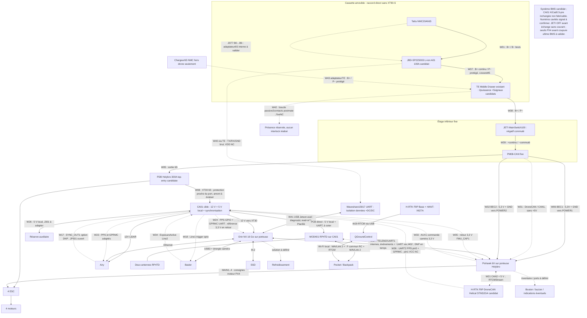

# Architecture électrique et réseaux

| Champ | Valeur |
|---|---|
| Référence | `DOC-ELEC` |
| Nature | document vivant |
| Dernière mise à jour | 5 octobre 2026 |
| Statut | architecture candidate ; schémas, faisceaux et qualifications **À valider** |

## 1. Objet

Ce document décrit l'énergie, l'électronique, les réseaux, les interfaces de
données et la synchronisation du système. Il porte la nomenclature électrique
et les essais d'interface. Les implantations sont décrites dans
[DOC-MEC](ARCHITECTURE_MECANIQUE.md), le logiciel dans
[DOC-SW](ARCHITECTURE_LOGICIELLE.md) et le fonctionnement global dans
[DOC-HLD](HLD.md).

## 2. Principes d'architecture

- PX4, ses capteurs de vol et ses failsafes restent indépendants du calculateur
  compagnon autant que possible.
- La charge utile possède un départ protégé distinct ; un défaut du Jetson ou
  d'un capteur ne doit pas faire chuter l'alimentation du contrôleur de vol.
- Les interfaces exposent tension, courant, puissance, débit, protocole,
  horloge, connecteur, blindage et comportement en défaut.
- Les masses électriques, protections et retours de courant sont conçus avec le
  faisceau, pas ajoutés après l'implantation mécanique.
- Les communications critiques ont une politique de perte explicite et testée.
- Une position RTK et une synchronisation temporelle sont deux fonctions
  distinctes.

## 3. Chaîne d'énergie candidate du cartographe

```text
Batterie 6S amovible → BMS JBD (CAO candidate Implémentée) → connecteur/coupure JETI → PM08-CAN
  ├─ OUT 6S → PDB Holybro 300A top-entry candidate → 4 ESC/moteurs
  │             └─ XT30 candidat → protection proche du départ → CA01 : 12 V calcul/LiDAR et 5 V auxiliaires/radio
  ├─ BEC1 5,3 V/3 A → POWER1 de la porteuse Pixhawk Jetson
  ├─ BEC2 5,3 V/3 A → POWER2 de la même porteuse
  └─ DroneCAN → CAN1 de la porteuse, sans injection de +5 V
Porteuse Holybro : Pixhawk 6X (FCU) + Jetson Orin NX 16 Go (compagnon).
Jetson alimenté séparément via XT30 depuis le 12 V calcul candidat.
```

Le PM08-CAN et la batterie restent des points communs : les deux entrées
POWER1/POWER2 protègent contre la perte d'un BEC ou d'une voie d'entrée
seulement après essais de bascule et d'absence de réalimentation. Les deux
BEC ne sont pas mis en parallèle. Le port CAN1 transporte les données batterie
séparément des entrées POWER ; ni le faisceau fourni ni son brochage ne sont
présumés compatibles sans contrôle contact par contact.

Cette chaîne est une architecture fonctionnelle **Planifiée**, pas un schéma
prêt à fabriquer. Calibres, fusibles, sections, connecteurs, références de
convertisseurs, masses et coupure restent **À valider**. Les 85 A sont une
réserve historique de dimensionnement issue d'un scénario plein régime,
pas un besoin continu démontré (§5.1). La cible de câblage V0.5 remplace V0.4 ;
le schéma CA01 V0.5-pre est migré partiellement, mais son PCB et la CAO ne le sont pas.

## 4. Domaines électriques

| Domaine | Source/convertisseur | Charges | Isolation et surveillance attendues |
|---|---|---|---|
| propulsion | batterie 6S et distribution | ESC/moteurs | courant fort, coupure, température et retour de courant |
| vol critique | deux BEC PM08-CAN vers POWER1/POWER2 séparés | Pixhawk et capteurs de vol | bascule sans reset, mesure batterie et absence de retour entre BEC |
| calcul | DC/DC 12 V candidat vers XT30 de la porteuse | Orin NX, SSD, ventilation et USB | fusible, transitoires, sous-tension, température et arrêt propre |
| perception | DC/DC ou rails qualifiés | Airy, Basler, synchronisation | bruit, courant de démarrage, masse et blindage |
| navigation/liaisons | rails qualifiés, dont 5 V local CA01 pour RP4TD | GNSS, récepteur RC, télémétrie | maintien du contrôle et comportement à la perte |
| station sol | alimentation indépendante | base RTK, radio, tablette/PC | autonomie, recharge et protection environnementale |

La batterie et le PM08-CAN en tête restent des éléments communs à toutes les
branches. La sélectivité des protections aval doit être démontrée par injection
de défauts ; aucune redondance de ces éléments communs n'est revendiquée.


### 4.1 Implantation avionique et interfaces à finaliser

La CAO du 16 septembre 2026 empile l'avionique sur les deux plateaux carbone
OEM. P06 porte les conversions et les modules auxiliaires ; P20 porte le
Pixhawk, avec cales, visserie et retenues. Les détails de fixation sont dans
DOC-MEC §4.4. Le modèle assure une implantation nominale et ne constitue pas
un faisceau prêt à câbler.

Le passage au-dessus du DC/DC est limité à 2,8 mm sous le plateau carbone,
2,2 mm sangle comprise. La définition des sorties latérales et des câbles est
donc un préalable au gel des références. Les cales et l'intercalaire ne suffisent
pas à démontrer l'isolation des vis traversantes ou des équipements vis-à-vis
du carbone conducteur.

| Interface | Action à réaliser | Condition de clôture |
|---|---|---|
| batterie → distribution | confirmer révision X650, pack, contacts et sections ; dimensionner protection et précharge sur profil de courant | schéma et bilan thermique revus, défauts et échauffement mesurés |
| PM08-CAN → porteuse Pixhawk Jetson | POWER1/POWER2 énergie séparée, CAN1 données batterie ; contrôler le faisceau réel | alimentation, bascule et mesure conformes sur banc, sans dépendance au Jetson |
| DC/DC → charge utile | sélectionner rails/références, connecteurs latéraux, protection et refroidissement | enveloppes fabricant substituées, marge électrique et thermique démontrée |
| Pixhawk/CA01 → Basler → Pixhawk | AUX1 commande Line1 ; retour ExposureActive Line2 vers FMU_CAP1 ; SYNC_OUT1 réservé | niveaux, fronts, délai et association image mesurés au banc |
| RC / télémétrie | choisir récepteur, radio, antennes et connecteurs ; vérifier accès et séparation des faisceaux | modèles réels intégrés, portée/CEM et comportements à la perte testés |
| GNSS / RTCM / PPS | candidat H-RTK DroneCAN Helical STM32G4 avec PPS UART2, Base inchangée | révision G4, niveaux, GPRMC, CAN2/RTCM et chaîne temporelle vérifiés |
| carbone / mécanique | définir rondelles, isolants, fixation des masses et prévention du frottement | continuité/isolement et inspection après vibration et traction |

### 4.2 Cahier des charges de la carte avionique commune CA01

Décision du 24 septembre 2026 : la cible V0.5 associe la
[Pixhawk Jetson Baseboard Holybro](https://holybro.com/products/pixhawk-jetson-baseboard?variant=44636223602877),
un [Pixhawk 6X module seul](https://holybro.com/products/pixhawk-6x?variant=44390763692221)
et un [Jetson Orin NX 16 Go](https://www.arrow.com/en/products/900-13767-0000-001/nvidia.html).
Le [PM08-CAN](https://holybro.com/products/dronecan-pm08-power-module-14s-200a?variant=44052276609213)
reste externe et fixé au châssis. BEC1 alimente POWER1 ; BEC2 alimente POWER2.
CA01 retrouve un convertisseur 5 V local protégé pour radio, auxiliaires et
synchronisation. Les convertisseurs 12 V et la régulation 3,3 V restent
**Planifiés**. Le schéma KiCad est en migration préliminaire vers cette cible V0.5 ;
il reste non raccordable et non fabricable. La CAO conserve l'ancienne implantation.

Le projet d'étude est
[CA01_Avionique.kicad_pro](../../hardware/electronique/cartographe/carte_avionique/CA01_Avionique.kicad_pro).
Le premier schéma n'est ni un dossier de fabrication ni une carte testée.
L'intégration mécanique de la porteuse et de CA01 reste **À valider** dans
DOC-MEC. La [PDB Holybro 300A top-entry SKU 18138](https://holybro.com/products/power-distribution-board-pdb-300a-top-entry)
est présélectionnée comme distribution passive en aval du PM08-CAN : six XT90,
deux XT30 et des bornes de puissance sont annoncés. Un XT30 est candidat pour
le départ 6S W08 vers CA01, avec protection de branche à placer au plus près
du port. Le tronçon PDB/XT30 en amont de cette protection reste exposé
au courant de défaut batterie : sa longueur, son isolement et sa tenue
doivent être justifiés avant fabrication. Aucun contact de signal, fusible, régulateur ou calibre propre à ce XT30 n'est
documenté ; la capacité annoncée de 300 A pour la PDB ne relève pas la limite
de 200 A continus annoncée pour le PM08-CAN placé en série.

#### 4.2.1 Périmètre et frontières électriques

- La propulsion conserve sa distribution et son faisceau : aucun courant
  moteur ni chemin principal batterie ne traverse CA01.
- Le PM08-CAN est en série entre batterie et PDB candidate. Ses BEC 5,3 V/3 A
  desservent exclusivement les deux entrées d'alimentation du Pixhawk sur la
  porteuse Holybro ; ils ne fournissent ni CA01 ni le Jetson.
- Un départ 6S protégé en aval du PM08-CAN fournit les conversions 12 V et
  le 5 V local CA01. Le RP4TD est alimenté depuis ce 5 V, avec protection
  et budget propres ; son UART rejoint directement le Pixhawk. Sa commande
  ne dépend ni du PC ni du Jetson. Une panne du 5 V CA01 peut néanmoins
  faire perdre la radio : le comportement PX4 correspondant est à tester.
- Ethernet Airy et USB3 Basler restent liés au Jetson ; l'interface de
  déclenchement Basler n'est pas une entrée d'alimentation de la caméra.

La liste fonctionnelle des interfaces externes de CA01 peut être fixée dès
maintenant. Les repères Jxxx ci-dessous désignent les connecteurs logiques
du schéma en cours de migration ; leur référence physique, leur orientation et
leur empreinte restent à fixer pour la cible V0.5.

| Sens vu de CA01 | Interface cible | Repère logique et liaisons | État de définition |
|---|---|---|---|
| Entrée puissance | XT30 candidat PDB → J103 via protection 6S | J103:1 = VBAT_PAYLOAD, :2 = GND ; W08 | polarité, tronçon amont, protection et calibre **À valider** |
| Entrée GNSS candidate | Helical G4 UART2 TX/PPS/GND | W36 ; J503 logique, GNSS pins 3/5/6 ; pin1 +5 V non raccordé | version STM32G4 requise, S32K1 pin5 NC ; niveaux et GPRMC **À valider** |
| Sorties de temps candidates | PPS/GPRMC adaptés vers Airy et Orin | W23/W24 ; J504 Airy, J505/J506 Orin logiques ; broches fabricant selon §4.3 | conversion série Airy, fan-out, protection, pinmux et masse **À valider** |
| Entrée commande caméra | AUX1 Pixhawk et GND | W33 ; J507 logique ; FMU PWM OUT pin2 3,3 V, pin10 GND | fonction PX4, groupe timer et protection **À valider** |
| Entrée optionnelle | SYNC_OUT1 Airy et retour | J501:1 = AIRY_SYNC_RAW, :2 = GND ; W17 | impulsion angulaire non caractérisée ; JP501 ouvert |
| Module radio direct | 5 V/GND RP4TD et UART | MOD401:1 = 5V_RADIO, :2 = GND, :3 = RP_TX, :4 = RP_RX ; sans W11/J401 | contacts physiques et montage **À valider** |
| Entrée/sortie contrôleur | UART radio Pixhawk | J402:1 = GND, :2 = FC_RX_RF, :3 = FC_TX_RF ; W12 | port et TX/RX **À valider** ; pas d'alimentation Pixhawk |
| Sortie puissance | 12 V calcul vers XT30 Jetson | J104:1 = 12V_COMPUTE, :2 = GND ; W09 | conversion et courant **À valider** |
| Sortie puissance | 12 V Airy | J201:1 = 12V_LIDAR, :2 = GND ; W10 | conversion et faisceau **À valider** |
| Sortie réservée | 5 V auxiliaire local | J301:1 = 5V_AUX, :2 = GND ; W26 | protection et budget avant emploi |
| Sortie/entrée caméra | Line1 trigger et Line2 ExposureActive | J502 logique : pin2 Line1, pin3 retour opto, pin4 Line2, pin6 GND GPIO ; W18/W34 | pin1 et pin5 NC ; masses pin3/pin6 distinctes, Q501/U509 réels candidats depuis30/09 ; séquencements et banc ouverts |
| Sortie capture | retour ExposureActive vers Pixhawk | W35 ; J508 logique ; AD&IO pin2 FMU_CAP1, pin8 GND | seuil 3,3 V, rappel, polarité et pilote **À valider** ; CAP1 non partagé avec PPS |

Le 3V3_SYNC est un rail interne de CA01, pas une sortie affectée au
faisceau. J101/5V2_FLIGHT appartenait au schéma historique V0.3 et a été
retiré de l'ébauche migrée. POWER1, POWER2 et CAN1 du PM08-CAN, CAN2 GNSS,
TELEM2 interne, Ethernet Airy et USB3 Basler contournent CA01. Ses
signaux de temps et de caméra sont des adaptations de charge utile ;
leur perte ne commande aucun moteur. Les connecteurs nouveaux restent
à définir et le schéma V0.5-pre n'est pas fabricable.

Les protections, retours de masse et risques de réalimentation par UART, USB,
CAN ou I²C doivent être contrôlés sur le faisceau et sur la porteuse. Les deux
BEC partagent batterie et PM08-CAN : aucune redondance de ces éléments communs
n'est revendiquée. PX4 garde seul l'autorité sur les moteurs.

#### 4.2.2 PM08-CAN, porteuse et affectation des faisceaux

Le PM08-CAN, fixé au châssis près de la distribution, remplace le PM02D dans
la cible. Le fabricant annonce 200 A continus, 400 A pendant 1 s à 25 °C
et deux BEC indépendants de 5,3 V/3 A chacun ; ces valeurs ne qualifient ni
connecteurs, ni faisceau, ni tenue thermique installée. Son enveloppe
45 × 41 × 26 mm hors câbles est représentée dans la maquette système
inactive du 3 octobre. Sa masse de 185 g câbles inclus est inscrite dans
la BOM cible ; la réconciliation du bilan et les fixations restent **À valider**.

| Voie fonctionnelle | Destination | Contrainte |
|---|---|---|
| BEC1 PM08-CAN, +5,3 V et GND | porteuse POWER1, contacts +5 V 1/2 et GND 5/6 | 3 A maximum annoncés ; contacts et orientation à contrôler |
| BEC2 PM08-CAN, +5,3 V et GND | porteuse POWER2, contacts +5 V 1/2 et GND 5/6 | voie distincte, sans pont avec POWER1 |
| CAN-H, CAN-L et GND PM08-CAN | porteuse CAN1, contacts 2, 3 et 4 | CAN1 contact 1 (+5 V OUT) non raccordé au PM |
| 6S hors BEC | PDB candidate XT30 → protection proche du port → CA01 ; tronçon amont à évaluer ; 12 V calcul vers XT30 de la porteuse | distinguer les deux XT30, polarité, courant, protection et connecteurs à dimensionner |

Sur la porteuse, POWER1 et POWER2 sont des connecteurs à six contacts :
1/2 = +5 V, 3/4 = I²C SCL/SDA, 5/6 = GND. CAN1 est un connecteur distinct
à quatre contacts : 1 = +5 V OUT, 2 = CAN-H, 3 = CAN-L, 4 = GND.
**Ne jamais raccorder directement les six fils d'un port combiné PM08-CAN
à POWER1 ou POWER2 : CAN-H/L ne doivent pas atteindre SCL/SDA.**
Les numéros des contacts côté PM et le contenu du faisceau livré restent
**À valider** sur la révision reçue. Si le faisceau ne sépare pas énergie
et CAN avec ces correspondances, produire un adaptateur documenté,
détrompé et vérifié avant branchement. Les deux BEC ne sont jamais
mis en parallèle ; vérifier également l'absence de retour vers CAN1 +5 V.

CAN1 est réservé au PM08-CAN ; allocation GNSS et terminaisons du bus
restent à fermer. La paire CAN est torsadée ; les résistances de 120 Ω
doivent se trouver aux deux extrémités seulement, après contrôle de celles
présentes sur les modules. La mesure batterie vient de DroneCAN, pas
de POWER1/POWER2 I²C. Configuration PX4, étalonnage tension/courant et
comportement à la perte CAN sont **À valider**.

La Jetson Baseboard a une entrée d'alimentation XT30 distincte pour le
module Jetson. Le 12 V calcul est un candidat dans la plage annoncée
7–21 V du produit ; la révision exacte, les appels de courant, le SSD,
la caméra USB et le refroidissement doivent être mesurés avant gel.
Aucun des BEC 3 A du PM n'alimente cette entrée.

Sources : [fiche PM08-CAN](https://holybro.com/products/dronecan-pm08-power-module-14s-200a?variant=44052276609213),
[brochage Pixhawk Jetson Baseboard](https://docs.holybro.com/autopilot/pixhawk-baseboards/pixhawk-jetson-baseboard/ports-pinout),
[fiche de la porteuse](https://holybro.com/products/pixhawk-jetson-baseboard?variant=44636223602877),
[configuration DroneCAN/PX4](https://docs.holybro.com/power-module-and-pdb/power-module/dronecan-power-module-setup).

#### 4.2.3 Rails et conversion proposés

L'entrée est une LiPo 6S, 22,2 V nominal et 25,2 V pleine charge. Les 19,8 V
utilisés dans le bilan sont un point de calcul, pas un seuil de coupure fixé.
La plage minimale, les transitoires admissibles et la protection amont sont
**À valider** avant de choisir définitivement les composants. La tension maximale
d'une puce n'est pas la tenue de l'ensemble condensateurs, MOSFET et connecteurs.

| Rail candidat | Charge et capacité de travail | Définition V0 et réserves |
|---|---|---|
| `5V3_POWER1` / `5V3_POWER2` | deux BEC PM08-CAN indépendants, 3 A annoncés chacun, vers POWER1/POWER2 de la porteuse | aucun parallèle ; consommation Pixhawk et bascule à mesurer ; ancien label KiCad `5V2_FLIGHT` historique |
| `12V_COMPUTE` | convertisseur candidat 12 V/6 A vers XT30 porteuse Jetson ; Orin NX, SSD, ventilation et USB inclus | LM5146-Q1 réel et passifs candidats depuis le 30/09 ; boucle, Ceff, charges et protections à valider (§4.2.6) |
| `12V_LIDAR` | cible calculée 12 V/3 A, au moins 2 A requis au démarrage Airy | LM76003 réel, L/C/FB candidats calculés ; stabilité, thermique et démarrage à valider |
| `5V_AUX` cible | DC/DC 5 V/3 A total local CA01 ; RP4TD, synchronisation et réserve J301 sans charge affectée | U301 LM76003 et passifs candidats calculés ; budget réel, protection et implantation à fermer |
| `3V3_SYNC` / alimentation trigger | 5 V CA01 via F501 et TPS7A20 ; budget 3,3 V provisoire 50 mA | régulateur et adaptation trigger/capture réels candidats ; niveaux, thermique et séquencements à valider |

La porteuse Holybro Pixhawk Jetson possède une entrée XT30 dédiée au Jetson.
La fiche produit annonce 7–21 V pour cette entrée ; la révision livrée et la
limite réelle du connecteur doivent être contrôlées. Le 12 V est un point de
conception candidat, sans validation du convertisseur 6 A ni de la consommation
Orin NX + USB Basler + SSD + refroidissement. Les limites de l'ancien kit
Orin Nano ne sont pas transférables à cette porteuse.
[Spécification Holybro](https://holybro.com/products/pixhawk-jetson-baseboard?variant=44636223602877).

L'Airy accepte 9–32 V, consomme 8 W typiques et son dépannage fabricant demande
une source capable d'au moins 2 A à 12 V : la puissance typique seule ne
suffit pas pour dimensionner le démarrage.
[Manuel RoboSense Airy, spécifications et dépannage](https://robosense-robotics.github.io/product-manual/en/Airy/).

Deux familles TI servent de bases de conception, sans qualification du circuit
CA01 :

- [LM5146-Q1](https://www.ti.com/product/LM5146-Q1), contrôleur buck avec
  MOSFET externes : l'[EVM 12 V/8 A](https://www.ti.com/tool/LM5146-Q1-EVM12V)
  documente une entrée 15–85 V et un fonctionnement 400 kHz, avec EN/UVLO,
  soft-start et PGOOD. Cette référence aide à établir le 12 V calcul ; la V0
  reprend depuis le 30/09 un étage de puissance et une compensation candidats ;
  stabilité, capacités effectives, MOSFET et routage restent à valider.
- [LM76003](https://www.ti.com/product/LM76003), buck intégré 3,5–60 V/3,5 A,
  avec compensation interne : conservé comme candidat pour le rail Airy ; U301
  est repris dans le schéma V0.5-pre pour le 5 V CA01 ; les passifs de puissance,
  protections et budgets restent à fermer.
  L'[EVM](https://www.ti.com/tool/LM76003EVM-500K) documente 3,3/5 V ; son
  passage à 12 V nécessite de recalculer inductance, capacités, feedback,
  courant limite et comportement thermique. Le symbole réel dans l'ébauche
  et les calculs candidats du §4.2.6 ne valent pas qualification matérielle.

Tolérances, ondulation, chute transitoire, ordre de démarrage, seuils UVLO,
protection inversion/surtension et limitation d'appel doivent être chiffrés
avant revue de fabrication. Prévoir EN/PGOOD et points de mesure accessibles
sans leur attribuer une action logicielle de vol non spécifiée.

#### 4.2.4 Radio et adaptation de synchronisation

La feuille `04_radio.kicad_sch` (page 3 du PDF) est reprise graphiquement
le 30 septembre 2026 : port Pixhawk et arrivée 5 V à gauche, module radio
à droite, voies UART reliées par des fils directs et sens aller/retour
explicites. Les symboles MOD401/J402 sont agrandis pour afficher les fonctions
des broches ; les condensateurs sont regroupés près du module MOD401. Valeurs,
numéros de broches, connexions et DNP sont conservés (DOC-VAL §12.7.3).
La guideline schématique place autant que possible les entrées à gauche
et les sorties à droite ; les symboles d'IC doivent être agrandis lorsque
leur densité nuit à la lecture.

Le RP4TD est alimenté par le 5 V local CA01, sa fiche annonçant 4,5–12 V.
Sa consommation et les niveaux électriques de TX/RX restent à confirmer.
L'ébauche représente les interfaces série candidates ; une éventuelle
adaptation de niveau, la protection ESD et la prévention des courants lorsque
l'un des équipements est hors tension restent à définir. Le connecteur et le
port Pixhawk retenus doivent préserver la liaison locale avec le Jetson.
Les résistances série R401/R402 sont DNP (non montées) par défaut ; les monter seulement après validation des niveaux et de la réalimentation hors tension. La fonction RF/MAVLink et ses limitations restent celles du §7.4.

La voie de déclenchement Basler V1 part de la sortie Pixhawk
**FMU PWM OUT AUX1**. CA01 la protège et l'adapte au courant de
l'entrée optocouplée **Line1 M8 pin2**, avec **pin3 retour opto**.
Le PMV30UN2 Q501 remplace le bloc U508 depuis le 30/09, avec grille
330 Ω et rappel 100 kΩ (§4.2.6). Le MMBT3904 de l’ancienne V0.3 est historique.
Courant opto, fronts et séquencements restent à mesurer ; aucun 5 V ne doit
revenir vers la sortie 3,3 V du Pixhawk.

La Basler fournit un retour `ExposureActive` sur **Line2 M8 pin4**
configurée en sortie, avec **pin6 GND GPIO** distinct du pin3.
CA01 comporte un circuit candidat de polarisation, protection DC et adaptation
3,3 V par SN74LVC1G17 U509 (§4.2.6) vers
**AD&IO FMU_CAP1 pin2/GND pin8**. Line2 est à collecteur ouvert ;
rappel, inversion, délai, front et correspondance Frame ID sont
**À valider**. Les pins4/6 de J502, NC dans l'ancienne V0.3,
sont représentées dans la netlist V0.5-pre. La
commande seule ou la réception USB ne datent pas l'exposition réelle.

`SYNC_OUT1` Airy reste optionnel sur J501, **JP501 ouvert/DNP** :
la sortie est angulaire et ses caractéristiques électriques ne
sont pas suffisamment établies pour commander la caméra V1.
CA01 doit aussi recevoir le PPS et le GPRMC du GNSS G4, tamponner
les sorties Airy/Orin et adapter le niveau série Airy après mesure.
Ces circuits GNSS sont désormais **Implémentés** en composants physiques
candidats dans la feuille `05_synchronisation.kicad_sch` (§4.2.6).
R530–R533 restent DNP ; niveaux OEM, interfaces et matériel sont **À valider**.
Cette réalisation schématique ne rend pas la carte fabricable.

Sources d'interface :
[Basler a2A4096-30ucBAS](https://docs.baslerweb.com/a2a4096-30ucbas),
[entrées optocouplées Basler](https://docs.baslerweb.com/a2a4096-30ucbas#opto-coupled-io-input-line),
[RP4TD](https://radiomasterrc.com/products/rp4td-expresslrs-2-4ghz-diversity-receiver).

#### 4.2.5 Exigences et recette

Les exigences suivantes portent les fonctions attendues. Leurs réalisations
sont **Planifiées** et leurs résultats **À valider** ; les seuils non définis
ci-dessous doivent être fermés avant l'essai, pas choisis après mesure.
Les protocoles et résultats sont centralisés dans
[DOC-VAL](../VALIDATION_QUALIFICATION.md), sous `T-CA01-01..12`.

| Exigence | Composant et critère d'acceptation | Test | Résultat |
|---|---|---|---|
| `CARTE-001` séparation de propulsion | connecteurs/nets CA01 : aucun chemin de courant moteur ; mesure globale PM08-CAN/DroneCAN hors CA01 explicitée | `T-CA01-01` revue schéma, netlist et faisceau | **À valider** |
| `CARTE-002` maintien du vol | défaut d'une branche charge utile isolé sans reset Pixhawk ; si le 5 V radio CA01 est perdu, détecter la perte RC et vérifier le repli PX4 ; sélectivité mesurée | `T-CA01-02` défauts et transitoires sur banc limité | **À valider** |
| `CARTE-003` entrée 6S protégée | inversion, surtension, appel capacitif et sous-tension : enveloppe et seuils chiffrés puis respectés | `T-CA01-03` rampe, démarrage et perturbations d'entrée | **À valider** |
| `CARTE-004` alimentation calcul | 12 V/6 A cible du buck, respect de la limite d'entrée porteuse, charge réelle stable et température admissible | `T-CA01-04` charge statique/dynamique, démarrage Jetson/USB/SSD | **À valider** |
| `CARTE-005` alimentation LiDAR | source 12 V capable d'au moins 2 A, démarrage sans boucle de reset et fonctionnement Airy stable | `T-CA01-05` démarrages et acquisition à chaud | **À valider** |
| `CARTE-006` rails auxiliaires | 5 V CA01 local protégé depuis 6S ; budgets 5 V/3,3 V fermés, plages des charges respectées, aucun retour vers POWER1/2 | `T-CA01-06` charges, défaut et séquences marche/arrêt | **À valider** |
| `CARTE-007` alimentation et mesure vol | PM08 externe, POWER1/POWER2 séparés, CAN1 distinct ; deux budgets 5,3 V ≤3 A, bascule sans reset, capteurs de vol essentiels surveillés, absence de retour et calibration vérifiés | `T-CA01-07` et `T-PM-V05-01/02/05/06`, DOC-VAL §12.7 | **À valider** |
| `CARTE-008` radio autonome du calcul | niveaux UART conformes, commande RC et QGC opérationnels avec Jetson arrêté ; alimentation radio stable | `T-CA01-08` interfaces et renvoi `T-RF-01..06` | **À valider** |
| `CARTE-009` temps et caméra | AUX1→CA01→Line1, ExposureActive Line2→CA01→FMU_CAP1 et PPS/GPRMC vers Airy/Orin ; niveaux, courant, fronts et Frame ID mesurés | `T-CA01-09` et `T-AIRY-SYNC-01` | **Planifié / À valider** |
| `CARTE-010` intégration mécanique | contour, hauteur, fixations, masse, isolation carbone et connecteurs accessibles validés dans SA03 réel | `T-CA01-10` CAO, montage et inspection | **À valider** |
| `CARTE-011` thermique et perturbations | composants sous limites avec marge définie ; GNSS/radio/capteurs sans perturbation invalidante, pertes et bruit mesurés | `T-CA01-11` charge simultanée, CEM et essais moteurs progressifs | **À valider** |
| `CARTE-012` dossier reproductible | schéma, BOM, empreintes et netlist cohérents, aucune valeur ouverte pour fabrication, ERC/DRC expliqués et revue indépendante | `T-CA01-12` contrôle des artefacts et revue | **À valider** |

La qualification doit suivre simulation/analyse, alimentation limitée, banc
sans hélices et progression DOC-VAL. Aucun essai de vol, carte assemblée ou
résultat thermique n'est revendiqué par l'existence du schéma.

#### 4.2.6 Outillage et limites du premier schéma

Le [schéma PDF complet CA01](../../hardware/electronique/cartographe/carte_avionique/CA01_Avionique.pdf)
est exporté directement depuis le projet KiCad et placé à côté de ses sources
pour faciliter son accès. Il comprend six pages ; sa copie dans `verification`
reste identique ; provenance actuelle DOC-VAL §12.7.10, exports et retouches
antérieurs conservés aux §12.7.4–12.7.9.

**Convention graphique — 1 octobre 2026.** La page 2 (`01_energie_pm`)
sépare la protection d'entrée du convertisseur calcul. Le symbole U101
(LM74800) est agrandi : mesures A/VSNS et diviseurs UVLO/OV à gauche,
DGATE et pompe de charge au-dessus, OUT et HGATE à droite. Les MOSFETs
restent sur un chemin de puissance horizontal ; R105/C104 et les
condensateurs C101–C105 sont reliés directement, sans labels locaux.
La broche RTN13 reste non connectée. Le symbole U102 est
agrandi ; ses réseaux FB/COMP, bootstrap et commande de grille restent
filaires, avec les passifs à proximité et la sortie à droite. Sur les cinq
sous-feuilles, les rails utilisent `Alimentation_Barre`, avec tige verticale
et barre horizontale en haut, et les masses le symbole KiCad GND. Les noms
globaux et les retours distincts, dont `BASLER_OPTO_RETURN`, sont conservés.
Trois indicateurs de puissance identifient les sources physiques après
L101 (12V_COMPUTE), L301 (5V_AUX) et F102 (5V_RADIO), sans masquer les
contrôles ERC. Cette reprise graphique ne change ni les valeurs ni les
connexions électriques ; recette et preuves : DOC-VAL §12.7.4.

Le [pont KiCad](https://github.com/mixelpixx/KiCAD-MCP-Server) est installé
localement sous `.runtime/kicad-mcp`, sur le commit
`ac716d1a8bfad325b4aa93a398222645b3f78fd7`. Le test historique Windows amd64
avec KiCad 10.0.6 a vérifié l'inventaire de 233 outils, une création/relecture
de projet factice et l'export d'une netlist ; preuve :
`hardware/electronique/cartographe/verification/kicad_mcp_probe_20260915.json`.
Ce résultat concerne l'outillage et ne qualifie pas CA01.

La migration **V0.5-pre** est **Implémentée** sous KiCad 10.0.6
(Windows amd64), avec une racine et cinq feuilles fonctionnelles compactes.
Le dimensionnement du 29–30 septembre 2026 ajoute les circuits réels
ci-dessous, avec références complètes visibles dans le schéma. Les connexions
locales restent réalisées par fils suivant la
[skill HW Design schématique](../../.agents/skills/hw-design-schematique/SKILL.md).
Le PCB contient depuis le 1 octobre le placement mécanique (§4.2.8) et
un démarrage du routage avec plans et vias thermiques (§4.2.9–4.2.11).
La carte demeure **À valider**, non fabricable et non raccordable.

Les hypothèses de calcul sont VIN = **18–25,2 V**, capacités de sorties
12V_COMPUTE **6 A**, 12V_LIDAR **3 A**, 5V_AUX **3 A au total**. Elles restent
candidates : le plancher 18 V n'est pas un seuil de sécurité batterie PX4,
et la somme 123 W représente des capacités de rails, pas la consommation
mission. À rendement supposé 90 %, cela représente 7,59 A à 18 V pour
le départ W08. Les appels, profils réels, transitoires et températures sont ouverts.

| Fonction | Références et valeurs candidates | Résultat / limite |
|---|---|---|
| Protection entrée U101 | LM74800QDRRRQ1, Q101/Q102 CSD19531Q5A en drain commun ; CAP 220 nF/50 V avec Ceff ≥100 nF ; bulk 33 µF/100 V EEE-FK2A330P | RTN13 flottant ; contrôleur sans limitation de surcourant ; SOA sous charge et TVS **à concevoir/valider** |
| UV/OV entrée | UV 100 kΩ/8,06 kΩ ; OV 100 kΩ/4,42 kΩ, 0,1 % | UV typ. 16,50/15,18 V ; OV typ. 29,08/26,70 V, récupération minimale calculée 25,70 V incluant tolérances/fuite ; permet le réarmement à 25,2 V dans ces hypothèses |
| Appel entrée | HGATE 100 Ω et 10 nF ; capacité aval totale supposée ≤300 µF | rampe typ. 4,58 ms à 25,2 V, appel capacitif seul 1,65 A typ./2,50 A au coin Ig/C ; ne couvre pas démarrage des bucks sous charge |
| Calcul U102 | LM5146QRGYRQ1, Q103/Q104 CSD19531Q5A ; XAL1010-682MED 6,8 µH ; 400 kHz/24,9 kΩ ; FB 21 kΩ/1,50 kΩ | 12 V/6 A cible ; bootstrap 100 nF via 2,2 Ω, VCC 2,2 µF ; shunt 10 mΩ Y14880R01000B9R ±0,1 % /15 ppm/K /3 W (§4.2.9), ILIM 750 Ω ; boucle/courant limite/thermique à fermer |
| Capacités calcul | entrée 5×4,7 µF/100 V, sortie 5×22 µF/25 V, X7R1210 | Ceff sortie ≥60 µF hypothèse ; exemple 4 A/20 µs/0,5 V demande 160 µF : réponse transitoire non démontrée |
| Compensation calcul | base TI EVM : 8,06 kΩ + 4,7 nF série COMP→FB, 100 pF parallèle ; 51,1 Ω + 1 nF VOUT→FB | point de départ ; MOSFET/Ceff/charges diffèrent, Bode et transitoires obligatoires |
| LiDAR U201 | LM76003RNPR ; L201 15 µH XAL1010-153MED ; C203 100 µF/25 V 25SVPF100M (ESRmax24 mΩ), C208 470 pF C0G | Icrête max. calculée 3,60 A < limite HS minimale 4,35 A ; Cmin TI eq.23 =28,83 µF, disponible au −20 %=80 µF ; marge conditionnelle |
| Auxiliaire U301 | LM76003RNPR ; L301 6,8 µH XAL1010-682MED ; C303 120 µF/10 V 10SVPC120MV (ESRmax22 mΩ), C308 360 pF C0G | Icrête max. calculée 3,84 A <4,35 A ; Cmin TI =82,14 µF, disponible au −20 %=96 µF ; marge conditionnelle |
| Passifs LM76003 | Cin 2×10 µF/50 V X7R +47 nF ; BOOT470 nF/25 V ; VCC2,2 µF/25 V ; BIAS1 Ω/1 µF50 V | exiger Cin total effectif ≥10 µF ; courbes DC bias/température/vieillissement à vérifier ; RT/SS ouverts, MODE GND autorise PFM |
| Feedback LM76003 | 90,9 kΩ/8,32 kΩ et 39,7 kΩ/10 kΩ, 0,1 %, 25 ppm/K candidats | PWM : 11,69–12,21 V et 4,876–5,085 V, ΔT≤100 K/VFB/Ibias inclus ; décalage PFM +2 % **typique**, pas borne garantie |
| Régulation U503 | TPS7A2033PDBVR ; CIN/COUT4,7 µF10 V X7R, Ceff≥0,47 µF | budget50 mA, VOUT3,2505–3,3495 V ; P≈0,100 W à5,25 V ; hausse≈18,7 °C estimée sur PCB TI de référence |
| Trigger Basler Q501 | PMV30UN2, grille330 Ω, rappel100 kΩ | Line1 pin2 alimentée5V_SYNC, pin3 retour opto commuté, distinct de GND GPIOpin6 ; >5 mA requis, <15 mA interne annoncé ; fronts à mesurer |
| Capture Basler U509 | SN74LVC1G17DBVR ; rappel1 kΩ via BAT54H ; entrée4,7 kΩ/0,25 W + BZT52H-C4V7 ; sortie1 kΩ | protection DC24 V candidate, R≈80 mW en positif ; pas qualification ESD ; absence de réalimentation Pixhawk éteint non démontrée |
| Fusibles | F10110 A sans référence fixée ; F102 SF-0603F100-2 1 A ; F501 SF-0603F040-2 400 mA | calibres candidats ; Icc/pouvoir de coupure DC, derating, appels et sélectivité à fermer ; protection W08 près PDB obligatoire |

La capacité d'inductance sous courant/température et Isat typique constructeur
ne sont pas des garanties sur toute l'enveloppe. Les calculs LM76003 couvrent
f=440–560 kHz et L±20 %, pas une simulation de boucle. Les pertes de
commutation, la dissipation sur le PCB réel et la CEM restent ouvertes.
Le magasin Holybro indique 7–21 V pour la baseboard, la documentation
7–24 V : relever la révision livrée avant de figer son enveloppe ; 12 V reste candidat.

**Allocation 5 V.** W26/J301 est une **réserve sans charge affectée** dans
le câblage du drone. Les 3 A sont partagés entre radio, synchronisation et
cette réserve. Réservation provisoire : radio0,50 A (courant non publié),
sync0,08 A, reste2,42 A théorique ; les charges et pointes doivent être mesurées
avant usage. Le GNSS reste alimenté sur CAN2 ; J503pin1 +5 V demeure NC.
F501 ne garantit pas une coupure sélective si le LDO limite un défaut sous
son calibre ; une perte du5 V radio impose le repli RC PX4 prévu.

**Temps physique candidat — 30 septembre 2026.** Les anciens blocs GNSS
sont remplacés par des composants et brochages physiques **Implémentés** ;
le matériel demeure **À valider**. U512/U513 SN74LVC1G17DBVR conditionnent
respectivement PPS/TX : protection TPD1E05U06 vers GND avant résistance
série 330 Ω, rappel 22 kΩ vers GND, sans pull-up alimentant le GNSS.
U504/U505/U507/U511 SN74LVC1T45DBVR distribuent les signaux de A vers B
(DIR au rail VCCA) : PPS Airy, PPS Orin, GPRMC Orin et DIN1 RS232 Airy.
VCCA est `3V3_SYNC` ; VCCB suit `5V_AIRY_IO` pour Airy ou la référence
OEM `3V3_ORIN_IO_REF` pour Orin. Leur isolation est spécifiée avec le rail
à GND ; référence flottante, transitoires et domaines internes des appareils
restent à tester.

| Voie / composant | Réalisation candidate | Limite à valider |
|---|---|---|
| Source GNSS | J503/W36 pin3 TX, pin5 PPS, pin6 GND ; pin1 +5 V NC | 3,3 V nominal, VOH≥2,9 V et VOL≤0,4 V supposés d'après u-blox ; sortie Holybro exacte non garantie |
| Entrées U512/U513 | 330 Ω série / 22 kΩ GND, Schmitt G17, TVS TPD1E05U06 en amont | G17 revY : VT+max1,92 V à3 V et2,74 V à4,5 V ; borne2,74 V à3,3 V candidate par monotonie, sans garantie ni interpolation ; ESD système à tester |
| Rail Airy U510 | TPS70950DBVR depuis12V_LIDAR vers5V_AIRY_IO ; EN flottant autorisé par TI ; C514/C51510 µF/25 V X7R1206 | 4,89–5,11 V, budget25 mA ; ambiante60 °C/VIN12,6 V donne environ101 °C de jonction avec modèle JEDEC, pas preuve PCB |
| PPS Airy U504 | translation vers5V_AIRY_IO, R53047 Ω puisJ504 | charge candidate≤12 mA avant câble ; courant réel, niveau≥3 V et front à mesurer |
| GPRMC Airy U511/U506 | translation DIN1 puisTRS3232EIDR alimenté5V_AIRY_IO ; R53147 Ω puisJ504 | UART repos haut devient RS232 négatif ; compatible Airy selon interface RS232 principale, révision réelle à vérifier |
| Pompe U506 | quatre1 µF/25 V ; Ceff minimale100 nF/470 nF/470 nF/470 nF ; C520bypass2,2 µF/25 V X7R, Ceff≥1 µF, plus100 nF | DC bias/température/vieillissement à fermer ; valeurs effectives et implantation conditionnent fonctionnement/ESD |
| Orin U505/U507 | PPS/GPRMC logiques ; R532/R533100 Ω ; J509 reçoitCamera0 ou1 pin22VDD3,3 V etpin1GND, rappel10 kΩ de référence versGND | confirmer que cette référence suit réellement les domainesGPIO/UART ; +5 V des portsGPIO/Debug exclu ; pinmux et cible éteinte à tester |

R530–R533 demeurent **DNP pour le banc** ; J501/JP501 et R401/R402
restent DNP. Le rail Airy dépend du départ LiDAR, mais les séquences
UVLO, réserves capacitives et courants vers les appareils éteints restent
à mesurer. La protection TVS d'entrée puissance, Ceff, PCB, connecteurs
et validation d'interface restent ouverts ; `manufacturing_ready=false`.
Le §12.7.2 de DOC-VAL définit la recette de vérification de ce lot.
La [revue indépendante](../../hardware/electronique/cartographe/carte_avionique/verification/synchronisation_revue_20260930.json)
conserve un résultat préliminaire : topologie conforme, niveaux OEM et banc ouverts.

Les calculs et valeurs sont dans [dimensionnement.json](../../hardware/electronique/cartographe/carte_avionique/dimensionnement.json),
la [BOM candidate](../../hardware/electronique/cartographe/carte_avionique/bom_candidate.json)
et l'[inventaire des sources archivées](../../hardware/electronique/cartographe/sources_fabricants/manifest_sources.json)
(29 PDF selon le [contrôle des sources](../../hardware/electronique/cartographe/carte_avionique/verification/sources_controle_20260930.json), plus documentation web). Les datasheets TI, Coilcraft,
Panasonic, Nexperia, Bourns et Vishay sont conservées. Le catalogue TDK historique
est un miroir DigiKey identifié ; ordre actuel et courbes des variantes à fermer.

Le [contrôle statique](../../hardware/electronique/cartographe/carte_avionique/verification/controle_statique.json)
porte désormais sur 151 composants/111 réseaux et **230 invariants** ;
ERC **0 erreur, 0 avertissement selon configuration du projet**, et
[44 contrôles analytiques](../../hardware/electronique/cartographe/carte_avionique/verification/calculs_reproduits.json)
conformes. Trois contrôles de conservation du lottemps sont portés par
[conservation_sync_20260930.json](../../hardware/electronique/cartographe/carte_avionique/verification/conservation_sync_20260930.json)
et la recette `verify_sync_preservation.py` : comparer les connexions
avant/après le lottemps selon les critères consignés dans cette preuve.
Les indicateurs de puissance déclarent les sources physiques :
entrée6S/GND, nœuds après FET/filtreVIN, BIAS via VOUT/R, 5V_SYNC viaF501, référenceCSI Orin surJ509 et
12V_LIDAR aprèsL201 pourU510 (#FLG503).
Ils renseignent le modèle ERC et ne qualifient pas les protections.
Les contrôles ERC ignorés du projet sont consignés dans la preuve ;
les empreintes exigent une revue fabricant distincte, notamment TI Q5A des FET.
La preuve de reprise compacte 53composants/51réseaux/22invariants/4erreurs
est historique, conservée avant dimensionnement. Aucun PCB ni banc qualifié.

#### 4.2.7 Critère de fin du schéma CA01

Un **schéma terminé pour passage au placement/routage** permet de réaliser le
PCB sans devoir encore inventer un circuit, une tension, un courant admissible
ou un brochage. Cette étape est distincte d'un PCB fabricable et d'une carte
qualifiée sur banc.

| Lot ouvert | Manque actuel | Condition pour clore le schéma |
|---|---|---|
| Charges et enveloppes | capacités candidates, appels/VIN transitoires/ambiante non mesurés ; J301 réserve | budgets continus/pointe et tolérances approuvés, profil réel Orin/USB/Airy/radio, température et marges |
| Conversions | circuits réels candidats, Ceff et boucle compute ouverts | MPN des passifs, courbes DC bias, limites de courant aux coins, stabilité/réponse/thermique justifiées |
| Protection | LM74800/FET réels, TVS absente, calibres de fusibles candidats | SOA chargée, transitoires/énergie, Icc et coupureDC, sélectivité/câble W08 prèsPDB, seuils aux tolérances |
| Temps et caméra | trigger/capture et GNSS en composants physiques candidats, sortiesR530–R533DNP | niveaux GNSS/Airy établis, référenceOrin validée, protections et délais ; cibles éteintes sans réalimentation |
| Radio et réserve | consommation inconnue, UARTDNP ; J301 sans charge | profils, protection, TX/RX et hors tension confirmés ; budget3A total partagé |
| Interfaces et empreintes | 151 références avec empreinte, prises CA01 candidates et préplacement mécanique implémentés (§4.2.8) | confirmer pièces livrées, polarités et faisceaux ; cuivre TIQ5A/shunt revu, pâte, détrompage/retours/blindages/calibres et raccordement OEM ouverts |
| Revue | ERC conforme mais étude/PCB incomplets | plus de bloc non réalisé ni valeur ouverte, BOM commandable et sources à jour ; revue indépendante des marges et topologies |

Un ERC sans erreur ne clôt pas les exigences électriques ou les limites
de fabrication. Les interfaces GNSS et les protections encore ouvertes
interdisent le passage au PCB final et le raccordement au drone.

Le contour, les fixations, le placement, les boucles de commutation, les
sections de cuivre, la dissipation, le dégagement RF et le DRC relèvent ensuite
du **PCB**. Les mesures de charge, défauts, thermique, CEM, synchronisation
et RF relèvent de la **qualification**. Les contraintes de routage et
l'enveloppe mécanique nécessaires doivent toutefois être connues avant de
déclarer le schéma prêt à router.

Les fonctions entièrement externes (mesure globale, GNSS DroneCAN) n'imposent
pas nécessairement d'attendre pour fermer un circuit CA01 indépendant ; elles
deviennent bloquantes si elles changent ses rails, ses connecteurs, ses ports
ou ses budgets. Elles restent obligatoires pour clore le câblage du drone.

#### 4.2.8 Empreintes et préplacement mécanique CA01, 1 octobre 2026

Le [PCB](../../hardware/electronique/cartographe/carte_avionique/CA01_Avionique.kicad_pcb)
est **Implémenté** pour revue mécanique : 151 composants du schéma, dont les
options DNP et MOD401 RP4TD (§4.2.10), plus quatre fixations M3, soit
155 empreintes. MOD401 possède quatre pads THT candidats ; leur géométrie est estimée
sur photo et doit être mesurée avant fabrication (§4.2.10).
Le contour candidat est 126 × 80 mm, épaisseur 1,6 mm, trous Ø3,2 mm sur
entraxes 120 × 74 mm ; provenance et empilage candidat : DOC-MEC §4.4.1.
Le PCB courant comporte **quatre couches**, avec plans de cuivre, vias
thermiques et quatre segments de pistes de démarrage (§4.2.9–4.2.11).
L’épaisseur reste 1,6 mm ; stackup et cuivre sont des candidats à confirmer
avec le fabricant. Les positions, contour, fixations et modèles3D sont conservés.

Les [connecteurs](../../hardware/electronique/cartographe/carte_avionique/empreintes_connecteurs.json)
sont choisis à partir des destinations et des fils réellement utilisés :
J103/J104 XT30 latéraux, J201/J301 JST-VH pour puissance, J502 JST-PH6
pour le câble Basler et les autres signaux JST-GH selon leur nombre de contacts.
La fiche CA01 et le port OEM sont distincts : un câble GH2 CA01 vers GPIO6
Orin ou PWM10 Pixhawk nécessite la correspondance explicite des contacts.
J502 PH6 n'est pas une M8 ; J503 garde ses NC et ne reprend pas le +5 V GNSS.
J509 est désormais une prise physique GH2 pour la référence IO ; l'extraction
CSI22 et son domaine électrique restent **À valider**. Les exclusions BOM
des anciennes prises logiques sont levées, excepté J501 DNP ; JP501 reste un
cavalier ouvert et les points de test ne sont pas des composants à commander.

Les deux empreintes XT30 locales échangent les numéros 1/2 du modèle KiCad
pour conserver **broche 1 positive et broche 2 GND** du schéma. Leur géométrie
et marquage sont conservés ; le contrôle de polarité sur pièces reste ouvert.
Les [autres choix](../../hardware/electronique/cartographe/carte_avionique/empreintes_composants.json)
ajoutent F101 Littelfuse 0451010.MRL candidat, passifs radio, pads de test
et cavalier ; Q101–Q104 utilisent le cuivre TI Q5A. R116 initialement placé
avec le pattern Vishay WSLT2512 est remplacé par CSM3637 au §4.2.9.
La pâte Q5A segmentée, le fusible sous charge et toutes les marges
électriques restent **À valider**. Les 8 DNP et 111 groupes de broches sont
conservés après substitution logique J401→MOD401 au §4.2.10.

Les prises sont orientées vers les bords. Les fonctions puissance et
synchronisation sont regroupées ; MOD401 occupe sa réserve de corps ; la réserve graphique de la TVS
d’entrée encore à définir reste libre. Les [modèles3D](../../hardware/electronique/cartographe/carte_avionique/modeles_3d.json)
remplacent dix familles de boîtes par des géométries détaillées de bibliothèque,
d'auteur ou dérivées de plans fabricants, avec contacts et queues traversantes.
Seul MOD401 RP4TD reste une enveloppe : aucun STEP détaillé fiable disponible.
Les modèles nominaux restent **À valider** ; cordons, accouplements et retenues
ne sont pas représentés. Sources et vérifications : DOC-MEC §4.4.1 et DOC-VAL §12.7.9. Le préplacement ne
fige pas les boucles de commutation, prises Kelvin, dissipation ou éloignements
CEM à reprendre pour le routage. J201 12 V et J301 5 V acceptent la même fiche :
le détrompage du faisceau reste à résoudre avant raccordement.

Chaîne `CARTE-010 / CARTE-012` → empreintes, PCB et variante CAO d'empilage →
`T-CA01-10 / T-CA01-12` → contrôles/revues DOC-VAL §12.7.5 et §12.7.10.
Les 30 trous thermiques U201/U301 utilisent désormais la variante locale
Ø0,3 mm/pads Ø0,5 mm ; le minimum projet reste Ø0,3 mm. Le routage complet est décrit au §4.2.11 ; `manufacturing_ready=false`.

#### 4.2.9 Dissipation PCB et cible du shunt, 1 octobre 2026

Les plans de cuivre et vias thermiques sont **Implémentés** pour le
démarrage du routage ; les performances thermiques restent **À valider**.
Le choix courant est **quatre couches**, afin de conserver une référence
GND sous les composants et d’allouer une couche distincte à la batterie
protégée. Un PCB deux couches offre moins de liberté pour ces plans et les
retours locaux ; davantage de couches n’est pas justifié à cette étape.

| Couche | Cuivre candidat | Allocation courante |
|---|---:|---|
| F.Cu | 70 µm | composants, pistes de puissance/signaux, GND et îlots de drains/SW |
| In1.Cu | 35 µm | plan GND de référence |
| In2.Cu | 35 µm | `VIN_PAYLOAD_PROT` sur la partie puissance et îlot du drain commun Q101/Q102 |
| B.Cu | 70 µm | signaux, GND et îlots thermiques locaux |

FR4, diélectriques 0,15/1,09/0,15 mm et épaisseur totale 1,6 mm sont
**candidats**, à confirmer avec le fabricant. Le cuivre externe plus épais
est choisi pour les départs de puissance et la diffusion de chaleur ; il
ne constitue pas une preuve de courant admissible ou de température. Le
plan batterie est limité à la zone puissance et exclut le nœud SW calcul.
`VBAT_PAYLOAD` reste distinct de `VIN_PAYLOAD_PROT` après protections.

U201/U301 LM76003 ont leur DAP à GND : 15 trous métallisés Ø0,3 mm sur
pads Ø0,5 mm par empreinte, avec cuivre/centres conservés. La variante
locale `CA01_Mecanique:TI_LM76003_RNP_ThermalVias_D0p3` est affectée aux
instances du schéma et à la BOM ; anneau nominal 0,1 mm et entre-trous
minimal 0,35 mm. U102 LM5146 reçoit six vias à son EP GND.
Les pads exposés Q101–Q104 CSD19531Q5A sont au **drain** : les neuf vias
de chaque transistor gardent exactement leur réseau. Q101/Q102 partagent
`Net-(Q101-D)`, Q103 utilise `VIN_PAYLOAD_PROT` et Q104 le nœud
`Net-(Q104-D)` ; ce dernier reçoit seulement deux petits îlots F/B pour
limiter sa surface rayonnante. Le pad RTN13 de U101 reste flottant, sans via.

Les vias de diffusion thermique ont une connexion électrique directe au
cuivre du même potentiel ; un relief thermique de brasage ne remplit pas
le même rôle. Les antipads des autres plans empêchent de relier les drains
à GND ou de court-circuiter les protections. Une exclusion dans GND F.Cu
couvre les prises sense du shunt R116 pour garder force et mesure séparées
jusqu’aux bornes ; leurs pistes Kelvin restent à router. Procédé via-in-pad,
bouchage/remplissage, cuivre fini et stencil restent **À valider** avec
fabricant et assembleur. La création des vias ne démontre pas la
température des DC/DC, MOSFET ou du shunt dans la stack réelle.

La tolérance initiale **±0,1 %** est acceptée par l'utilisateur ; la cible
reste **10 mΩ et |TCR| ≤25 ppm/K**. Le WSLT2512 (0,5 %, 75 ppm/K, 1 W)
est remplacé par **VPG CSM3637 / Y14880R01000B9R**, quatre bornes Kelvin,
**±0,1 %, ±15 ppm/K et 3 W à 70 °C**, conformément au
[catalogue fabricant](https://vpgfoilresistors.com/products/current-sense-resistors/csm2512/datasheet)
(4138-EN Rev. 8, juillet 2025), avec derating linéaire jusqu'à zéro à
170 °C. Le choix, l'empreinte et le préplacement sont **Implémentés**,
qualification **À valider**. Son corps nominal 9,144 × 9,398 × 0,8 mm
remplace l'enveloppe 2512 dans la variante de stack ; le modèle conservateur
utilise les dimensions maximales 9,398 × 9,652 × 1,054 mm.
Le symbole conserve deux réseaux logiques ; les quatre pads sont associés
par paire aux deux extrémités résistives. Les chemins de force et de mesure
doivent être séparés jusqu'aux bornes au routage. Le CSM2512 1 W laisse
moins de marge en limitation et n'est pas retenu.

R116 est dans le retour du MOSFET bas Q104, pas traversé par 6 A en continu.
En CCM idéal, avec D = Vout/Vin et ΔI = Vout(1−D)/(Lf), sa perte vaut
R × (1−D) × (Iout² + ΔI²/12). Les coins conservateurs de la
[preuve analytique](../../hardware/electronique/cartographe/carte_avionique/verification/shunt_thermique_20261001.json)
donnent environ **0,20 W à 6 A** et **0,62 W en limitation soutenue**, sous
les hypothèses de calcul déclarées. À 125 °C d'ambiance locale candidate,
le catalogue CSM3637 autorise encore 1,35 W : marge de puissance favorable, conditionnelle à la version
sélectionnée et à la température réelle. Cela ne démontre pas la tenue aux
impulsions de court-circuit ni une température de composant sur CA01.
Le TCR catalogue est garanti de −55 à +125 °C de température résistive :
une ambiance à 125 °C avec autoéchauffement ne ferme pas cette garantie.

Les prises Kelvin doivent rester séparées des chemins de force. À 25 ppm/K,
100 K de variation ajoutent jusqu'à 0,25 % à la résistance (0,15 % avec
le TCR du composant choisi) ; ±0,1 % est la tolérance initiale,
pas la précision à chaud ni celle de la limitation
LM5146. Le débit d'air minimal local dans la stack, les charges simultanées
et l'ambiance maximale sont à mesurer. La convection des selfs et les
estimations LDO/contrôleurs restent à vérifier au même banc thermique.
Chaîne `CARTE-004 / CARTE-011 / CARTE-012` → R116, plans et vias →
`T-CA01-04 / T-CA01-11 / T-CA01-12` → DOC-VAL §12.7.6.

#### 4.2.10 Symbole et empreinte RP4TD sur broches, 1 octobre 2026

Le symbole **CA01_Radio:RadioMaster_RP4TD** est créé dans la bibliothèque
dédiée `CA01_Radio.kicad_sym` et affecté à **MOD401** dans la feuille radio.
Numéros internes CA01 : 1=5V, 2=GND, 3=TX récepteur, 4=RX récepteur ;
les fonctions CRSF RX/TX/5V/G inférieures sont utilisées, sans les pads
latéraux R/T de l’UART auxiliaire. Types passifs conservés pour la continuité
de la topologie ; le contrôle statique ne valide pas les niveaux UART.
J401/W11 sont supprimés ; F102, C401/C402, J402 et R401/R402 DNP restent.
Le récepteur est compté une fois dans la BOM de CA01.

L’empreinte **RadioMaster_RP4TD_Broches_THT_Candidat** est **Implémentée**,
qualification **À valider** : quatre pads traversants métallisés sur
`*.Cu / *.Mask`, sans pâte. Les broches sont soudées dans CA01 puis dans
les demi-trous du récepteur. Origine au centre du corps nominal
23,7 × 16,3 mm, axeX positif vers les contacts :

| Pad logique | Fonction | X local candidat (mm) | Y local candidat (mm) |
|---|---|---:|---:|
| 1 | 5V | 11,85 | −1,3 |
| 2 | GND | 11,85 | −3,9 |
| 3 | TX | 11,85 | +1,3 |
| 4 | RX | 11,85 | +3,9 |

**Ces coordonnées sont une estimation photographique, pas des cotes OEM.**
La [vue TOP RadioMaster](https://radiomasterrc.com/cdn/shop/files/RP4TD-Image-1000X1000px-1.jpg?v=1750061219),
archivée inchangée dans `sources_fabricants/rp4td/RP4TD_Image_1.jpg`, montre
RX/TX/5V/G de gauche à droite. Largeur 16,3mm projetée sur484pixels ;
les centres observés u385/462/540/617 donnent Y≈3,87/1,28/−1,35/−3,94mm,
arrondis à la candidate symétrique ±3,9/±1,3mm (pas2,6mm). Les axesX
sont projetés au bord nominal +11,85mm. Le rapport de l’image diffère
d’environ2,5% du rapport nominal : aucune tolérance ni garantie
d’alignement physique n’est attribuée. La face BOTTOM est miroir ;
la page2RP3 erronée du manuel reste exclue.

Broche ronde0,5mm générique, trou fini0,8mm et pad1,6mm sont des choix
**candidats** : jeu diamétral nominal0,3mm et couronne radiale0,4mm.
Ils doivent être confrontés au diamètre des demi-trous et aux broches
réelles ; aucun modèle commandable n’est encore retenu. Une broche carrée
ne se vérifie pas comme une broche ronde. Le courtyard s’étend àX13mm
côté contacts pour englober le cuivre ; préplacement (16,5 ;20,5)mm à90°.
Hauteur libre, profil sous-face, appui isolant opposé et maintien en
porte-à-faux/vibrations restent ouverts ; modèle3D de corps illustratif.

L’[inventaire](../../hardware/electronique/cartographe/carte_avionique/empreinte_rp4td.json)
porte pixels, transformation, coordonnées et limites. Les quatre pads
sont raccordés aux quatre broches ; parité0,151composants+4fixations,
155 empreintes. L’état de routage courant est au §4.2.11 ; la géométrie
radio reste inchangée. **La carte reste non fabricable avant mesures
et clôture des autres points ouverts.** Traçabilité `CARTE-008/010/012` →
MOD401 → `T-CA01-08/10/12` → DOC-VAL §12.7.8.

#### 4.2.11 Routage complet CA01, 2 octobre 2026

Le [PCB KiCad](../../hardware/electronique/cartographe/carte_avionique/CA01_Avionique.kicad_pcb)
est routé : **1 255 segments, 251 vias traversants, 10 zones de cuivre,
sept exclusions Kelvin et zéro connexion restante**. Il conserve les
155 empreintes, les 111 réseaux logiques, les huit DNP, le contour126×80mm,
les fixations, connecteurs et la radio. Le placement électrique de
48 références a été repris pour les boucles DC/DC, leurs condensateurs
et les échappements des contrôleurs. Les modèles3D restent associés ;
les exports FreeCAD/STEP du préplacement du01/10 restent historiques.
La variante `CA01_PCB_Revue_20261003` reprend maintenant le placement
courant et50perçages de pads, sans modifier le PCB électrique ; voir
DOC-MEC§4.4.1.1 et DOC-VAL§12.7.14. La fixation communeM3 avecP17 et
la plaque carbone exige de définir masse/isolement des tiges, dégagement
cuivre et pressions d'appui. Les entretoisesG10 ne démontrent pas seules
l'isolement électrique ; fiches accouplées et ancien faisceau système
ne sont pas recalés ni qualifiés par cette revue.

Quatre couches sont retenues comme **candidat À valider fabricant** :
F.Cu70µm composants/puissance, In1.Cu35µm GND, In2.Cu35µm batterie protégée
VIN_PAYLOAD_PROT, B.Cu70µm signaux/retours/diffusion. Épaisseur nominale1,6mm,
diélectriques0,15/1,09/0,15mm ; cuivre fini, matériau, pressage et tolérances
restent ouverts. Aucune piste n'occupe les couches internes. L'exclusion
locale autour du via E2 évite une jonction prématurée du Kelvin au plan GND.
Les plans batterie et GND sont distincts ; les vias thermiques respectent
le potentiel électrique de chaque pad, sans connexion thermique commune
entre nets. U101/13 reste flottant ; U102/21 et U201/U301/31 sont àGND ;
Q101/Q102 au drain commun, Q103 àVIN_PAYLOAD_PROT, Q104 au SW compact.
Les 30 trous EP intégrés aux LM76003 restent séparés des 251 vias de carte :
Ø0,3mm/padsØ0,5mm, anneau nominal0,1mm, procédé via-in-pad/stencil À valider.

Les forces, grilles, bootstrap, VCC, SW/self, sorties, compensations et
signaux sont connectés. Le shunt R116 utilise ses connexions internes I/E,
représentées par les pads à numéro dupliqué configurés comme jumpers
([KiCad10](https://docs.kicad.org/10.0/en/pcbnew/pcbnew.html#jumper-pads)).
Ce modèle n'ajoute aucun pont PCB entre les prises de mesure et de force.
E1 rejoint R115 séparément ; E2 rejoint PGND12 par un retourB isolé des plans
jusqu'à sa jonction côté contrôleur. Les deux chemins sont contrôlés par
suppression des jumpers et coupure du dernier segment uniquement en mémoire.
Des bus de charge dédiés évitent de faire circuler le courant dans les
branches fines de feedback : continuité ≥1,8mm vers les sorties calcul,
LiDAR et AUX, seuil candidat0,6mm vers la radio viaF102. Les sections locales
aux pads, le cuivre fini, les vias et les températures restent à qualifier.

La [preuve](../../hardware/electronique/cartographe/carte_avionique/verification/routage_complet_20261002.json),
le [DRC](../../hardware/electronique/cartographe/carte_avionique/verification/drc_routage_complet_20261002.json)
et la [revue indépendante](../../hardware/electronique/cartographe/carte_avionique/verification/revue_routage_complet_20261002.json)
portent sur Windows amd64/KiCad10.0.6 : DRC0, parité0, aucune connexion
restante ; revue28/28. Un audit isolé réactive les cinq contrôles ignorés
du projet et trouve aussi zéro violation, sans modifier le projet courant.
Les preuves du démarrage01/10 restent historiques. Les recettes initiales
de placement/routage refusent d'effacer le cuivre existant ; utiliser les
contrôles du routage complet pour la cible actuelle.

Le [plan de validation](../../hardware/electronique/cartographe/carte_avionique/validation_electrique_thermique_cem.json)
contient 13 protocoles électriques, thermiques et CEM, sans essai matériel
exécuté ni critères finaux approuvés (DOC-VAL§12.7.11). Le
[dossier fabricant provisoire](../../hardware/electronique/cartographe/carte_avionique/fabrication/export_manifest.json)
contient Gerber, Excellon, cartes de perçage, BOM/CPL et contraintes stack/vias.
TVS, fusible/Icc/SOA/Ceff, références BOM manquantes, contactsRP4TD,
procédé fabricant/assembleur et banc restent **À valider**.
Routage **Implémenté** ; matériel non qualifié, `manufacturing_ready=false`.
Chaîne `CARTE-003/004/005/006/011/012` → couches/plans/DC/DC/MOSFET →
`T-CA01-03/04/05/06/11/12` → DOC-VAL§12.7.13.

### 4.3 Câblage global du cartographe

#### Registre des faisceaux physiques et revue CAO — 3 octobre 2026

Le [registre système cible](../../hardware/electronique/cartographe/faisceau_systeme_cible_20261003.json)
classe exactement une fois les **33 liaisons Wxx actives** du câblage global,
en 28 groupes physiques, internes, sans fil ou réserves non montées.
W07, W11 et W30 restent retirées. Le montage direct RP4TD supprime W11,
mais conserve les deux coaxiaux W13. W19 est interne au port M.2,
W14 est interne à la porteuse et le transport RTCM W29 n'ajoute pas de
cordon au CAN2 W21 déjà compté. Les quatre LED OEM sont ajoutées à
l'inventaire sans inventer un identifiant W ni une alimentation CA01.

W10/W15/W23 partagent le cordon Airy et ses dérivations ; W18/W34 partagent
un seul M8 Basler. W24 comporte trois adaptateurs distincts PPS, GPRMC et
référence 3,3 V, dont l'interface CSI reste à concevoir. La paire opto
Basler pin2/pin3 reste distincte de Line2/pin6 ; le M8 n'alimente pas
la caméra. POWER1, POWER2 et CAN1 restent séparés, sans six fils droits
PM→POWER, parallèle des BEC ni réalimentation via CAN1 +5 V.

La maquette historique `Drone_Cartographe_Systeme_Candidat.FCStd` est archivée.
La configuration locale courante `Integration_Stack_Revue_20261003.FCStd`
lie SA08 et ses37 routes, dont les liaisons UART isolée et USB BMS.
Le recalage après déplacement du BMS au-dessus du pack est vérifié sur
les37 routes enregistrées, par identité avec les candidats contrôlés et
contrôle BOP (DOC-VAL§12.1.9). Le contrôle de l’implantation arrière reste historique.
Les routes internes du dock restent distinctes. Voir DOC-MEC§4.1.3.3 et
DOC-VAL§12.1.9. Le registre conserve les sections, diamètres et rayons
non confirmés comme hypothèses **À valider** ; les masses linéiques,
longueurs de coupe et sorties OEM inconnues restent `null`.
Le refroidissement, les accessoires de vol et le chaînage LED restent
à inventorier et à router. Les prises accouplées, protections W08,
retenues, isolement carbone, repli des bras et boucles souples vers
les capteurs ne sont pas démontrés par les primitives de câbles.

Les ESC Tekko32 F4 45A du kit X650 utilisent des XT30 ; les quatre
départs XT90 de la PDB 18138 candidate nécessitent donc quatre
adaptateurs explicitement dimensionnés et comptés, sans modification
présumée des cordons OEM. Le PM08 185 g est annoncé câbles inclus,
comme le pack et le JETI comprennent des fils : aucune nouvelle ligne
de masse ne les ajoute à nouveau. Le cuivre nominal calculé est un
complément partiel, distinct d'une masse de câble assemblé.

Tout retour aval de puissance reste derrière OUT− du JETI, sans détour
vers BAT− brut. Son positif reste raccordé en OFF et sa mémoire ON
ne réalise pas un interverrouillage automatique. Les exigences de
longueur libre et de rayon près des contacts TE restent celles du
faisceau du dock ; les endpoints JETI/PM dessinés ne sont pas cotés
sur le matériel. Aucun raccordement ni fabrication du faisceau complet
n'est autorisé par cette revue.

Exigence `CAB-CARTO-001` : tenir les E/S et les liaisons Wxx cohérentes avec le schéma, puis contrôler chaque faisceau point à point avant branchement.

Première définition du 21 septembre 2026 : schéma d'interconnexion et registre
des entrées/sorties, **Planifié / À valider**, pas un faisceau prêt à fabriquer.
Révision cible V0.5 du 24 septembre : PM08-CAN sur châssis, BEC1 vers POWER1,
BEC2 vers POWER2 et DroneCAN distinct sur CAN1 ; CA01 retrouve son 5 V local.
Budgets, bascule, compatibilité et thermique **À valider** ; CA01 est migrée
en schéma préliminaire V0.5-pre. La maquette système inactive du 3 octobre
représente cette implantation cible ; la migration de l'assemblage actif,
les fixations et la mise à jour du natif CA01 restent **À valider**.
Le périmètre couvre le cartographe et ses liens au sol ; la pompe, les vannes
et les actionneurs du drone de traitement feront l'objet de leur propre variante.

Sources techniques éditables : [schéma global Mermaid](../../hardware/electronique/cartographe/cablage_global.mmd)
et [registre modules/liaisons](../../hardware/electronique/cartographe/cablage_global.json).
Les 33 liaisons actives documentaires sont `W01..W06`, `W08..W10`, `W12..W29`,
`W31..W36`. W36 distribue PPS/GPRMC du GNSS vers CA01. W31 porte DroneCAN PM et W32 le BEC2 ; W33 commande
la caméra, W34 rapporte l'exposition et W35 rejoint FMU_CAP1. W07, ancienne dérivation du BEC1 vers la
radio, est retirée ; W08 alimente CA01 et le RP4TD reçoit ses connexions directement sur PCB.
W11 est retiré pour ce montage ; W30 reste retiré
et sa fonction de mesure est portée par W31.
W06 ne transporte que l'énergie. Les identifiants retirés ne sont pas réutilisés.
W32 correspond au second départ FCU. W18, W23, W24 et W26
dépendent de la migration du 5 V local et des adaptations CA01. Les broches conservées et interfaces à
migrer sont distinguées dans le registre ; aucune preuve V0.4 ne qualifie V0.5.
Les flèches d'énergie représentent alimentation **et retour** ; la masse est
commune, les blindages et l'isolation du carbone restent à concevoir.
Les traits pointillés désignent des interfaces ouvertes ou non raccordées.
La porteuse regroupe physiquement le FCU et le Jetson, mais conserve leurs
entrées électriques séparées. CA01 ne reçoit aucun BEC du PM.



#### 4.3.1 Entrées et sorties des modules

Les ports internes SSD/refroidissement ne sont pas des sorties CA01 supplémentaires.
Les antennes RF/GNSS, les équipements au sol et les accessoires de sécurité
sont recensés pour éviter les omissions de faisceau ou d'alimentation.
Aucun accessoire optionnel non identifié n'est considéré comme déjà installé.

| Module | Entrées | Sorties | Réserves |
|---|---|---|---|
| `BAT` Tattu NMC20Ah6S TAA200006S5X9S candidat | charge hors drone par port BMS protégé | B+ et B− bruts, JST-XHR-7P B0…B6 internes cassette | Brochage OEM, seuils/charge NMC, état du lot et tenue mission ; retrait XT90-S autorisé mais terminaison à valider |
| `DIST` Holybro PDB300A TopEntry candidate, étage inférieur | PM08-CAN OUT 6S +/− | 4 départs ESC candidats XT90 ; départ CA01 candidat XT30 | liaison PM, polarité, protection branche CA01, courant par connecteur, montage et thermique à valider |
| `ESC1..4` Quatre ESC | 6S ; consigne Pixhawk | trois phases vers chaque moteur | références, protocole et brochages |
| `M1..4` Quatre moteurs | trois phases ESC | couple mécanique | références, ordre et sens |
| `PM` Holybro PM08-CAN fixe à l’étage inférieur | JETI OUT via IN, après BMS et TE | OUT distribution ; BEC1/2 5,3 V/3 A vers POWER1/2 ; DroneCAN | variante, brochage réel et faisceau séparateur ; tenue thermique, couverture/calibration ; support fixe |
| `FCU` Pixhawk 6X module seul sur Holybro Pixhawk Jetson Baseboard | POWER1 depuis BEC1 ; POWER2 depuis BEC2 ; CAN1 mesures PM ; RC/navigation/compagnon ; retour ExposureActive sur AD&IO FMU_CAP1 candidat | ESC ; états ; télémétrie ; AUX1 trigger caméra candidat | CAN1 PM ; bus GNSS, bascule des deux POWER et terminaisons à finaliser |
| `CA01` Carte alimentation/radio/synchronisation | 6S charge utile protégé ; GNSS UART2 PPS/GPRMC ; AUX1 Pixhawk ; ExposureActive Basler ; SYNC_OUT1 Airy option non montée | 12V calcul/LiDAR ; 5V local radio/aux ; PPS/GPRMC adaptés Airy et Jetson ; trigger Basler ; retour exposition 3,3V vers FMU_CAP1 ; UART RF | Circuits d’énergie et caméra candidats dimensionnés ; U504-U507 GNSS non réalisés/DNP ; TVS, sélectivité, Ceff, niveaux, empreintes/PCB et banc ouverts ; non fabricable/non raccordable |
| `RF` RP4TD en montage direct sur CA01 | 5V local CA01 ; UART ; RF | UART ; RF | Contacts et sous-face à coter, jeuZ/brasage/support, alimentation/UART/RF à valider |
| `RFANT1..2` Deux antennes RP4TD | coaxiaux RF | liaison radio | références, emplacement et dégagement carbone |
| `CPU` Jetson Orin NX 16 Go sur Holybro Pixhawk Jetson Baseboard | 12V candidat via XT30 ; données capteurs/Pixhawk ; PPS sur Orin GPIO et GPRMC sur UART candidat | USB caméra ; Ethernet ; consignes haut niveau | révision porteuse, polarité XT30 et budget USB/SSD/refroidissement |
| `SSD` SSD NVMe | alimentation et PCIe porteuse | données stockées | modèle, endurance et courant |
| `FAN` Refroidissement Jetson | alimentation et éventuelle commande | retour vitesse éventuel | solution/refroidissement, connecteur et budget |
| `LID` RoboSense Airy | 12V ; Ethernet ; PPS pin9 et GPRMC pin11 adaptés depuis CA01 candidats | Ethernet/UDP horodaté ; SYNC_OUT1 optionnel non monté | variante/faisceau et niveaux de synchronisation |
| `CAM` Basler a2A4096-30ucBAS | USB3 alimenté ; trigger optocouplé | images USB3 avec Frame ID/chunk ; ExposureActive Line2 pin4 et GND pin6 candidats | câble USB/M8 et configuration trigger ; niveau et délai ExposureActive à mesurer |
| `GNSS` Holybro DroneCAN H-RTK F9P Helical STM32G4 candidat temps | 5 V domaine vol ; antenne hélicoïdale ; RTCM via Pixhawk/CAN2 | navigation PX4 DroneCAN ; UART2 TX/GPRMC et PPS pin5 candidats vers CA01 | référence/révision STM32G4 à garantir (S32K1 pin5 NC) ; niveaux UART2/PPS, émission GPRMC, CAN2, terminaison, alimentation et PX4 à valider |
| `GNSSANT` Antenne hélicoïdale du H-RTK candidat | connexion mécanique ou SMA de la variante confirmée | signaux GNSS | fixation, coaxial éventuel, ciel dégagé, masque et multipath à valider |
| `SAFE` Accessoires Pixhawk à identifier | alimentation/commande FCU | bouton sécurité / buzzer / signalisation éventuels | inventaire livré et références ; aucune fonction supposée présente |
| `POCKET` Pocket ELRS / Backpack au sol | manches ; supervision QGC ; énergie propre | liaison RF commune | configuration et batteries |
| `GCS` Station QGroundControl | base H-RTK F9P par USB ; supervision RF | RTCM MAVLink 2 ; missions et commandes ponctuelles | continuité PC/Backpack et charge RF |
| `BASE` Holybro H-RTK F9P Base + HANT-X627A | GNSS ; alimentation USB/sol | RTCM via USB vers QGC | repère, implantation, alimentation et acheminement RTCM |
| `AUX_RESERVE` Réserve auxiliaire sans charge affectée | 5V local CA01, sortie J301 à adapter | aucune fonction affectée | charge, protection et budget avant usage ; schéma V0.5-pre non fabricable |
| `BMS` JBD-SP22S003 Li-ion A01, variante100A, embarqué cassette | B+/B− bruts, prises cellules internes et NTC | B+ continu, P− protégé commun charge/décharge, UART brut | Bornes C−/P−, mapping6S, température/derating, précharge absente et seuils OEM à valider |
| `TE` TE ELCON125A Middle Drawer1648151-1/1648156-1 | 2contacts puissance #4 et5signaux #20 | Puissance vers JETI, UART vers isolateur, boucle passive distincte | Plans de cavités, séquence réelle, sertissages, isolement/carbone, protection contacts mobiles et câbles à valider |
| `JETI` JETI MainSwitch100, étage inférieur fixe | TE B+ continu/P− protégé | B+ continu/retour négatif commuté vers PM IN | OFF mémorisé vérifié avant échange ; pas de retour brut contournant la coupure |
| `BMS_ISO` Waveshare USB TO RS232/485/TTL SKU15817, fixe | TXD/RXD/GND UART côté isolé ; USB énergie/données côté Jetson | USB diagnostic vers Jetson à travers isolation numérique et DC/DC | Niveau UART JBD à relever avant réglage TTL3.3V ; 5V isolateur et VDD JBD NC, tests Ioff/backpower/CEM à faire |
| `PRESENCE_RESERVE` Boucle passive présence TE, réserve non raccordée | Deux contacts postmate reliés ensemble dans cassette | Aucun signal exploité ; côté châssis NC | Pas de liaison B− brut ; éventuel circuit de détection CA01 à concevoir séparément |
| `CHARGE_EXTERNE` Chargeur6S NMC externe sur adaptateur TE protégé | Énergie secteur hors drone | B+ et retour P− protégé du BMS commun | Aucun chargeur embarqué ; mode charge incompatible insertion drone, profils OEM/seuils/connectique et fusible à valider |

#### 4.3.2 Registre des liaisons

Les numéros `Jxxx` sont ceux du schéma CA01 ; ils ne fixent ni l'empreinte,
ni l'ordre visuel d'un connecteur constructeur vu côté accouplement.
Chaque liaison reste **Planifiée / À valider**. Les deux sens des liaisons
de données sont décrits dans leur fonction même si la colonne source/cible
n'indique qu'un sens de lecture.

| Liaison | Modules | Fonction | Signaux / contacts connus | Réserve avant câblage |
|---|---|---|---|---|
| `W01` | `BAT` → `BMS` | Pack mobile sans XT90-S → BMS embarqué : B− brut vers B−, B+ continu vers TE | AWG8 OEM candidat ; B+ brut / B− brut distinct de P− protégé | Courant100A annoncé non qualifié ; bornes/sections et protection court-circuit à valider ; aucun départ direct vers PM/PDB |
| `W02` | `DIST` → `ESC1..4` | Quatre départs propulsion | +/− vers chaque ESC | courant moteur via PM08-CAN IN/OUT, jamais via CA01 ; sections et protections à dimensionner |
| `W03` | `ESC1..4` → `M1..4` | Trois phases par moteur | U/V/W logiques, ordre à vérifier | référence ESC/moteur et sens à figer |
| `W04` | `FCU` → `ESC1..4` | PX4 MAIN1..4 candidats → 4 ESC ; AUX1 réservé à la caméra | signal/retour ; PWM/DShot/autre à choisir | allocation MAIN, ordre, protocole et télémétrie ESC à valider |
| `W05` | `PM` → `DIST` | PM08-CAN OUT → PDB Holybro 300A Top Entry candidate | 6S +/− ; sortie puissance PM, variante de terminaisons à choisir | liaison PM/PDB, polarité, courant, pointes, température et terminaisons à valider |
| `W06` | `PM` → `FCU` | BEC1 → POWER1 de la porteuse | côté porteuse : +5V contacts 1/2, GND 5/6 ; SCL/SDA 3/4 non raccordés au PM | contacts côté PM, orientation et faisceau à contrôler ; 3A annoncés |
| `W08` | `DIST` → `CA01` | PDB XT30 candidat → protection de branche au plus près du port → CA01 J103 | 6S +/− vers J103:1 VBAT_PAYLOAD et :2 GND ; aucun signal sur XT30 | polarité, accouplement, calibre XT30/câble, protection, segment PDB/XT30 en amont exposé au défaut et appels CA01 à valider ; distinct de W09 |
| `W09` | `CA01` → `CPU` | 12V calcul candidat → XT30 Jetson de la porteuse | J104:1 = 12V_COMPUTE ; :2 = GND | polarité, protection, tension et appels Orin NX/USB/SSD à mesurer |
| `W10` | `CA01` → `LID` | J201 → alimentation Airy | J201:1 12V_LIDAR ; :2 GND ; Airy faisceau optionnel B1/B2 ou aviation 6/7 VIN, 5/8 GND | faisceau livré, polarité, section et source 12V capable de 2A au démarrage à vérifier |
| `W12` | `CA01` → `FCU` | J402 → UART Pixhawk réservé RF | J402:1 = GND ; :2 = FC_RX_RF ; :3 = FC_TX_RF | choisir port ; TX/RX croisés ; pas injection 5 V TELEM supposée |
| `W13` | `RF` → `RFANT1..2` | Deux liaisons coaxiales | ports antenne du module, deux antennes | références et cheminements ; pas deux systèmes radio indépendants |
| `W14` | `FCU` → `CPU` | TELEM2 Pixhawk ↔ UART1 Jetson internes à la porteuse, lien local candidat | MAVLink 2 événements CAMERA_TRIGGER/CAMERA_IMAGE_CAPTURED, état GNSS et synchronisation d'horloges ; uXRCE-DDS via autre port si requis | configurer flux, débit, TIMESYNC, conversion UTC/monotone et incertitude ; ne pas partager le port RF |
| `W15` | `LID` → `CPU` | Ethernet direct Airy ↔ Jetson | interface/câble Ethernet du faisceau Airy | port Jetson, IP, blindage ; partage Ethernet FCU éventuel à résoudre |
| `W16` | `CPU` → `CAM` | USB3 direct Jetson ↔ caméra | alimentation par USB et USB3 Vision | câble verrouillable, budget port et débits ; pas alimentation via M8 |
| `W17` | `LID` → `CA01` | SYNC_OUT1 Airy → J501, option diagnostique non montée | Airy aviation 10 / D2 bleu → J501:1 ; D4 noir retour → :2 | sortie angulaire et caractéristiques électriques/latence non documentées ; JP501 ouvert ; pas maître du trigger V1 |
| `W18` | `CA01` → `CAM` | CA01 → Basler Line1 opto via J502 candidat | M8 pin1 NC ; pin2 Line1/5V_SYNC ; pin3 retour opto commuté ; pin4 Line2 ExposureActive retour W34 ; pin5 NC ; pin6 GND GPIO retour W34 | 5V local CA01, courant opto, niveaux/polarité, durée et protection à dimensionner ; pin3 distinct de pin6 |
| `W19` | `CPU` → `SSD` | Port M.2 NVMe de la porteuse | PCIe / alimentation interne porteuse | référence SSD et courant ; pas de rail externe ajouté par supposition |
| `W20` | `CPU` → `FAN` | Commande/alimentation refroidissement candidat | connecteur porteuse ou autre solution à définir | aucune tension ou numérotation de ventilateur présumée |
| `W21` | `FCU` → `GNSS` | H-RTK F9P DroneCAN Helical STM32G4 candidat sur CAN2 | CAN H/L, GND, 5 V 4,75–5,25 V selon brochage exact | CAN1 PM ; CAN2/Jetson, terminaison, protection, alimentation ; variante G4 avec PPS à confirmer avant achat |
| `W22` | `GNSS` → `GNSSANT` | Réception GNSS par antenne hélicoïdale candidate | antenne directement fixée ou par SMA selon version confirmée | position, masque, multipath et orientation à valider |
| `W23` | `CA01` → `LID` | CA01 → Airy : PPS tamponné + GPRMC adapté, alimentation GNSS sur CAN2 distincte | Airy aviation pin9 PPS/D3, pin11 GPRMC/D1, pin5/8 GND/D4 ; GPRMC 9600 8N1 | Interface RS232 retenue ; mesurer niveaux et chargePPS, largeur/timing, séquencement et masse commune |
| `W24` | `CA01` → `CPU` | CA01 → Jetson : PPS/GPRMC adaptés ; retour référence3.3V Orin vers J509 | Orin GPIO pin2 GPIO_07/PPS et pin6 GND candidats ; Orin Debug pin3 UART2_RXD/GPRMC et pin6 GND candidats ; Camera0 ou Camera1 pin22 VDD3.3→CA01J509/1, pin1GND→J509/2 ; Camera0 ou Camera1 pin22 VDD3.3→CA01J509/1, pin1GND→J509/2 | DomaineCSI3.3 identique aux IO et extinction à mesurer ; fan-out actif sans Y passif ; pinmuxPPS, consoleUART, chrony/UTC et incertitude à valider |
| `W25` | `FCU` → `SAFE` | Accessoires de vol à inventorier | bouton/buzzer/LED : ports et niveaux inconnus | réalisation après identification du matériel livré |
| `W26` | `CA01` → `AUX_RESERVE` | Distribution du 5V local → réserve J301 à adapter | J301:1 = 5V_AUX ; :2 = GND, confirmés par netlist V0.5-pre | Réserve sans charge affectée ; budget de 3 A partagé radio/sync/J301, protection et charge à fermer |
| `W27` | `POCKET` → `RF` | ELRS commun RC + MAVLink 2 : RTCM montant, commandes ponctuelles et télémétrie | liaison sans fil ; Pocket alimentée séparément | profil 333 Hz Full EU-LBT, marge et portée à qualifier |
| `W28` | `GCS` → `POCKET` | Wi-Fi local QGC ↔ Backpack, RTCM compris | MAVLink/UDP candidat avec GPS_RTCM_DATA | radio manuelle sans PC ; continuité RTCM et versions à valider |
| `W29` | `BASE` → `GNSS` | Base USB → QGC → Backpack/ELRS → Pixhawk → DroneCAN Helical G4 candidat | GPS_RTCM_DATA en MAVLink 2 ; RTCMStream DroneCAN | transport fonctionnel sélectionné ; débit, CAN2, configuration PX4 et perte à valider |
| `W31` | `PM` → `FCU` | PM08-CAN → CAN1 de la porteuse, séparé de POWER1/POWER2 | côté porteuse : CAN1 2 H, 3 L, 4 GND ; contact 1 +5V OUT non raccordé au PM | contacts PM et faisceau à vérifier ; torsade, terminaisons, configuration PX4 |
| `W32` | `PM` → `FCU` | BEC2 → POWER2 de la porteuse | côté porteuse : +5V contacts 1/2, GND 5/6 ; SCL/SDA 3/4 non raccordés au PM | contacts côté PM, orientation et faisceau à contrôler ; 3A annoncés ; aucun pont vers POWER1 |
| `W33` | `FCU` → `CA01` | FMU PWM OUT AUX1 candidat → adaptation CA01 | baseboard FMU PWM OUT pin2 = FMU_CH1 (3,3V), pin10 = GND ; sortie moteur MAIN1..4 à réserver propulsion | affectation PX4, groupe timer, polarité/largeur, protection et aucun retour 5V vers FCU à valider |
| `W34` | `CAM` → `CA01` | Basler ExposureActive → adaptation CA01 | M8 pin4 = Line2 GPIO sortie ExposureActive ; pin6 = GND GPIO ; pin3 GND opto distinct | mode sortie Basler, pull-up et courant, niveaux/fronts, latence et association Frame ID à valider ; pins4/6 NC en V0.3 |
| `W35` | `CA01` → `FCU` | CA01 retour 3,3V → AD&IO FMU_CAP1 Pixhawk | baseboard AD&IO pin2 = FMU_CAP1, pin8 = GND ; CAP1 dédié exposition | driver camera_capture PX4, polarité/timer, timestamp/UTC et essais ; CAP1 ne reçoit pas aussi le PPS |
| `W36` | `GNSS` → `CA01` | H-RTK Helical STM32G4 UART2 → CA01 : PPS, GPRMC et GND ; VCC UART2 non raccordé (alimentation par CAN2) | G4 UART2 pin3 TX/GPRMC, pin5 PPS, pin6 GND ; pin1 +5 V non raccordé à CA01 | SKU G4, pin5 PPS (S32K1 NC), niveaux, émission GPRMC, protection et absence de retour alimentation à valider |
| `W37` | `BMS` → `TE` | B+ continu et P− protégé → TE mobile, cosses M5 sans XT90-S | CAO candidate cavité39PLUS/cavité40MOINS ; contacts #4 M5, mapping à contrôler sur lot | P− peut être marqué C− sur fiche commune ; jamais B− brut au contact puissance négatif |
| `W38` | `TE` → `JETI` | TE fixe → JETI IN étage inférieur | +/− ; − = P− protégé amont JETI | Positif permanent ; capotage et absence de chemin vers masse avionique hors JETI |
| `W39` | `JETI` → `PM` | JETI OUT → PM08-CAN IN étage inférieur | + continu, − commuté JETI | Toutes charges embarquées après PM IN/OUT ; bascule JETI et inrush à tester |
| `W40` | `BMS` → `BMS_ISO` | JBD UART →5contacts TE dont3UART → TTL Waveshare côté isolé | J2candidat1GND=B−brut,2RXD_BMS←TXD_ISO,3TXD_BMS→RXD_ISO ;4VDD NC | J2/J3 contradictoire dans fiche ; niveau logique lot à relever ; GND brut ne rejoint ni USB GND ni masse avionique |
| `W41` | `BMS_ISO` → `CPU` | USB Waveshare → port USB Jetson aval, données et alimentation hôte | Isolation données et DC/DC ; aucun fil5VTTL ni VDD_BMS raccordé | Parser C++17 lecture seule et adaptation PX4 Planifiés ; aucune commande moteur ni commande BMS |
| `W42` | `TE` → `PRESENCE_RESERVE` | Deux broches TE postmate court-circuitées entre elles dans cassette ; extrémités fixes NC | S_PRESENT_A/S_PRESENT_B distincts de B− brut et de masse avionique | Aucun interverrouillage réalisé ; éventuelle entrée CA01 non raccordée, circuit à concevoir |
| `W43` | `CHARGE_EXTERNE` → `TE` | Hors drone uniquement : chargeur → adaptateur TE → B+ et P− protégé BMS commun | Même polarité protégée que puissance ; jamais retour chargeur sur B− brut, jamais courant charge dans JST cellules | Profil et courant NMC approuvés OEM, protection et interlock charge/vol à valider |

Pour transformer ce registre en dossier de faisceau : renseigner pour chaque
Wxx correspondant à un tronçon physique les références des deux connecteurs et contacts, vues de brochage, nombre
de conducteurs, section, longueur, blindage, couleur/repérage, sertissage,
détrompage, protection, fixation et test de continuité/isolement.
Le choix PWM/DShot, les ports Pixhawk/Jetson et le chemin RTCM sont des
décisions ouvertes ; aucun Y passif UART ni partage implicite de port n'est autorisé.
Les sorties BEC éventuelles des ESC ne doivent pas être mises en parallèle
avec les BEC du PM08-CAN sans architecture explicitement conçue.

Le courant propulsion et charge utile traverse le chemin IN→OUT du PM08-CAN.
BEC1 et BEC2 desservent uniquement les deux entrées du FCU. Le 5 V local CA01
alimente la radio et les auxiliaires depuis le départ 6S protégé. Le défaut de
ce rail radio doit être traité comme perte RC, même si le FCU reste alimenté.


## 5. Budget électrique préliminaire

Le tableau ci-dessous conserve les repères historiques de consommation. Les
capacités candidates des rails CA01 du §4.2 sont des objectifs de dimensionnement,
pas leur consommation simultanée mesurée ; le bilan de puissance et les
protections doivent être recalculés après fermeture des budgets de chaque rail.

| Charge | Repère de travail | Réserve |
|---|---:|---|
| RoboSense Airy | environ 8 W typiques | variante, pointes et température **À valider** |
| Basler a2A4096-30ucBAS | environ 3,2 W typiques | mode, USB et déclenchement **À valider** |
| module Jetson | mode 25 W comme repère | porteuse, SSD et refroidissement non inclus |
| sous-total illustratif | 36,2 W | ne dimensionne pas le convertisseur |

Une batterie 6S 10 Ah représente 222 Wh nominaux. Énergie utilisable, réserve de
retour, pertes et autonomie ne sont pas qualifiées. Le bilan complet doit ajouter
propulsion, avionique, radios, GNSS, convertisseurs, câbles et pointes de
démarrage, puis être mesuré à chaud en mission représentative.

### 5.1 Enveloppe de présélection du faisceau

Le calcul historique plus conservateur retient 75 W utiles pour Jetson,
porteuse/SSD/ventilateur, Basler, Airy, Pixhawk, GNSS, RC/télémétrie et
synchronisation. Avec un rendement global d'étude de 80 %, cela représente
93,75 W côté batterie, soit 3,72 A à 25,2 V, 4,22 A à 22,2 V et 4,73 A à
19,8 V. Les 19,8 V ne constituent pas un seuil PX4 validé.

La courbe fabricant disponible pour MN4014 KV330 à 22,2 V et hélice T-Motor
15×5 indique 3,6/5,9/7,8/10,1/11,9 A par moteur pour 50/65/75/85/100 % de
commande. Le kit candidat utilise des Gemfan 1555 : ces données sont une base
de présélection, pas une courbe qualifiée du drone.

**Audit du 22 septembre 2026 : l'arithmétique est correcte, mais présenter
« 85 A continus » comme besoin du drone était prématuré.** Cette valeur reste
une réserve historique de présélection, **À valider**, et ne constitue ni une
mesure ni une prévision de consommation continue en mission.

| Étape historique | Hypothèse / formule | Résultat |
|---|---|---:|
| Propulsion plein régime, 22,2 V | 4 × 11,9 A, hélice de référence | 47,60 A |
| Avionique côté batterie | 75 W / 0,80 | 93,75 W, soit 4,22 A à 22,2 V |
| Total au point de référence | 47,6 + 93,75 / 22,2 | 51,82 A |
| Batterie basse, puissance constante | (1 056,72 + 93,75) / 19,8 | 58,10 A |
| Batterie pleine, propulsion extrapolée | 47,6 × (25,2 / 22,2)² + 93,75 / 25,2 | 65,05 A |
| Marge puis arrondi | 65,05435 × 1,25 = 81,31794 | 85 A historiques |

Ces deux scénarios de tension emploient des hypothèses différentes : puissance
constante à basse tension, plein régime et courant proportionnel au carré de
la tension à batterie pleine. La seconde loi est une approximation, pas une
borne. Ni l'hélice réelle, ni le profil de commande, ni la durée au plein
régime ne sont qualifiés. Les 25 % sont une marge d'étude sans justification
thermique expérimentale. Les appels de courant et transitoires ne sont pas bornés.

Les 75 W couvrent toute l'avionique, y compris des équipements déjà présents
dans le kit ; ce n'est pas le seul surcroît ajouté au kit. Leur effet direct
est d'environ 3,72–4,73 A aux points de calcul. L'effet indirect de la masse
ajoutée sur la propulsion n'est pas calculé ici. Actualiser le bilan de masse
DOC-MEC §6.1 puis établir poussée et courant avec les Gemfan 1555. Aucun
pourcentage de commande n'est assimilé au stationnaire ; les calibres des
ESC ne représentent pas la consommation des moteurs.

Le [kit X650 complet](https://holybro.com/products/x650-development-kit)
comprend un PM02D avec le Pixhawk 6X ; la variante Pixhawk 6C utilise un PM02 V3.
Il comporte quatre MN4014 KV330, quatre ESC Tekko32 F4 45 A et des Gemfan 1555.
Sa fourniture avec un PM02D ne qualifie pas notre configuration chargée.
[Tableau moteur Holybro](https://docs.holybro.com/drone-development-kit/x650-development-kit/motor-specifications).

La sélection courante est le **PM08-CAN sur châssis** (§4.2.2), remplaçant la
décision antérieure PM02D/faisceau adapté. L'audit des 85 A reste historique :
ni cette réserve ni les 200 A annoncés pour le PM08 ne qualifient le besoin
réel, les connecteurs ou le faisceau. Actualiser masse et consommation, puis
vérifier courant, durée des pointes, budgets des deux BEC et échauffement.
CA01 reste hors chemin moteur.

La CAO fournit masses, inerties et implantation. Gazebo/PX4 peut ensuite
estimer les sollicitations en mission si propulsion, charge électrique et
batterie sont modélisées et confrontées aux mesures. Une décharge paramétrée
ne valide pas le courant réel : le [modèle batterie Gazebo](https://gazebosim.org/api/sim/8/battery.html)
reçoit une puissance consommée configurée ou calculée par les systèmes.
Ni ce modèle ni un vol simulé ne qualifient shunt, cuivre, soudures, câbles,
connecteurs, appels capacitifs ou thermique du module de puissance. Le banc reste requis
avant les vols progressifs ; voir DOC-VAL §12.6.

[Preuve de recalcul](../../hardware/electronique/cartographe/verification/audit_courant_20260922.json).
Le bilan historique est conservé ; son champ `design_continuous_a` décrit
l'hypothèse ancienne et ne fige pas une exigence.

### 5.2 Limites de la chaîne actuelle

- Le PM08-CAN est annoncé à 200 A continus ; ces capacités ne valent pas
  qualification des terminaisons, du faisceau ni de la PDB 300A candidate.
  Sa valeur de 300 A ne relève pas la limite du PM08-CAN en série.
- Le pack candidat est livré avec EC5 et AWG10 ; ajouter une prise AWG4 ne
  qualifie pas le câble existant.
- Le maximum de mesure du capteur de courant n'est pas sa capacité de transport.
- Une limitation d'appel capacitif ou précharge adaptée aux ESC/DC-DC est à
  définir ; aucun échange sous charge n'est prévu.
- Vérifier au banc le monitoring PM08 avec OUT, BEC1 et BEC2 séparément,
  puis simultanément ; tester perte CAN et absence de réalimentation entre rails.

### 5.2.1 Compatibilité d'une batterie 12S

Le scénario comparatif DOC-MEC §6.3 considère 12S, soit 44,4 V nominaux
et 50,4 V pleine charge. **Ce n'est pas un remplacement compatible de la
batterie 6S actuelle** ; la sélection courante et ses schémas restent 6S.

| Élément actuel/candidat | Constat pour 12S |
|---|---|
| [Tekko32 F4 45A](https://holybro.com/products/tekko32-f4-45a-esc) du kit | entrée 2–6S annoncée : incompatible |
| [MN4014 KV330](https://store.tmotor.com/product/mn4014-kv330-motor-navigator-type.html) du kit | 4–8S annoncés : incompatible |
| [PM08-CAN](https://holybro.com/products/dronecan-pm08-power-module-14s-200a) candidat | 7–60,9 V et 2–14S annoncés : tension nominalement compatible, sans qualification du montage |
| CA01, §4.2.7 | calculs 18–25,2 V ; OV typique 29,08 V ; Cin LM76003 50 V inférieurs aux 50,4 V du pack chargé : incompatible en l'état |
| PDB, connectique et faisceaux | tension maximale PDB et tenue des interfaces/transitoires non confirmées pour cette variante |

Une étude 12S nécessiterait une propulsion adaptée, une nouvelle enveloppe
de tension/transitoires, les protections et passifs CA01 recalculés, une
revue de distribution, une configuration énergie PX4 adaptée et une
validation suivant DOC-VAL. Les tensions admissibles de quelques circuits
intégrés ne suffisent pas à rendre la carte ou le drone compatibles.
La [preuve de comparaison](../../hardware/mecanique/cartographe/verification/estimation_autonomie_12s_20261002.json)
porte des durées conditionnelles avec rendement transféré de la courbe 6S,
pas une autonomie du drone actuel sous 12S. État : **À valider** ; aucun
circuit, faisceau ou paramètre de vol n'a été modifié pour cette étude.

### 5.2.2 Compatibilité d'une batterie 8S

Le scénario DOC-MEC §6.3 conserve 10 Ah et considère 29,6 V nominaux,
33,6 V pleine charge. La chaîne actuelle ne peut pas recevoir directement
ce pack ; le choix courant reste 6S.

- Le [MN4014 KV330](https://store.tmotor.com/product/mn4014-kv330-motor-navigator-type.html)
  figure dans la plage 4–8S fabricant, mais sa consommation et ses limites
  avec les Gemfan 1555 à 33,6 V ne sont pas démontrées par la courbe 6S.
- Les [Tekko32 F4 45A](https://holybro.com/products/tekko32-f4-45a-esc)
  sont limités à 2–6S et doivent être remplacés pour une variante 8S.
- Le [PM08-CAN](https://holybro.com/products/dronecan-pm08-power-module-14s-200a)
  accepte nominalement 7–60,9 V ; cela ne qualifie pas le faisceau ni la PDB,
  dont la tension maximale reste à confirmer.
- La protection CA01 coupe typiquement à 29,08 V, sous la tension nominale
  8S. Son enveloppe calculée 18–25,2 V doit être reprise pour 33,6 V et les
  transitoires, avec revue des seuils, protections, passifs, pertes et thermique.

Le gain d'autonomie calculé dans
[la preuve 8S](../../hardware/mecanique/cartographe/verification/estimation_autonomie_8s_20261002.json)
suppose un rendement et des watts par poussée identiques au 6S ; ce n'est
pas une consommation 8S validée. ESC, CA01, distribution, profils de
propulsion, configuration énergie PX4, montage et essais DOC-VAL restent
**À valider** avant une migration, qui n'est pas engagée par cette estimation.

### 5.2.3 Augmenter la capacité en conservant le 6S

Le 6S reste retenu pour conserver la compatibilité en tension des ESC.
Une LiPo classique 6S de plus grande capacité conserve 22,2 V nominaux
et 25,2 V pleine charge ; elle n'impose pas à elle seule de remplacer les
ESC pour une tension plus élevée. Le courant mission peut toutefois
augmenter avec la masse, et le courant de défaut disponible, la connectique,
le faisceau, la protection, la précharge et la charge doivent être réévalués.
La référence choisie pour l'intégration mécanique est désormais la 6S 20 Ah
`TAA200006S5X9S` ; ses performances sur le profil mission restent **À valider**.

La candidate [20 Ah semi-solid 5C, TAA200006S5X9S](https://gensace.de/collections/semi-solid-state/products/tattu-nmc-20000mah-22-2v-5c-6s1p-lipo-battery-pack-with-xt90-s-plug)
est annoncée 6S 22,2 V, 1 950 ±20 g, 193 × 76 × 58 mm. La fiche vise
des usages 1–3C et ne fournit pas ici de courbe de décharge qualifiant notre
profil. Le produit arithmétique 5C ×20 Ah =100 A n'est pas une preuve
de tenue à nos pointes, températures ou durée. La tension de charge
admissible, la capacité sous charge et les seuils de retour/atterrissage
doivent être établis pour cette référence. La revendication fabricant
de décharge jusqu'à 3,2 V/cellule ne devient pas un seuil PX4 du projet.

Voir [le calcul comparatif 6S](../../hardware/mecanique/cartographe/verification/estimation_autonomie_capacite_6s_20261002.json).
Cette comparaison reste une preuve historique avant la nouvelle cassette.
La sélection 20 Ah du 2 octobre ne modifie aucun paramètre PX4 et ne qualifie
ni la tension de charge ni l'endurance du nouveau montage.

## 6. Nomenclature électrique candidate

| ID | Équipement | Quantité | Fonction | État |
|---|---|---:|---|---|
| `ELEC-BAT-01` | Tattu NMC 6S 20 Ah TAA200006S5X9S | 1 par cassette | source d'énergie | sélection mécanique ; profil électrique **À valider** |
| `ELEC-CON-01` | TE ELCON 1648151-1 / 1648156-1 | 1 paire par drone avec une cassette | accouplement guidé pendant l'insertion | détails §6.1 ; montage physique **À valider** |
| `ELEC-CAB-01` | contacts M5 TE 1766283-1 / 6648335-1 et cosses à 90° Klauke 742F5 M5 candidates | 2 contacts de puissance par côté | raccorder les fils AWG8 du pack au dock | BOM du dock ; compatibilité AWG8, sertissage, courant et parcours **À valider** |
| `ELEC-SW-01` | JETI MainSwitch100 J-MSW-100-MS et commande magnétique | 1 jeu fixe par drone | coupure et limitation de l'étincelle | commutation du négatif ; état ON mémorisé, voir §6.1 |
| `ELEC-PWR-01` | PDB Holybro 300A top-entry SKU 18138 candidate | 1 | distribution passive aval PM08 vers ESC et CA01 | six XT90/deux XT30 annoncés ; branche CA01, montage et courant par sortie **À valider** |
| `ELEC-PWR-02` | Holybro PM08-CAN 14S 200A, distinct du PM08D | 1 par drone, à l'étage inférieur dans SA07 | mesure DroneCAN ; BEC1→POWER1, BEC2→POWER2 | implantation CAO sur P57 **Implémenté** ; fixations/faisceau/courants/thermique **À valider** |
| `ELEC-PWR-03` | conversions CA01 12 V calcul/LiDAR et 5 V auxiliaires | selon rails §4.2 | Jetson XT30, Airy, radio et synchronisation | schéma V0.5-pre partiel ; références/protections et ERC à fermer |
| `ELEC-CA01` | carte avionique commune CA01 | 1 | porteuse radio, conversion et synchronisation ; PM externe | schéma V0.5-pre et démarrage du routage quatre couches **Implémentés** ; routage complet **Planifié**, qualification **À valider**, non fabricable |
| `ELEC-FCU-01` | Holybro Pixhawk 6X module seul | 1 | contrôle de vol PX4 sur porteuse | sélection cible **Planifiée** ; matériel **À valider** |
| `ELEC-CMP-01` | NVIDIA Jetson Orin NX 16 Go 900-13767-0000-001 | 1 | compagnon ROS 2 | sélection cible **Planifiée** ; thermique/performance **À valider** |
| `ELEC-BRD-01` | Holybro Pixhawk Jetson Baseboard | 1 | porteuse commune FCU/compagnon | révision, connecteurs, fixation et alimentation **À valider** |
| `ELEC-STO-01` | SSD NVMe 1 To candidat | 1 | acquisition locale | endurance/thermique **À valider** |
| `ELEC-LID-01` | RoboSense Airy | 1 | LiDAR horodaté par PPS/GPRMC candidat | temps, lock et intégration **À valider** |
| `ELEC-CAM-01` | Basler a2A4096-30ucBAS USB | 1 | image RGB | présélection confirmée ; optique **À valider** |
| `ELEC-SYN-01` | tampons PPS/GPRMC et adaptation AUX1/ExposureActive sur CA01 | 1 | distribution de temps et capture image | circuits candidats **Implémentés**, qualification **À valider** ; DNP conservés |
| `ELEC-GNS-01` | H-RTK F9P DroneCAN Helical STM32G4 candidat | 1 | RTK CAN2 et PPS UART2 pin5 | G4 et niveaux à garantir ; S32K1 pin5 NC ; montage/RTK **À valider** |
| `ELEC-CTL-01` | RadioMaster RP4TD candidat, partagé avec ELEC-TLM-01 | 1 par drone équipé | commande manuelle + MAVLink sur RF commun | présélection §7.4 ; **À valider** |
| `ELEC-TLM-01` | Pocket ELRS EU-LBT au sol + même RP4TD embarqué | 1 ensemble par drone utilisé, sans double comptage du RX | QGC/MAVLink + commande manuelle | présélection §7.4 ; débit, portée et conformité **À valider** |
| `ELEC-RTK-01` | Holybro H-RTK F9P Base (12022), antenne HANT-X627A et USB vers PC QGC | 1 jeu | corrections RTCM sans abonnement | sélection cible **Planifiée** ; repère, installation et transit **À valider** |
| `ELEC-CHG-01` | chargeur LiPo et adaptateur de puissance TE protégé | 1 jeu | recharge hors drone et stockage | adaptateur **Planifié** ; référence/procédure **À valider** ; JST d'équilibrage seul insuffisant |

**Option d'implantation GNSS/radio — 4 octobre 2026, Planifié / À valider.**
Le catalogue FreeCAD a été trié : seules les dernières représentations et
les deux montages de construction du dock restent dans `sous_assemblages/`.
Les configurations globales précédentes sont archivées avec leurs dépendances
(DOC-MEC§2.1). Ce rangement ne modifie aucune interface électrique ou route ;
le GNSS sur plateaux et les antennes radio déportées restent à implémenter.

Le [H-RTK DroneCAN Helical](https://docs.holybro.com/gps-and-rtk-system/f9p-h-rtk-series/dronecan-f9p/overview)
autorise une antenne directement vissée ou déportée par câble SMA.
Le scénario demandé place l'antenne au-dessus de la batterie et le récepteur
en dessous ; conserver la variante STM32G4 et les liaisons CAN2/W21 et
PPS/GPRMC/W36. La [spécification](https://docs.holybro.com/gps-and-rtk-system/f9p-h-rtk-series/dronecan-f9p/specification)
indique SMA femelle côté récepteur, SMA mâle côté antenne et 58 g groupés ;
elle ne fournit pas les masses séparées ni celle d'une rallonge choisie.
Le compas BMM150/IST8310 reste dans le récepteur inférieur. Vérifier les
perturbations batterie/JETI/PDB et câbles sous charge avant d'accepter cette
pose, selon les [recommandations PX4](https://docs.px4.io/main/en/gps_compass/).

Le RP4TD reste sur CA01 ; ses deux antennes sont candidates sur le plateau
déporté. Leurs prises U.FL sont distinctes du SMA GNSS : références de
coaxiaux, adaptateurs éventuels, retenues et supports restent ouvertes.
Préserver le dégagement des éléments rayonnants, les rayons fabricant et
l'isolation vibratoire si le plateau retenu est suspendu. La [source
RadioMaster](https://www.radiomasterrc.com/products/rp4td-expresslrs-2-4ghz-diversity-receiver)
et le manuel ne permettent pas de figer une masse radio avec antennes sans
pesée. Déplacer ces composants ne retire pas leur masse ; seule la différence
de supports et de câbles entre dans le delta (DOC-MEC§6.1).
Les routes natives antérieures ne représentent pas cette option ; aucun
passage, bilan de pertes RF ou montage magnétique n'est déclaré validé.

Les quantités de rechange et de banc ne sont pas figées. Les équipements
mécaniques associés sont listés dans `DOC-MEC`.

L'Orin NX 16 Go est la cible d'intégration sur la porteuse Holybro. Le budget
CPU/GPU, la mémoire, la température et la puissance restent à confirmer sur
le matériel réel ; l'ancien Orin Nano reste une référence historique de CAO.
Le GNSS embarqué Rover DroneCAN sélectionné précédemment est réévalué :
la variante Helical DroneCAN STM32G4 est candidate pour fournir PPS
sans perdre CAN2. Le choix final reste **À valider**. La base au sol
Holybro H-RTK F9P Base avec HANT-X627A reste sélectionnée.
Le choix écarte la variante ArduSimple pour cette intégration, sans qualifier
les performances ni le montage. La cible du 16 septembre est une liaison RF
commune RC + MAVLink, remplaçant la présélection de deux radios distinctes.
La commande manuelle demeure indépendante du PC et du Jetson, mais n'est pas
indépendante de la liaison RF de supervision. Le trajet RTCM cible emprunte QGC puis le RF commun et le Pixhawk ; son débit
et sa défaillance sont évalués au §7.4. Les choix matériels sont **Planifiés**,
leur intégration et leur qualification restent **À valider** ; voir DOC-HLD
§4.6–4.7.

Dans l'archive précédente, pour un drone et deux cassettes, la présélection SBS prévoyait deux fiches mobiles
`SBSX75A-PLUG-KIT-BLK`, un réceptacle panneau `SBSX75A-PMREC-KIT-BLK`, six
contacts `1339G4`, les joints adaptés au diamètre réel des câbles et des
capuchons pour toutes les interfaces débranchées. Le constructeur annonce
90 A CSA ou 145 A UL pour la combinaison panneau/câble AWG4 à 25 °C ; ces
valeurs reposent sur des critères thermiques différents et ne qualifient pas
notre faisceau. Effort d'accouplement, chute de tension, température, étanchéité
et cycles restent **À valider**.

La reprise mécanique du 2 octobre 2026 étudie aussi un berceau fixe à capot
captif pour les packs 6S 16/20 Ah (DOC-MEC §4.1.1). Dans cette variante,
chaque batterie possède son faisceau mobile et sa fiche protégée ; le
réceptacle reste fixé au drone. Le SBS est manipulé par son corps et débranché
manuellement avant l'ouverture du capot et l'extraction verticale du pack.
Le capot, le loquet et les butées reprennent les efforts mécaniques ; aucun
effort de maintien de batterie ne doit passer par le connecteur.
Le support P15, l'accès latéral, les boucles de câble, les rayons de courbure
et l'absence de pincement sont à reprendre dans cette variante : la présence
du SBS historique ne démontre pas cette nouvelle interface. Aucun brochage,
circuit, paramètre PX4 ou choix électrique actif n'est modifié.

L'option de batterie entre les deux plateaux supérieurs (DOC-MEC §4.1.2)
nécessite de déplacer l'avionique qui occupe actuellement ce logement et
de reprendre le trajet du faisceau batterie/SBS. La rehausse dimensionnelle
de 20/30 mm ne démontre ni une nouvelle implantation Holybro/CA01, ni
l'accessibilité de la prise ou l'absence de pincement. Cette option reste
**Planifiée / À valider** ; aucun équipement électrique ou câble natif
n'est déplacé par la préétude.

### 6.1 Définition historique sans BMS : raccordement direct, 4 octobre 2026

La chaîne représentée dans la CAO enregistrée du 4 octobre, sans BMS, est
**pack 6S AWG8 → cosses à 90° candidates → TE mobile/fixe →
JETI IN/OUT → PM08-CAN → PDB → toutes les branches**. JETI, commande magnétique,
PM08-CAN et PDB sont placés à l'étage inférieur dans SA07 sur P57 candidat.
Le raccordement frontal XT90-S, les adaptateurs AWG10 et les barres P42 sont
retirés. Le schéma CA01 conserve ses circuits ; cette migration CAO n'est
pas un routage KiCad. L'implantation CAO a l'état **Implémenté** ; la définition
directe AWG8/742F5 M5 reste candidate et n'est pas qualifiée.

TE ELCON 125 A Middle Drawer : logements 1648151-1/1648156-1, broches
1766283-1 fixes flottantes sur vis 1650589-1 et douilles 6648335-1 mobiles.
Positions 39 = + et 40 = − ; aucun signal ni interverrouillage ajouté.
Contacts M5 × 0,8 internes ; couple plafond de 2,9 N·m selon 114-13206,
engagement de vis et talonnage à contrôler. Rails, butée et verrou Southco
reprennent la cassette ; les contacts ne font pas fin de course ni retenue.
Les calibres catalogue ne qualifient pas le drone.

La cosse à 90° Klauke 742F5 M5 est candidate : cuivre étamé, trou de 5,3 mm,
section nominale de 10 mm², conducteurs fins de classes 5/6. Son adéquation
AWG8, le sertissage, l'outillage et la forme exacte du coude restent
**À valider**. Sa représentation CAO est une enveloppe d'étude. Elle permet
un départ axial court ; la cosse Phoenix droite exigeait des contre-coudes
trop longs. Les deux fils du pack ont des chemins CAO de 89,70/90,56 mm,
avec des arcs de rayon 50 mm, sans prolongation ni barres longitudinales.
Les 150 mm usine sont une donnée d'achat ; retrait du XT90-S, préparation,
coupe et dénudage doivent être définis sur le lot, sans intervention sur
les cellules scellées. Le contrôle CAO concerne uniquement le pack nominal
de 193 × 76 × 58 mm ; l'enveloppe d'étude de 198 × 78 × 60 mm et le lot réel
restent **À valider**.

Côté fixe : cosses Phoenix 3240219 AWG8, P48 et P49/P50, fils 55A0111-8-2/-0
(Ø nominal de 4,78 mm, étude de 5 mm), routes de rayon 50 mm et de longueur
354,42/354,07 mm vers JETI inférieur. Les anciennes épissures et retenues
P41/P53 ne définissent plus le faisceau courant : raccords sur fils OEM,
section du kit de 6/8 mm², bridage et sorties réelles sont à définir.
PM08-CAN reste la sélection courante. Sa variante à fils étamés SKU 15029
est candidate pour faciliter le raccordement aval. Le PM08D numérique I²C
est distinct, sans substitution. Les réservations JETI/PM08-CAN/PDB ne sont
pas des sorties fabricant cotées.

TE 114-13206 §3.18 impose une liberté des fils qui ne restreigne pas le
flottement, un dressage perpendiculaire au connecteur, un rayon au moins égal
à dix fois le diamètre extérieur du plus gros fil et un collier éventuel
à au moins 152,4 mm du départ connecteur. La longueur
d'une boucle ne démontre pas cette distance spatiale. Aucun premier collier
proche du TE n'est posé dans cette CAO ; l'orientation −Y des cosses fixes
et les fils courts côté mobile doivent être approuvés et validés pour cette
application. Les rayons nominaux de 50 mm et les longueurs de câble ne
démontrent pas une conformité globale à cette spécification.

JETI MainSwitch100 fournit coupure et anti-étincelle ; il commute **le négatif
seulement**, le positif demeure raccordé. Aucun retour aval, USB, chargeur
ou auxiliaire ne doit rejoindre le négatif brut et contourner la coupure.
PM08-CAN et tous les consommateurs restent en aval. Sa télémétrie n'est pas
raccordée ici. L'anti-étincelle est annoncé ; courant d'appel, charge et
températures restent à mesurer. Retirer le XT90-S ne qualifie ni 85 A ni
100 A pour le système.

Échange : au sol, désarmé, moteurs arrêtés ; JETI OFF vérifié avant
déverrouillage/extraction ; insertion jusqu'à la butée, verrouillage vérifié,
puis ON. L'état ON est mémorisé : il faut commander OFF avant déconnexion.
Aucun interverrouillage OFF/loquet automatique n'est revendiqué. La charge
hors drone nécessite un adaptateur de puissance TE protégé, **Planifié**,
jamais une connexion par JETI OUT. La prise JST d'équilibrage, rangée sous
P51/P52, seule ne remplace pas la liaison de puissance de charge. Le choix
du pack et les seuils PX4/CA01 sont conservés.

[Faisceau courant](../../hardware/mecanique/cartographe/verification/faisceau_dock20Ah_20261002.json),
[BOM](../../hardware/mecanique/cartographe/verification/bom_dock20Ah_20261002.json),
[Klauke fabricant](https://www.klauke.com/be/de/winkelrohrkabelschuhe-cu-90-und-45-abgewinkelt-f-reihe),
[PM08-CAN fabricant](https://holybro.com/collections/power-modules-pdbs/products/dronecan-pm08-power-module-14s-200a).
Validation CAO et limites matérielles : DOC-VAL §12.1.8, DOC-MEC §4.1.3.2.

### 6.2 BMS dans la cassette et évolution du connecteur — 5 octobre 2026

`ELEC-BMS-001` / `SAFE-REQ-011` : le BMS commercial **JBD-SP22S003 Li-ion
A01, variante 100 A**, est sélectionné pour le prototype. CAO et schéma
**Implémentés**, lot, montage, performances et protection **À valider**.
Il couvre 6–22S NMC et utilise un port commun charge/décharge : B+ reste
continu, B− brut entre dans le BMS et P−/C− protégé va au contact TE40.
La notice A01 nomme la borne protégée **C−** ; P− est son nom fonctionnel
dans le registre. Le positif du BMS arrive par BC22=B6 dans le faisceau
cellules interne : aucune borne positive de puissance ni piquage supplémentaire.
Le TE39 porte B+. Tous les consommateurs sont ensuite derrière le JETI,
qui commute le négatif, puis PM08-CAN et PDB. Aucune charge ni masse avionique
ne rejoint B− brut. Le chargeur hors drone passe aussi par B+/P− protégé ;
l'adaptateur de charge et sa protection restent **Planifiés**.

La [spécification JBD A01](https://cdn-files.myshopline.com/file/store/1720492677212/JBD-SP22S003-Li-ion-A01-2.pdf)
donne un PCB de 130±0,5 ×65±0,5 ×10±2 mm. Cela n'inclut pas une enveloppe
installée de prises, câbles ou dissipation. Le courant «100 A» n'est pas
qualifié dans le coffret : les pertes, températures, courant mission,
pointes et seuils doivent être mesurés sur le lot. Le module n'est pas un
chargeur. JETI et PM08-CAN sont conservés ; aucun module PM08D I²C substitué.

Le PCB est implanté au-dessus du pack, sous un plateau rehaussé de25 mm
(DOC-MEC§4.1.3.3). Le TE avance de74 mm par rapport à la première implantation
BMS arrière, sans changement du circuit, des27 modules ou des40 liaisons.
Le positif OEM reste direct au TE, avec une route R50 de59,6998 mm au lieu
de133,6998 mm ; le solde90,3002 mm sur les150 mm usine n'a pas d'affectation
physique acceptée. Coupe, sertissage, stockage et reprise de traction sont
**À valider**. Aucun fil auxiliaire B+ n'est ajouté au BMS.
Le recalage SA08, dont le départ TE à(−235, −20, 78) mm, est vérifié sur
les37 natifs enregistrés par identité avec les candidats contrôlés et contrôle
BOP ; une longueur CAO ne démontre pas le rayon du câble de lot.
Les jeux d'étude de3 mm au capot et4 mm sous le fond ne prouvent ni isolation,
ventilation ni maintien mécanique de la carte équipée.

**Connecteur retenu pour ce montage : TE Middle Drawer existant**,
1648156-1 mobile /1648151-1 fixe, contacts #4 M5 6648335-1 /1766283-1.
Son boîtier comporte 32 logements de signal et huit de puissance ; seuls
deux de puissance sont utilisés. La [famille TE](https://www.te.com/en/products/brands/elcon/elcon-drawer-connectors.html)
est documentée blind-mate, flottante et hot-plug. Cela ne qualifie pas
l'interruption des contacts #4 à 100 A. Échange au sol, désarmé, **JETI OFF
et courant puissance nul** avant extraction ; ON seulement après insertion
et verrouillage. L'état ON mémorisé impose de commander OFF avant déconnexion.
Les instructions TE114-13206, notamment dressage, rayon, liberté et distance
au premier collier, restent à valider dans cette application.

| Alternative vérifiée | Motif de non-sélection pour ce prototype |
|---|---|
| DuraSwap Concentric 2+6, 100A/4AWG, 10000cycles | [GS20-0895 §6.7](https://cdn.amphenol-cs.com/media/wysiwyg/files/documentation/gs-20-0895.pdf) interdit tout contact puissance ou signal sous potentiel pendant l'accouplement. Le TX JBD peut rester alimenté, même avec DSG OFF ; JETI OFF ne résout pas cette condition. AWG8 et terminaisons resteraient aussi à confirmer. |
| Floating Mate2+12 | 100cycles catalogue ; déclassement et durée de vie mission non démontrés. |
| BSC BSC1A1C-000/001, 2+8 | AWG8 couvert par contacts usinés USCP000-203/-206 ; permission de raccordement sous potentiel et cotes complètes du cadre non établies dans le [catalogue](https://www.amphenol.co.jp/military/catalog/BSC.pdf). |
| PwrMAX G2 | PCB/busbar ; exigerait une carte et sa reprise mécanique plutôt qu'un raccordement direct au BMS commercial. |
| Anderson SBS75X | Raccordement sous potentiel possible ; courant IEC en AWG8 60–65A selon charge des auxiliaires, donc pas une chaîne100A qualifiée. |
| Anderson MARC / TE Mini Drawer1648111-1 | Calibre principal insuffisant ; Mini n'accepte pas les contacts #4. |

**Données via cinq contacts de signal TE**, sans prises cellules brutes :

| Fonction logique | Contact fixe candidat /douille mobile | Raccordement |
|---|---|---|
| S_GND | 1650161-1 prémate /1648325-1 | B− brut vers GND du côté TTL isolé seulement |
| S_TX | 1650155-1 /1648325-1 | TX JBD vers RX isolateur |
| S_RX | 1650155-1 /1648325-1 | RX JBD vers TX isolateur |
| S_PRESENT_A/B | 2×1650162-2 postmate /1648325-1 | Boucle mobile passive, indépendante de B− ; côté fixe NC |

Les axes CAO proviennent des cavités #20 du STEP TE ; **numéros de cavités,
vues de sertissage, dimensions complètes et séquence réelle restent à valider**.
Le registre laisse les numéros `null`. Les longueurs prémate/postmate ne
prouvent pas l'ordre relatif avec les contacts de puissance. Aucun interlock
ni précharge locale automatique n'est implémenté. Les contacts commerciaux
nouveaux sont représentés par des enveloppes provisoires, pas des plans d'usinage.

L'UART JBD est non isolé, 9600 bauds,8N1. Le connecteur indiqué J2 HY2.0-4P
porte 1=B− brut,2=RX,3=TX,4=VDD. La mention J3 ailleurs dans la notice et
le niveau logique doivent être contrôlés sur le lot. L'interface **Waveshare
USB TO RS232/485/TTL, SKU15817** est placée à l'étage fixe ; son manuel décrit
l'isolation des données et l'alimentation DC/DC isolée. Son USB rejoint le
Jetson alimenté en aval JETI. **VDD JBD et sortie5V TTL isolée restent NC**.
GND TTL=B− brut ; aucune liaison au GND USB, châssis ou blindage aval.
La variante USB TO TTL(B) non isolée ne convient pas. La réservation CAO
90×80×26mm n'est pas une cote fabricant confirmée.

Les lectures JBD03/04/05 préparent tension, courant signé, SOC, capacités,
cycles, tensions des six groupes, températures NTC accessibles, défauts et
états MOS. Les affectations NTC de la notice sont contradictoires : aucun
nombre de sondes externes ni mesure interne des cellules n'est garanti.
Les sept prises JST-XHR-7P du [Tattu](https://gensace.de/collections/semi-solid-state/products/tattu-nmc-20000mah-22-2v-5c-6s1p-lipo-battery-pack-with-xt90-s-plug)
restent dans la cassette. L'adaptation 6S au faisceau22S suit la notice et
les contrôles d'ordre/continuité/fil ouvert ; jamais supposer que les sept
premières cavités suffisent, ni intervenir sur les cellules scellées.

Le transport diagnostic est prévu en lecture seule. Le décodeur C++17,
l'identification batterie, fraîcheur des mesures et publication sont
**Planifiés**, sans compatibilité DroneCAN supposée. **PM08 reste le producteur
batterie PX4 actuel** : pas de seconde batterie fictive créée à partir du même
pack. Contrat : [UART BMS](../../hardware/electronique/cartographe/contrat_uart_bms.json).

Une protection BMS peut couper propulsion et les deux BEC du PM08 : aucune
garantie d'atterrissage après coupure brusque. Les alertes de dérive progressive
et marges PX4 se règlent au banc sur le profil mission ; ne pas inhiber ni
retarder les protections sévères. Précharge, isolement, contacts accessibles,
charge, sertissage, vibration et thermique restent **À valider**.

Schéma et registre courants : §4.3. Implantation : DOC-MEC§4.1.3.3.
Validation : DOC-VAL§12.1.9. La définition sans BMS du §6.1 est historique.

## 7. Architecture réseau et données

```text
 Station Qt / QGroundControl
    +-- réseau local / service HTTP de banc --> Docker, télémétrie et PX4 SITL
    +-- Wi-Fi local vers Pocket/Backpack ---> RF commun RC + MAVLink ---> Pixhawk
    +-- base H-RTK F9P USB → RTCM/ELRS → Pixhawk → CAN2 → H-RTK Helical G4 candidat
    +-- transfert de paquets ----------------> compagnon Jetson (**À valider**)

 Radiocommande Pocket ----------------------> même RF (commande sans PC)

 Jetson / ROS 2
    +-- TELEM2/UART1 interne <--------------> Pixhawk : événements caméra et temps
    +-- Ethernet ----------------------------> Airy : points UTC candidats
    +-- USB3 --------------------------------> Basler : images/Frame ID
    +-- GPIO PPS et UART GPRMC <------------- CA01 / GNSS G4 candidats
    +-- NVMe --------------------------------> stockage local
```

### 7.1 Matrice d'interfaces

La porteuse Holybro offre des chemins locaux entre Pixhawk et Jetson ; le
port, la liaison physique et le protocole effectivement utilisés restent à
choisir avec la réservation du port RF. CAN1 est affecté au PM08-CAN.

| Producteur | Consommateur | Physique/protocole candidat | Donnée | Point ouvert |
|---|---|---|---|---|
| Pixhawk 6X | Orin NX sur même porteuse | TELEM2↔UART1 interne, MAVLink 2/TIMESYNC candidat | événements caméra, état GNSS, pont d'horloges | flux, débit, offset et incertitude **À valider** ; ROS 2 sur lien distinct si nécessaire |
| Pixhawk AUX1 | CA01 puis Basler | sortie FMU 3,3 V vers Line1 opto adaptée | commande de prise de vue | affectation/groupe timer, courant et latence **À valider** |
| Basler Line2 | CA01 puis Pixhawk FMU_CAP1 | ExposureActive GPIO, adaptation 3,3 V | instant d'exposition réel | rappel, front, délai et association Frame ID **À valider** ; CAP1 réservé |
| Airy | Jetson | Ethernet 100BASE-TX / UDP | points horodatés, diagnostics | IP, pertes et lien UTC **À valider** |
| Basler | Jetson | USB3 Vision + Frame ID/chunk | images et métadonnées | câble, débit, séquence et reset **À valider** |
| H-RTK F9P DroneCAN Helical STM32G4 candidat | Pixhawk | CAN2 et RTCMStream | position RTK et temps GNSS | révision G4, alimentation et RTK **À valider** |
| H-RTK Helical G4 UART2 | CA01 puis Airy/Orin | PPS pin5, GPRMC TX pin3, GND pin6 ; sorties tamponnées | UTC physique de référence | niveaux, GPRMC, RS232 Airy et Linux PPS **À valider** |
| H-RTK F9P Base | QGC puis Pixhawk puis GNSS | USB, MAVLink 2/ELRS, DroneCAN | corrections RTCM | débit, repère, portée et maintien RTK **À valider** |
| RP4TD RC + télémétrie | Pixhawk | UART MAVLink candidat, §7.4 | voies opérateur et télémétrie | coexistence et pertes **À valider** |
| station | Jetson | Ethernet/Wi-Fi/support amovible | acquisitions, cartes et missions | protocole, signature et reprise **À valider** |


### 7.2 Réseaux logiciels

Sur le poste de développement, les services de banc exposent uniquement les
interfaces nécessaires. Le pont de télémétrie LIO utilise actuellement
`127.0.0.1:8092` et le service PX4 SITL `127.0.0.1:8091`. Ces ports sont des
interfaces locales de développement, pas l'architecture radio du drone.

Les domaines ROS 2 Humble, ROS 2 Jazzy et PX4/Gazebo restent isolés dans des
conteneurs adaptés. Les liaisons DDS finales, découverte, sécurité, QoS et
topologie embarquée sont **À valider**.

### 7.3 Caméra et optique du cartographe

La Basler ace 2 R `a2A4096-30ucBAS` est la candidate confirmée pour le premier
banc : IMX545 4096 × 3000, obturateur global, USB 3, monture C, trigger
matériel, environ 85 g hors objectif et 3,2 W typiques annoncés. Le SDK pylon
existe pour Linux `x86_64` et `arm64`, sans démontrer encore la compatibilité de
notre combinaison JetPack, Docker et matériel.

Alternatives conservées seulement comme voies de repli : Basler
`a2A4096-9gcPRO` GigE/PTP, e-con `e-CAM56_CUONX` MIPI plus sobre, et Teledyne
FLIR `BFS-U3-123S6C-C` USB plus légère. Un changement exige une limite mesurée
de la Basler retenue et la mise à jour du présent document.

Pour l'IMX545, la focale de travail initiale 8–12 mm reste **À valider**. Les
ordres de grandeur idéaux sont :

| Hauteur locale | Focale | GSD théorique | Largeur théorique |
|---:|---:|---:|---:|
| 10 m | 8 mm | 3,43 mm/pixel | 14,03 m |
| 20 m | 8 mm | 6,85 mm/pixel | 28,06 m |
| 20 m | 12 mm | 4,57 mm/pixel | 18,71 m |

À 3 m/s et 6,85 mm/pixel, un flou de translation limité à 0,5 pixel demanderait
environ 1,14 ms d'exposition ; rotations, vibrations, lumière et distorsion ne
sont pas incluses. À 5 images/s en Bayer8, le flux brut vaut environ
61,44 Mo/s et 73,73 Go sur 20 minutes, hors LiDAR et métadonnées. Ces calculs
dimensionnent le banc mais ne fixent ni hauteur, ni vitesse, ni objectif.

Le RoboSense Airy est maintenu pour la première itération. Le
[guide utilisateur Airy v1.3 fourni](../../hardware/electronique/cartographe/sources_fabricants/RoboSense_Airy_User_Guide_v1.3_20251105.pdf)
(64 pages, révision du 5 novembre 2025) documente 9–32 V, 8 W typiques,
une source 12 V capable d'au moins 2 A au démarrage, Ethernet 100BASE-TX
avec paquets UDP et les interfaces d'horloge GPS/PTP/gPTP. L'adresse et les
ports d'usine (192.168.1.200, MSOP 6699, DIFOP 7788) servent seulement
à préparer le réseau Jetson ; la configuration finale est **À valider**.
Cette sélection doit être réouverte si les essais montrent une portée,
densité, synchronisation, tenue thermique, débit ou intégration `arm64` insuffisante. Le plafond d'étude
de 30 m AGL n'est pas une hauteur nominale ; la portée oblique peut être
supérieure et reste à mesurer. Les contrôles de portée, densité et stabilité
`T-HW-LID-01..03` restent **À valider**.

### 7.4 Liaison RF commune RC et MAVLink

**Présélection — À valider**, sources consultées le 16 septembre 2026 :
**RadioMaster Pocket ELRS 2,4 GHz EU-LBT + RP4TD LBT**. La liaison doit
servir les deux modes décrits dans DOC-HLD, avec suivi QGroundControl.
Ce choix vise la compacité du prototype et n'est ni un achat, ni une
qualification RF à Cornas. Une paire dessert le drone utilisé ; l'exploitation
simultanée des deux drones n'est pas dimensionnée ici.

```text
Manches / interrupteurs Pocket --------> module ELRS interne
PC QGroundControl <--> Wi-Fi local <--> TX Backpack
                                             |
                                  même liaison RF 2,4 GHz
                                             |
                                       RP4TD embarqué
                                             |
                                      UART MAVLink
                                             |
                                          Pixhawk
                          compagnon ROS 2 <--+--> vol critique PX4
```

[ExpressLRS MAVLink](https://www.expresslrs.org/software/mavlink/) combine
commande RC et MAVLink bidirectionnel sur un UART. Minimum documentaire :
TX/RX 3.5.0 et Backpack 1.5.0 ; versions compatibles exactes à figer au banc.
La Pocket utilise son Backpack pour QGC en Wi-Fi/UDP ; son USB ne fournit
pas ce pont depuis le module interne. La série à 460800 bauds ne représente
pas le débit RF : à 333 Hz Full, la documentation estime environ 1470 octets/s
descendants et 735 montants avec RC, hors dégradations. Le profil radio
européen effectivement disponible reste à vérifier. Ces capacités imposent un
budget de messages ; ni vidéo, ni images brutes, ni LiDAR ne passent ici.
Le support Backpack de la Pocket est confirmé dans
[la liste matérielle](https://www.expresslrs.org/hardware/backpack/esp-backpack/).

| Option | Compatibilité documentaire et arbitrage |
|---|---|
| Pocket ELRS EU-LBT + RP4TD | première candidate ; pont local Wi-Fi vers PC, deux antennes côté drone |
| RadioMaster Ranger Micro EU-LBT + RP4TD | variante module externe avec Backpack, à monter sur une radiocommande à baie JR compatible ; connexion PC USB possible, réglage DTR Low à vérifier dans QGC Windows ; ne se monte pas directement sur la baie Nano de la Pocket |
| MATEKSYS mR24-30 + mR24-30-TX, mLRS | alternative RC + MAVLink avec intégration et firmware différents ; conformité du profil RF et câblage à établir avant sélection |
| SIYI HM30 | alternative RC + données + vidéo ; plus encombrante pour ce besoin sans vidéo, unité air 74 g, 70 × 55 × 16 mm |

Le [RP4TD](https://radiomasterrc.com/products/rp4td-expresslrs-2-4ghz-diversity-receiver)
associe ESP32 et deux SX1281 ; la fiche indique 4,5–12 V, 23,7 × 16,3 × 4 mm
et 1,4 g **sans antennes**. Il ne se branche pas directement sur la batterie
6S. Le 5 V local CA01 est dimensionné sur une capacité candidate de 3 A
partagée (§4.2.6) ; protection et consommation réelle restent à valider.
La consommation moyenne et les pointes ne sont pas données par cette fiche :
mesure obligatoire avant de fermer le budget DC/DC. La CAO conserve ses
enveloppes candidates tant que module, antennes, câble et retenue ne sont
pas intégrés. Deux circuits RF ne constituent pas deux chaînes indépendantes.

La [Pocket](https://radiomasterrc.com/products/pocket-radio-controller-m2)
doit être la version **ELRS EU-LBT**, avec batteries de radiocommande adaptées.
Le domaine, les antennes et la configuration conformes à l'usage français
doivent être conservés et vérifiés sur la référence livrée. Le seul choix
d'un menu EU-LBT ne démontre pas la conformité de l'intégration.
La surface de 5 ha ne garantit ni distance ni couverture : relever les
positions opérateur, relief et masques, puis mesurer la liaison installée.

L'alternative [AirPort](https://www.expresslrs.org/software/airport/) remplace
la commande RC par un lien série : elle ne répond pas au besoin d'un seul RF
avec les deux fonctions. La télémétrie CRSF habituelle d'une radiocommande
n'est pas non plus équivalente à un transport MAVLink complet pour QGC.

Le RP4TD en mode MAVLink se raccorde à un UART disponible du Pixhawk
(TX/RX croisés, masse commune, niveaux et alimentation à vérifier).
La sélection du port doit préserver la liaison locale PX4–Jetson.
Cette voie ne suppose pas le pilote CRSF évoqué pour la présélection précédente.
Le code [PX4 v1.15.4](https://raw.githubusercontent.com/PX4/PX4-Autopilot/v1.15.4/src/modules/mavlink/mavlink_receiver.cpp)
traite `RC_CHANNELS_OVERRIDE` comme une entrée RC ; ce constat ne qualifie
pas le firmware cible. Vérifier voies, calibration, arbitrage avec les
commandes QGC, fraîcheur, heartbeats et identifiants MAVLink ; ne pas appliquer
un réglage « joystick uniquement » sur la seule base du mot MAVLink.
Les versions finales doivent inclure les correctifs applicables :
[ELRS 4.0.1](https://github.com/ExpressLRS/ExpressLRS/releases/tag/4.0.1)
corrige notamment une anomalie de voies MAVLink en famille SX1280.
Un minimum de version fonctionnel n'est pas une version qualifiée.

Le trajet de corrections visé est Base H-RTK F9P → USB/QGC →
`GPS_RTCM_DATA` en MAVLink 2 → Wi-Fi Backpack → ELRS → Pixhawk →
`RTCMStream` DroneCAN → GNSS embarqué candidat. QGC doit rester actif pour cette voie.
[PX4 RTK](https://docs.px4.io/main/en/advanced/rtk_gps) donne environ
300 octets/s de RTCM montant en MAVLink 2, contre plus de 700 en MAVLink 1.
À 333 Hz Full, ce repère consomme 300/735, soit environ 41 % de la capacité
montante estimée par ELRS ; il reste 435 octets/s théoriques avant commandes,
pertes, files et retransmissions. À 250 Hz (environ 300 octets/s montants),
il ne reste aucune marge ; à 100 Hz Full (environ 220), ce flux indicatif
ne tient pas. Le débit RTCM réel du F9P et le profil 333 Hz Full disponible
en EU-LBT sont **À valider**. Les 460800 bauds UART et un paramètre PX4
de sortie série ne sont pas des budgets RF.

La télémétrie descendante estimée à 1470 octets/s à 333 Hz Full doit être
limitée aux états, position, énergie, alarmes et accusés utiles ; ses taux
réels restent à définir. Les manches RC utilisent la même radio et sont
prioritaires. Les commandes QGC ponctuelles (mode, pause, RTL, mission) sont
envisageables avec accusé et fraîcheur vérifiés. Les trajectoires et consignes
Offboard continues sont générées localement par Jetson/PX4 ; une boucle de
déplacement pilotée depuis le PC sur ce RF chargé n'est pas retenue comme
chaîne nécessaire au vol. [PX4 Offboard](https://docs.px4.io/main/en/flight_modes/offboard)
exige un flux continu supérieur à 2 Hz et un repli à sa perte.

La perte du PC ou du Wi-Fi coupe RTCM/QGC mais pas les manches Pocket tant
que le RF reste disponible. La perte du RF commun coupe RC, RTCM et télémétrie ;
PX4 applique les politiques distinctes DOC-HLD §4.7 et le statut de
navigation effectif. Le partage est **Planifié / À valider** par T-RF-06,
avec saturation et couverture représentative ; aucune marge ni RTK Fix
soutenu n'est démontré. Restent aussi à démontrer commande physique PC
arrêté, thermique/CEM, consommation et reconnexion.
Les paramètres headless SITL restent exclus de la configuration matérielle.

Sources des alternatives :
[Ranger Micro](https://www.radiomasterrc.com/products/ranger-micro-2-4ghz-elrs-module),
[mLRS](https://github.com/olliw42/mLRS),
[MATEKSYS mR24-30](https://www.mateksys.com/?portfolio=mr24-30),
[SIYI HM30](https://www.siyi.biz/en/product/image-digital-link/hm30/spec/).

## 8. Synchronisation et repères temporels

### 8.1 Référence GNSS commune étudiée

**Planifié / À valider.** Le candidat est le H-RTK F9P **DroneCAN
Helical STM32G4**, en remplacement du Rover DroneCAN à patch retenu
précédemment ; la Base au sol reste identique. La navigation et le RTCM
continuent via CAN2/Pixhawk. Son UART2 expose TX pin3, **PPS pin5** et
GND pin6 selon le [brochage Holybro](https://docs.holybro.com/gps-and-rtk-system/f9p-h-rtk-series/dronecan-f9p/pinout).
Sur la variante **S32K1**, pin5 est **NC**. Avant achat ou raccordement,
confirmer SKU/révision STM32G4, niveaux électriques PPS/TX non indiqués
pour cette carte exacte, émission GPRMC et coexistence avec DroneCAN/RTCM.

**Niveau PPS — recherche documentaire du 30 septembre 2026.**
L'hypothèse étayée est **3,3 V nominal, À valider** au connecteur UART2
du DroneCAN Helical STM32G4 candidat (SKU 12037). Les sources distinguent
la tension d'alimentation du boîtier et celle du signal :

| Source primaire / périmètre | Information établie | Limite pour le candidat |
|---|---|---|
| [Brochage Holybro DroneCAN Helical](https://docs.holybro.com/gps-and-rtk-system/f9p-h-rtk-series/dronecan-f9p/pinout), [image archivée](../../hardware/electronique/cartographe/sources_fabricants/Holybro_HRTK_DroneCAN_Helical_G4_Pinout_20260930.jpg) | UART2 : pin1 alimentation 5 V, pin5 PPS, pin6 GND | aucune tension PPS ni topologie de sortie indiquée |
| [Brochage Holybro F9P standard UART, Helical](https://docs.holybro.com/gps-and-rtk-system/f9p-h-rtk-series/standard-f9p-uart/pinout) | UART2 pin5 PPS explicitement 3,3 V ; pin1 alimentation +5 V | autre carte ; indice convergent, pas spécification du DroneCAN |
| [u-blox ZED-F9P-01B R09](https://content.u-blox.com/sites/default/files/documents/ZED-F9P-01B_DataSheet_UBX-17051259.pdf), §4.2 et §5, pages 13–15 | VCC 2,7–3,6 V ; niveaux numériques référencés à VCC ; TIMEPULSE pin53 | caractérise le module natif, pas un éventuel tampon Holybro |

Le [manuel d'intégration ZED-F9P R16 §4.2.3](https://content.u-blox.com/sites/default/files/ZED-F9P_IntegrationManual_UBX-18010802.pdf)
présente une alimentation typique 3,3 V régulée depuis 5 V. Le TIMEPULSE
natif n'est donc pas une sortie 5 V ; un PPS 5 V au connecteur demanderait
une adaptation sur la carte Holybro. Aucun schéma électrique public exact
ni preuve de cette adaptation n'a été trouvé dans les documents,
téléchargements CAO et dépôts Holybro consultés. Le [brochage NEO-F9P](https://docs.holybro.com/gps-and-rtk-system/h-rtk-neo-f9p-series-rm3100-compass/neo-f9p-module-pinout)
indique aussi 3,3 V, mais concerne une autre génération et ne lève pas
l'incertitude du SKU 12037.

À VCC = 3,3 V, la datasheet R09 garantit un niveau haut numérique
VOH ≥ 2,9 V à 2 mA et un niveau bas VOL ≤ 0,4 V à 2 mA ; TIMEPULSE a
une capacité source/absorption de 4 mA. La valeur nominale 3,3 V ne garantit
donc pas à elle seule la marge face au minimum PPS Airy de 3 V sous charge.
Conserver la qualification des adaptations CA01 ouverte : confirmer rail/topologie par
Holybro ou mesurer UART2 pin5 par rapport à pin6, puis caractériser la
sortie et la charge réelle selon `T-AIRY-SYNC-01` dans DOC-VAL §12.8.
Cette recherche ne constitue pas une mesure ni une qualification électrique.

**Niveau TX/GPRMC — recherche documentaire du 30 septembre 2026.**
GPRMC est le contenu NMEA de la liaison série ; il ne définit pas son
niveau électrique. Pour UART2 pin3 TX du DroneCAN Helical STM32G4,
l'hypothèse de dimensionnement est **UART logique 3,3 V nominal,
À valider**. Le tableau UART2 du
[Helical standard UART Holybro](https://docs.holybro.com/gps-and-rtk-system/f9p-h-rtk-series/standard-f9p-uart/pinout)
précise TX2 pin3 « TTL 3.3V », mais ne spécifie pas la carte DroneCAN.
Le ZED-F9P natif sort TXD2 sur sa pin27 avec les niveaux numériques
référencés à VCC décrits ci-dessus ; ce n'est pas un émetteur RS232.
Le brochage DroneCAN ne publie ni tension TX ni schéma d'un éventuel
tampon/convertisseur. Aucun indice primaire de conversion RS232 ou
logique 5 V sur le SKU 12037 n'a été trouvé ; mesurer pin3 par rapport
à pin6 avant de raccorder une entrée externe.

Côté Airy, le [guide v1.3 archivé](../../hardware/electronique/cartographe/sources_fabricants/RoboSense_Airy_User_Guide_v1.3_20251105.pdf)
§2.5.5.2, tableau3 (pages PDF15–16), et le
[manuel officiel en ligne](https://robosense-robotics.github.io/product-manual/en/Airy/#2552-gps-time-synchronization-usage)
spécifient **RS232** pour l'entrée GPS GPRMC. Le tableau14 de dépannage
(page PDF42) évoque pourtant un module GPS sortant TTL 3,3 V ou RS232.
Cette mention ne prouve pas une entrée compatible avec les deux niveaux,
ni ses seuils ou sa tolérance sur la révision livrée. Le PPS positif
3–15 V est une autre entrée : sa plage ne s'applique pas à GPRMC.
La voie candidate conserve donc une **conversion UART logique → RS232
par CA01** vers Airy aviation pin11 / faisceau D1 jaune, avec retour
GND D4 / aviation pin8 ; la branche Orin conserve une adaptation logique
distincte. Une sortie RS232 ne doit pas rejoindre le RX logique Orin.

Une simple élévation de 3,3 V vers 5 V ne réalise pas cette conversion.
L'UART logique a un repos haut ; un émetteur RS232 réalise la polarité
inversée et les tensions positives/négatives de la ligne. Le
[TRS3232E de TI](https://www.ti.com/lit/ds/symlink/trs3232e.pdf), déjà dans
les sources candidates, réalise désormais cette fonction dans le schéma
physique candidat (§4.2.6) ; sélection et montage restent **À valider**.
Mesurer la source TX, valider l'interface d'entrée Airy et
contrôler les octets décodés avant de qualifier le raccordement.

La présence de TX sur le connecteur ne prouve pas une émission GPRMC active.
Le [manuel ZED-F9P R16 §3.1.3](https://content.u-blox.com/sites/default/files/ZED-F9P_IntegrationManual_UBX-18010802.pdf)
indique NMEA désactivé par défaut sur UART2 et configurable. Relever le
firmware F9P et celui du nœud DroneCAN, configurer la sortie RMC, le débit
et le préfixe accepté par l'Airy, puis vérifier la persistance au redémarrage
et l'absence d'écrasement par l'autoconfiguration. La sortie GPRMC directe
reste une **hypothèse À valider**, pas une propriété acquise du H-RTK.

Pour un firmware compatible, la
[description d'interface F9 HPG1.32](https://content.u-blox.com/sites/default/files/documents/u-blox-F9-HPG-1.32_InterfaceDescription_UBX-22008968.pdf)
documente `CFG-UART2OUTPROT-NMEA`, `CFG-MSGOUT-NMEA_ID_RMC_UART2`,
`CFG-UART2-BAUDRATE` et `CFG-NMEA-MAINTALKERID` (GP = 1).
Préparer une sortie RMC seule à 9600 bauds 8N1 pour le banc, avec cadence
et association PPS vérifiées ; GP permet d'obtenir `$GPRMC` plutôt qu'un
autre talker tel que `$GNRMC`. Ce réglage NMEA peut affecter les autres
sorties NMEA du récepteur. Relever la version réelle et les réglages
existants avant application ; configurer par une interface UBX réellement
supportée, conserver navigation/RTCM et relire les paramètres après
redémarrage du nœud avec PX4 actif. Activer RMC ne change ni la tension
TX ni sa polarité et ne prouve pas le respect de la fenêtre GPRMC/PPS Airy.

Les deux liaisons ont des fonctions distinctes dans la cible :

| Liaison | Fonction | Rapport à la capture |
|---|---|---|
| CAN2 GNSS ↔ PX4 (`W21`) | navigation, état RTK et corrections RTCM ; temps GNSS selon messages disponibles | flux continu de position/temps, aucun ordre photo vers le GNSS |
| TX série UART2 pin3 GNSS → CA01 (`W36`), puis Airy/Jetson (`W23/W24`) | sortie GPRMC candidate à configurer : date et heure pour identifier le repère PPS | date les acquisitions ; l'arrivée de la trame n'est pas un instant d'exposition |
| PPS pin5 sur le connecteur nommé UART2, fil distinct de TX | front électrique périodique de référence distribué par CA01 | référence d'horloge, pas une demande photo ni une donnée série UART |

L'intérêt de l'UART direct étudié est d'alimenter en GPRMC l'interface de
temps GPS de l'Airy, associée au PPS ; il ne duplique pas le chemin de
navigation CAN. Les messages GNSS standard DroneCAN (`Fix`/`Fix2`, etc.)
contiennent des champs binaires, pas les phrases NMEA originales.
La [spécification DroneCAN](https://dronecan.github.io/Specification/7._List_of_standard_data_types/)
prévoit déjà un temps GNSS dans `Fix2`, et un mécanisme réseau
[`GlobalTimeSync`](https://dronecan.github.io/Specification/6._Application_level_functions/).
Cela ne démontre ni leur disponibilité de bout en bout GNSS/PX4/Jetson,
ni la discipline des horloges Airy/Jetson, ni la précision du montage.
Une alternative supprimant GPRMC vers Jetson est possible si le chemin
CAN/PX4 restitue une heure valide correctement associée au PPS, avec
incertitude mesurée. Elle ne supprime pas l'entrée PPS/GPRMC de l'Airy
dans le mode GPS retenu, mais une passerelle pourrait alimenter son entrée
série au lieu d'utiliser directement TX du GNSS. Cette alternative reste
**À valider**.

Un second chemin existe si le firmware du nœud le prend en charge :
**Serial Forwarding** encapsule les octets d'un port série interne dans
des messages de tunnel DroneCAN ; le GUI peut les
exposer à u-center par un pont TCP. Ce n'est pas une extraction de GPRMC
depuis `Fix2` : des phrases NMEA ne sont accessibles que si le port tunnellisé
les émet effectivement. Le [protocole Targetted](https://raw.githubusercontent.com/DroneCAN/DSDL/master/uavcan/tunnel/3001.Targetted.uavcan)
transporte des octets et ne reproduit pas le front électrique PPS.
[Holybro](https://docs.holybro.com/gps-and-rtk-system/zed-f9p-h-rtk-series/u-blox-f9p-firmware-upgrade)
renvoie à [Serial over DroneCAN ArduPilot](https://ardupilot.org/copter/docs/common-serial-over-DroneCAN.html)
pour ce dépannage/configuration ; ces sources ne démontrent pas le chemin
proxy PX4/Jetson de notre cible. L'accès CAN direct depuis Jetson est aussi
une possibilité distincte, dont l'interface reste à définir.

La voie UART directe reste candidate pour son chemin court et la distribution
par les tampons CA01. La remplacer par un tunnel permanent, ou reconstruire
une phrase RMC depuis les champs GNSS binaires, demanderait une passerelle
logicielle explicite, un accès CAN, une sortie série vers l'Airy et un PPS
physique conservé ou une autre référence qualifiée. Les tampons CA01 décrits
ne réalisent pas cette conversion. Comparer maintien du flux après fermeture
du GUI, pertes/délais sous charge CAN, association RMC/PPS, verrouillage du
port interne et coexistence navigation/RTCM ; un accès u-center réussi ne
qualifie pas cette chaîne d'acquisition. Aucun tunnel permanent ni générateur
RMC n'est implémenté ou qualifié par cette décision.

CA01 recevrait PPS/TX/GND par W36, sans reprendre le +5 V du port UART2
(GNSS alimenté via CAN2). Elle fournirait ensuite des départs tamponnés et
protégés vers l'Airy (aviation pin9 PPS/D3, pin11 GPRMC/D1, retour
pin5/8/D4) et l'Orin NX (baseboard Orin GPIO pin2 GPIO_07/PPS et pin6
GND ; port debug pin3 Orin_UART2_RXD/GPRMC et pin6 GND candidats).
Le port debug exige une console libérée ; GPIO PPS exige pinmux/pilote
Linux vérifiés. Aucun Y UART passif ni retour 5 V n'est admis.
Le guide Airy v1.3 exige PPS positif 3–15 V, 20–200 ms,
1 s ±200 µs et GPRMC valide 9600 bauds 8N1, transmis après le
front descendant PPS (10 ms) et terminé 300–500 ms avant le suivant.
La conversion série candidate CA01 suit la spécification RS232 du guide ;
la compatibilité TTL directe évoquée par le dépannage reste non établie
sur la révision réelle. Qualification selon DOC-VAL §12.8.

### 8.2 Exposition et association temporelle

La Jetson sous ROS 2 décide des captures. L'adaptateur logiciel envoie une
commande caméra locale à PX4, qui génère le signal matériel ; les commandes
et le transport compatibles avec le firmware sont à vérifier selon
[l'architecture caméra PX4](https://docs.px4.io/main/en/camera/camera_architecture).
CA01 adapte les signaux sans ordonnanceur de capture. Aucun changement du
faisceau n'est requis par cette clarification ; ports et niveaux restent
**À valider**. La Pixhawk commanderait la Basler par **FMU PWM OUT AUX1** (baseboard
pin2 signal 3,3 V, pin10 GND), adapté par CA01 vers l'entrée opto
**Line1 M8 pin2/pin3 retour**. La Basler renverrait son
`ExposureActive` sur **Line2 M8 pin4 et pin6 GND GPIO** via CA01
vers **AD&IO FMU_CAP1 pin2/GND pin8**. Les temporisateurs AUX et CAP1
du FMUv6X sont distincts ; allocation PX4, front, latence et niveaux
restent **À valider**. CAP1 est réservé au retour d'exposition et
ne peut recevoir aussi le PPS. La capture PPS PX4 demanderait une
seconde ressource et un firmware qualifiés, non démontrés sur la
configuration Holybro standard.
[PX4 caméra](https://docs.px4.io/main/en/camera/fc_connected_camera),
[PX4 PPS](https://docs.px4.io/main/en/advanced/pps_time_sync),
[baseboard](https://docs.holybro.com/autopilot/pixhawk-baseboards/pixhawk-jetson-baseboard/ports-pinout).

Dans la cible planifiée, PX4 daterait le retour d'exposition sur son horloge
monotone et enverrait l'événement à Jetson par le **TELEM2↔UART1 interne**.
Jetson recevrait aussi les
images USB3 avec Frame ID/chunk et les points Airy horodatés via
Ethernet. Le contrat d'acquisition conserve UTC GNSS, horloges
PX4/Jetson, source/lock, offset estimé et incertitude, associe
ExposureActive à chaque Frame ID et interpole la pose IMU/PX4 au temps
des points. Si la qualité temporelle dépasse la limite approuvée,
le segment est marqué non synchronisé et exclu du géoréférencement
validé. Le seuil et la méthode PX4↔UTC seront fixés avant banc ;
une arrivée USB ou un statut Lock seuls ne prouvent rien.

La séquence cible sépare décision et datation :

```text
Jetson/ROS 2 -> commande locale -> PX4 AUX1 -> CA01 -> Basler Line1
Basler Line2 ExposureActive -> CA01 -> PX4 CAP1 -> événement -> Jetson
Basler USB3 -> image/Frame ID --------------------------------> Jetson
GNSS -> CAN2 -> PX4 -> historique position/état ---------------> Jetson
GNSS -> PPS + GPRMC -> CA01 -> horloges Airy et Jetson
Airy Ethernet -> points horodatés ----------------------------> Jetson
```

RTK, IMU et LiDAR mesurent en continu ; la Jetson sélectionne les mesures
utiles dans l'historique au temps réel de l'image et aux temps des points.
Un ordre ROS 2 envoyé à plusieurs pilotes ne prouve pas une acquisition
simultanée. La cible n'impose pas un déclenchement commun au GNSS/LiDAR.
Le contrat de demande, l'autorité unique et le résultat sont définis dans
[DOC-SW §7.1.1](ARCHITECTURE_LOGICIELLE.md#711-contrat-temporel-du-cartographe--planifié--à-valider).

### 8.3 Alternatives et limites

Conserver le Rover DroneCAN à patch demanderait une seconde source
PPS/GPRMC physique. Le H-RTK Standard UART Helical expose PPS mais
déplacerait la navigation vers GPS1 UART. Le PTP/gPTP Airy exigerait
maître discipliné et commutateur compatibles ; le switch RTL8367S de
la baseboard ne prouve pas la prise en charge PTP matérielle.
La voie PPS/GPRMC directe reste candidate privilégiée.

`SYNC_OUT1` Airy pin10/D2 est une impulsion angulaire ; niveau,
courant, polarité, latence et lien UTC sont insuffisamment établis.
J501/JP501 restent ouverts : cette sortie ne commande pas la caméra V1.
Pour `ELEC-TIM-001` et `MAP-FUN-001`, mesurer PPS/GPRMC,
offset/dérive, délai AUX→ExposureActive, correspondance Frame ID,
pertes/reprise GNSS/PPS/RTCM et compensation du mouvement pendant
les scans. Un trigger commun ne rend pas un scan LiDAR instantané.

## 9. Sûreté, défauts et comportements attendus

| Défaut | Détection | Réponse attendue |
|---|---|---|
| court-circuit charge utile ou 5 V CA01 | protection et chute de rail | isoler la branche, maintenir le FCU ; si la radio est perdue, appliquer le failsafe RC validé |
| perte d'un BEC PM08-CAN | tensions POWER1/POWER2 et journal PX4 | maintenir le FCU sur l'autre entrée si essais validés ; aucune réalimentation de la sortie défaillante |
| perte DroneCAN batterie | fraîcheur de mesure PX4 | signaler l'absence de mesure et appliquer la politique d'énergie validée |
| sous-tension batterie | PM08-CAN/PX4 et supervision | failsafe PX4 selon configuration qualifiée |
| perte Jetson ou du rail XT30 | heartbeat/interface PX4 | arrêt des consignes ; comportement PX4 sûr sans reset FCU |
| perte télémétrie station | fraîcheur des messages et timeout PX4/QGC | poursuite AUTO sous gardes ; suivi indisponible ; commande physique maintenue si RF valide |
| perte RC | fraîcheur voies et état récepteur/PX4 | AUTO : poursuite sous gardes ; MANU : repli préconfiguré ; paramètres **À valider** |
| perte RF commune | perte voies et échanges MAVLink | même politique selon mode, avec perte simultanée du suivi et de la reprise ; évaluer aussi RTCM s'il partage le lien |
| reconnexion | identité, fraîcheur et état des commandes | pas de changement d'autorité ni de réarmement par simple reconnexion ; reprise volontaire validée |
| perte corrections RTK | statut GNSS | dégrader ou interrompre selon mission, sans prétendre au RTK fixe |
| perte synchronisation | diagnostics de temps | marquer acquisition invalide ou dégradée, ne pas inventer le temps |
| stockage plein/lent | télémétrie SSD et compteurs | interrompre l'acquisition utile avant corruption silencieuse |
| surchauffe Jetson/DC-DC | capteurs thermiques | dégradation contrôlée puis interruption avant limite |

## 10. Vérification et traçabilité

Les protocoles transversaux, résultats et statuts de qualification sont
centralisés dans [DOC-VAL](../VALIDATION_QUALIFICATION.md).

| Exigence | Composant/interface | Test | Résultat |
|---|---|---|---|
| `ELEC-PWR-001` défaut charge utile sans perte FCU | protections, PM08-CAN, DC/DC | court-circuit/transitoires sur banc instrumenté | **À valider** |
| `ELEC-PWR-002` courant et température admissibles | batterie, SBS, PM08, BEC, XT30, CA01, faisceau | charge graduelle jusqu'au profil mission | calcul préliminaire ; **À valider** |
| `ELEC-PWR-003` continuité de l'alimentation FCU | BEC1/POWER1 et BEC2/POWER2 | `T-PM-V05-01/02` : pinout, perte de chaque BEC, absence de retour et reset | **Planifié / À valider** |
| `ELEC-DAT-001` acquisition sans pertes silencieuses | Airy, Basler, Jetson, SSD | débit soutenu à chaud et compteurs | **À valider** |
| `ELEC-TIM-001` datation multi-capteurs maîtrisée | GNSS G4 PPS/GPRMC, CA01, Airy, Orin, PX4 AUX1/CAP1, Basler | T-AIRY-SYNC-01 et T-CA01-09 : offset/incertitude, Frame ID, pertes/reprise | **Planifié / À valider** ; matériel, firmware et horloges non qualifiés |
| `ELEC-LNK-001` perte de chaque liaison sûre | RC, télémétrie, DDS, RTCM | T-RF-02..06, pertes selon AUTO/MANU, simulation puis banc | RF commun **Planifié** ; seul le failsafe Offboard historique a une preuve SITL |
| `ELEC-LNK-002` RC et MAVLink simultanés | Pocket/Backpack, RP4TD et PX4 | T-RF-01/04/05 : commande, QGC, charge, alimentation/CEM et terrain | **Planifié**, non exécuté |
| `ELEC-LNK-003` RC, RTCM, commandes et télémétrie simultanés | Base/QGC, Pocket/Backpack, RP4TD, Pixhawk, GNSS CAN2 | T-RF-06 : débits, fraîcheur RTK, latences/ACK et saturation | **Planifié / À valider**, non exécuté |
| `ELEC-EMC-001` absence de perturbation critique | moteurs, DC/DC, GNSS, capteurs | essais moteurs, bruit rails, GNSS et données | **À valider** |
| `ELEC-ARM-001` prise batterie sûre et durable | SBS X-75A et câble | traction, cycles, échauffement et insertion erronée | CAO préliminaire ; **À valider** |

Ordre des essais : simulation des pertes, alimentation de laboratoire limitée,
banc sec sans hélices, banc propulsion sécurisé, puis intégration et vols
progressifs selon protocole validé.

## 11. Points à fermer avant fabrication du faisceau

1. révision exacte du kit X650, de la distribution, du PM08-CAN, de la porteuse, du 6X module seul et de l'Orin NX ;
2. courant continu, pointes, marge et profil thermique mesurés ;
3. références des DC/DC et protections avec tenue aux transitoires 6S ;
4. sections, connecteurs, longueurs, cheminement et masse du faisceau ; continuité POWER1/POWER2/CAN1 et polarité XT30 ;
5. variante H-RTK Helical STM32G4 garantie, CAN2/RTCM, PPS/GPRMC UART2, antenne et niveaux réels ;
6. TELEM2 interne Pixhawk–Jetson, GPIO/UART Orin, AUX1 caméra, FMU_CAP1 exposition, radio et comportement à chaque perte ;
7. schéma CA01 migré (tampons temps, conversion Airy, trigger/retour Basler), nets, brochages et plan de test revus.

Tous ces choix restent **À valider**. Aucun faisceau de vol ne doit être fabriqué
à partir du seul diagramme fonctionnel de ce document.

## 12. Références et historique consolidés

- Les interfaces PX4–ROS 2, candidats capteurs, plateforme, batterie et
  connecteur sont définis aux sections 3, 5, 6 et 7.
- Sources primaires : [Airy](https://robosense-robotics.github.io/product-manual/en/Airy/),
  [Basler a2A4096-30ucBAS](https://www.baslerweb.com/en/shop/a2a4096-30ucbas/),
  [Pixhawk 6X](https://docs.px4.io/main/en/flight_controller/pixhawk6x),
  [PM08-CAN](https://holybro.com/collections/power-modules-pdbs/products/dronecan-pm08-power-module-14s-200a),
  [PDB Holybro 300A top-entry](https://holybro.com/products/power-distribution-board-pdb-300a-top-entry),
  [Jetson Orin NX](https://www.arrow.com/en/products/900-13767-0000-001/nvidia.html),
  [porteuse Pixhawk Jetson Holybro](https://docs.holybro.com/autopilot/pixhawk-baseboards/pixhawk-jetson-baseboard/ports-pinout),
  [H-RTK DroneCAN brochages G4/S32K1](https://docs.holybro.com/gps-and-rtk-system/f9p-h-rtk-series/dronecan-f9p/pinout),
  [H-RTK Base](https://holybro.com/products/h-rtk-f9p-base) et
  [SBS X-75A](https://www.andersonpower.com/product-lines/sbsx-connector-series/).
- Guide utilisateur fabricant reçu :
  [RoboSense Airy User Guide v1.3](../../hardware/electronique/cartographe/sources_fabricants/RoboSense_Airy_User_Guide_v1.3_20251105.pdf),
  pages PDF 12, 15–16, 22–24 et 41 pour les données retenues.
- Preuve de calcul :
  `hardware/mecanique/cartographe/verification/bilan_electrique.json`.

## Journal de modifications

| Date | Modification |
|---|---|
| 5 octobre 2026 | Implantation BMS au-dessus du pack et plateau +25 mm ; TE avancé74 mm et route positive raccourcie, circuit27 modules/40 liaisons inchangé ; isolation, charge protégée et qualification physique restent ouvertes (§6.2). |
| 5 octobre 2026 | BMS JBD A01 commercial sélectionné, TE conservé avec5signaux/UART isolé ; CAO/schéma candidats Implémentés, courant/lot/thermiqueÀvalider (§6.2) |
| 5 octobre 2026 | Préparation initiale BMS embarqué requis et chaîne cible définie ; charge, coupures et communication isolée à étudier ; alternatives blind-mate vérifiées, distinction DuraSwap standard/Concentric et limites de cycles/AWG explicites ; aucun remplacement CAO (§6.2) |
| 4 octobre 2026 | Liaison pack directe candidate AWG8/742F5 M5 au TE, sans XT90-S/AWG10/P42 ; énergie à l'étage inférieur, PM08-CAN conservé et PM08D distinct ; contrôle du seul pack nominal, dressage TE/lot/fixations/thermique **À valider**, adaptateur de charge protégé **Planifié** (§6.1, DOC-VAL §12.1.8) |
| 4 octobre 2026 | Repli des deux adaptateurs fixesTE/JETI en conservantR50 et terminaisons :480,91/425,75mm libres ; coupe sur gabarit et intersectionP49 non résolue, aucune qualification matérielle (§6.1, DOC-MEC§4.1.3.1, DOC-VAL§12.1.7) |
| 4 octobre 2026 | Catalogue CAO trié et anciennes intégrations globales archivées ; dernière stack conservée, GNSS/faisceau séparés, aucune modification d'interface ou de câblage (§6, DOC-MEC§2.1) |
| 4 octobre 2026 | Option GNSS déportée par SMA au-dessus du pack, récepteur inférieur avec compas intégré et deux antennes RP4TD sur plateau déporté ; coaxiaux, fixation, passages et essais magnétiques/RF ouverts (§6) |
| 3 octobre 2026 | Revue mécanique CA01/Holybro synchronisée sur plan fabricant ; interfaceM3 confirmée, isolement tiges/carbone/PCB, précharge et fiches accouplées À valider (DOC-MEC§4.4.1.1) |
| 3 octobre 2026 | Registre physique cible : 33 Wxx classées en 28 groupes, cordons Airy/M8 partagés, trois adaptateurs W24 et quatre adaptateurs XT90→XT30 ; 35 réservations CAO sans gel des sections/prises/rayons ni masse finale (§4.3, DOC-VAL §12.1.4) |
| 3 octobre 2026 | Dock 6S 20 Ah : références TE ELCON et JETI, conducteurs rigides protégés, mémoire ON et négatif commuté ; contraintes de la XT90 du pack et séquence OFF avant échange ; BOM et faisceau distincts du routage CA01, essais physiques à réaliser (§6.1) |
| 2 octobre 2026 | Option batterie interplateaux : avionique et faisceau/SBS à réimplanter, rehausse mécanique seule insuffisante ; aucune modification de la configuration électrique (§6, DOC-MEC §4.1.2) |
| 2 octobre 2026 | Variante mécanique de berceau fixe et capot captif : connexion SBS manuelle avant extraction verticale, retenue mécanique séparée et faisceau/support à reprendre ; architecture électrique 6S conservée (§6, DOC-MEC §4.1.1) |
| 2 octobre 2026 | Maintien 6S pour les ESC ; augmentation de capacité étudiée avec revue masse/courant et variante semi-solid distincte, profil de décharge/charge et seuils PX4 À valider, aucune sélection ni modification matérielle (§5.2.3) |
| 2 octobre 2026 | Variante 8S étudiée : moteur dans plage 4–8S sans qualification hélice/charge, ESC 6S et OV CA01 29,08 V incompatibles ; PM08 nominalement compatible, sélection système 6S conservée (§5.2.2) |
| 2 octobre 2026 | Comparaison batterie 12S : limites ESC 6S, moteurs 4–8S, entrée/OV et Cin CA01 explicitées ; PM08 nominalement compatible, distribution à confirmer ; architecture 6S conservée et autonomie 12S uniquement hypothétique (§5.2.1) |
| 2 octobre 2026 | CA01 : routage complet1255segments/251vias, Kelvin isolé et bus dédiés ; DRC/parité/connectivité0, revue indépendante28/28, plan13protocoles et fabrication provisoire ; qualification matérielle ouverte (§4.2.11) |
| 2 octobre 2026 | Finalisation du démarrage CA01 : revue indépendante conforme à son périmètre, reconstruction isolée identique et gardes de préservation vérifiées ; empilage fabricant, routage complet et qualification ouverts |
| 1 octobre 2026 | Démarrage routage CA01 : quatre couches, plans GND/batterie protégée, vias thermiques par potentiel, variantes LM76003 Ø0,3 et exclusion Kelvin ; 10 zones/111 vias/4 segments, DRC0/parité0 avec218 connexions restantes, fabrication et thermique À valider (§4.2.9–4.2.11) |
| 1 octobre 2026 | Modèles 3D CA01 : 10 familles d'enveloppes remplacées pour 16 composants, références KiCad locales et stack FreeCAD actualisées ; géométrie nominale revue, RP4TD détaillé et montage physique À valider ; aucun routage (§4.2.8) |
| 1 octobre 2026 | Symbole CA01_Radio et empreinte RP4TD quatre pads THT candidats créés ; centres photoestimés, parité0,155 empreintes sans routage ; géométrie/broches/hauteur À valider ; schéma Implémenté, montage Planifié et non fabricable (§4.2.10) |
| 1 octobre 2026 | Plans/vias thermiques planifiés ; ±0,1 % accepté pour R116, remplacement par CSM3637 Y14880R01000B9R 10 mΩ /15 ppm/K /3 W, empreinte Kelvin et préplacement mis à jour ; thermique matérielle et impulsions À valider (§4.2.9) |
| 1 octobre 2026 | 23 empreintes manquantes affectées ; corrections cuivre Q5A/shunt et polarité logique XT30, prises CA01 versus destinations OEM explicitées ; préplacement 151 composants + 4 fixations sans routage, protections/faisceaux et qualification ouverts |
| 1 octobre 2026 | Zone LM74800 de la page 2 reprise : U101 agrandi, diviseurs et pompe de charge dégagés, connexions conservées ; PDF réexporté et inspecté |
| 1 octobre 2026 | PDF schématique CA01 réexporté et accessible à côté du projet KiCad ; lien direct dans le README, provenance et six pages vérifiées |
| 1 octobre 2026 | Page 2 réorganisée et U102 agrandi ; alimentations à barre vers le haut et masses GND sur toutes les feuilles, réseaux et champs électriques conservés ; preuve et revue de lisibilité référencées dans DOC-VAL |
| 30 septembre 2026 | Page 3 radio réorganisée : Pixhawk à gauche, RP4TD à droite, connecteurs agrandis et UART filaires ; topologie et champs électriques conservés, ERC 0/0 ; guideline entrées/sorties et taille des IC explicitée |
| 30 septembre 2026 | Temps GNSS CA01 réalisé en composants physiques candidats : Schmitt/TVS, quatre translations, RS232 et railAiry TPS709 ; référenceOrin CSI surJ509, sortiesDNP et qualification hors tension ouverte ; 44 contrôles analytiques, matériel non fabricable |
| 30 septembre 2026 | Distinction GNSS binaire DroneCAN/NMEA/tunnel Serial Forwarding ; GPRMC UART2 conditionné à la configuration et à sa persistance ; alternatives passerelle et PPS physique, chemin PX4 non démontré et validation ouverte |
| 30 septembre 2026 | Recherche PPS : 3,3 V nominal étayé par u-blox et Helical UART standard ; niveau exact DroneCAN STM32G4 non publié, alimentation 5 V distincte, brochage archivé et mesure sous charge à réaliser |
| 30 septembre 2026 | Recherche GPRMC : TX UART2 logique 3,3 V probable, conversion RS232 vers Airy candidate, ambiguïté TTL du dépannage non résolue ; configuration NMEA/RMC/GP distincte du niveau électrique et protocole de mesure/décodage précisé |
| 30 septembre 2026 | Capture décidée par Jetson/ROS 2 et impulsion exécutée par PX4 ; fonctions CAN navigation, UART TX/GPRMC et PPS séparé explicitées ; séquence d'association aux flux continus, faisceau inchangé et qualification ouverte |
| 30 septembre 2026 | Dimensionnement candidat CA01, sources fabricants archivées, références chips visibles, circuits énergie/trigger/capture réels et preuves statiques actualisées ; TVS, temps GNSS, Ceff/thermique/PCB/banc ouverts |
| 29 septembre 2026 | Reprise CA01 : circuits 12 V et synchronisation compacts selon les retouches utilisateur, skill HW Design schématique, petits passifs LM76003 candidats et contrôle de topologie indépendant des labels internes ; qualification matérielle ouverte |
| 25 septembre 2026 | Migration KiCad CA01 V0.5-pre : 53 composants/51 réseaux, 20 invariants conformes, 4 erreurs ERC ouvertes, adaptations fonctionnelles non fabricables et BIAS LM76003 revus |
| 25 septembre 2026 | Architecture temporelle candidate : H-RTK DroneCAN Helical STM32G4 PPS UART2 via CA01 vers Airy/Orin ; Pixhawk AUX1 déclenche Basler, ExposureActive revient sur FMU_CAP1 ; UTC/offset et variantes à valider |
| 25 septembre 2026 | PDB Holybro 300A top-entry présélectionnée après PM08-CAN, XT30 candidat pour W08 CA01 ; guide Airy v1.3 archivé et contraintes alimentation, connectique, GPS/PTP et SYNC_OUT1 intégrées |
| 24 septembre 2026 | inventaire fonctionnel des huit interfaces externes CA01 cible V0.5 ; distinction du J101 historique et des liaisons qui contournent la carte |
| 24 septembre 2026 | sélection Rover/Base H-RTK F9P, trajet RTCM via QGC/ELRS/PX4/DroneCAN, bilan tri-flux indicatif et T-RF-06 ; câblage CAN2 et RF à qualifier |
| 24 septembre 2026 | cible V0.5 : porteuse Holybro Pixhawk Jetson + 6X + Orin NX 16 Go ; BEC1/2 vers POWER1/2, CAN1 séparé, 5 V CA01 local ; registre, diagramme et contrôle documentaire actualisés, faisceau, KiCad et CAO à valider |
| 22 septembre 2026 | câblage cible V0.4 PM08-CAN sur châssis, BEC1 vol/BEC2 auxiliaires, CAN distinct POWER1 ; migration interne CA01 explicitement planifiée |
| 22 septembre 2026 | décision PM02D complet en tête, faisceau adapté, BEC conservé ; W01/W05 réorientés, MEAS/W30 retirés ; simulation et banc distingués |
| 22 septembre 2026 | audit 85 A : arithmétique reproduite, besoin continu non démontré ; effet direct avionique et effet de masse distingués ; choix PM et topologie à réévaluer |
| 21 septembre 2026 | PM02D externe, POWER1 direct et entrée radio dédiée ; câblage W01..W30 et critères de fin schéma/PCB/qualification |
| 20 septembre 2026 | ébauche KiCad CA01 créée et contrôlée : six feuilles, 46 symboles ; revue interfaces, UART DNP, rappel de synchronisation ; 3 erreurs ERC ouvertes, aucun matériel qualifié |
| 17 septembre 2026 | cahier des charges CA01 : porteuse commune radio/PM, rails et synchronisation ; séparation 85 A/vol/charge utile, candidats DC/DC, exigences CARTE et recette T-CA01 ; schéma V0 non fabricable |
| 16 septembre 2026 | présélection RF commune Pocket/RP4TD en MAVLink, alternatives, interfaces et pertes alignées sur le HLD ; essais à réaliser |
| 16 septembre 2026 | pile avionique sur ancrages OEM, réserves de connectique et isolation ; option PCB et test du pont KiCad |
| 13 septembre 2026 | consolidation des décisions actives d'équipement, liaisons, LiDAR et caméra ; retrait du registre ADR |
| 10 septembre 2026 | consolidation énergie, faisceau 85 A, caméra/optique, réseaux, synchronisation, BOM et tests |
